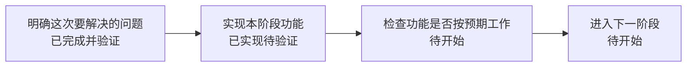

# MedAxis 项目协作规则

## 阶段结束时的费曼汇报与进度图

每执行完一个阶段任务，都必须向用户提供一次费曼汇报，并附一张 PlantUML 或 Mermaid 进度图。默认使用 Mermaid；用户指定 PlantUML 时按指定格式输出。

### 触发时机

- 以当前任务计划或用户约定的阶段为单位，不把每次工具调用或零碎修改当作一个阶段。
- 阶段工作结束并完成相应验证后，先汇报，再推进下一阶段；已有继续执行授权时，汇报不增加确认或等待步骤。
- 阶段因阻塞暂停、验证失败或仅部分完成时，也说明当前状态并更新进度图，但不得称为阶段完成。

### 费曼汇报

假设读者完全不了解项目，也没有软件工程背景。用平实的中文解释本阶段的意义，先讲用户能感知的结果，再补必要的技术依据。

每次覆盖以下内容，可用短段落或简短列表，不为填模板重复已有信息：

1. **为什么做：** 一句话介绍与本阶段相关的项目用途，以及这次要解决的具体问题。
2. **做了什么：** 用“以前怎样，现在怎样”解释变化；术语首次出现时用日常语言解释，避免堆砌文件名和技术名词。
3. **凭什么确认：** 给出实际执行的检查、测试或演示及结果；区分代码已实现、本地已验证、真实环境已验证，未验证的内容明确标注。
4. **还差什么：** 说明剩余限制、失败或阻塞的影响，以及下一阶段要解决的问题。

可以使用贴切的类比辅助理解，但不能用类比替代事实，也不能把工程测试解释成医疗效果已经得到验证。

### 进度图

- 汇报中直接附可渲染的 `mermaid` 或 `plantuml` 代码块，不能只给文件路径。
- 优先使用流程图展示当前任务各阶段及先后依赖；节点使用读者能理解的任务名称。
- 节点明确标注状态：`待开始`、`进行中`、`已实现待验证`、`已完成并验证`、`阻塞`；部分完成时写明剩余工作。
- 状态以现有计划和本轮实际证据为准。未执行验证的阶段不能标为“已完成并验证”；没有可靠统计依据时不编造完成百分比。
- 图与文字保持一致，突出本轮所在阶段和下一步；没有整体计划时，只画已知阶段，不虚构完整路线图。
- 当前计划或进度文档是状态真源。已有记录需要更新时沿用该记录，避免另建一套重复维护的进度体系。

以下仅为格式示例，不代表项目当前进度：

