# 医枢 MedAxis

**AI 辅助问诊与就医资料整理原型。** 将多轮信息采集、医学资料检索、结构化辅助报告和病例管理组织成一条连续流程，帮助患者把分散的主诉与检查资料整理为可核对、可携带、可恢复的就医信息。

项目包含患者端、医生端与运营后台，演示聚焦患者侧；技术重点是 **Agent 流程编排、来源可追溯、持久化与版本控制，以及失败和费用边界**。

> 项目定位：原型与工程实践。演示使用合成资料；AI 输出用于信息整理和沟通支持，不替代医生诊断、处方或急救服务。

[演示预览](#演示预览) · [核心流程](#核心流程) · [技术实现](#技术实现) · [本地启动](#本地启动) · [验证与当前边界](#验证与当前边界)

## 演示预览

**把两天的头痛，整理成看医生时能讲清楚的资料。** 虚构患者林晓先描述症状，再回答两道补问，查看总结和参考资料，核对病情、准备就医摘要，最后回到自己的日常记录。

下面是 2026-10-09 前端实际运行页面的 **22.2 秒交互分镜 GIF**，共 9 个操作状态；点击图片可查看原尺寸。当前源码已继续演进，素材保留为历史展示记录。

[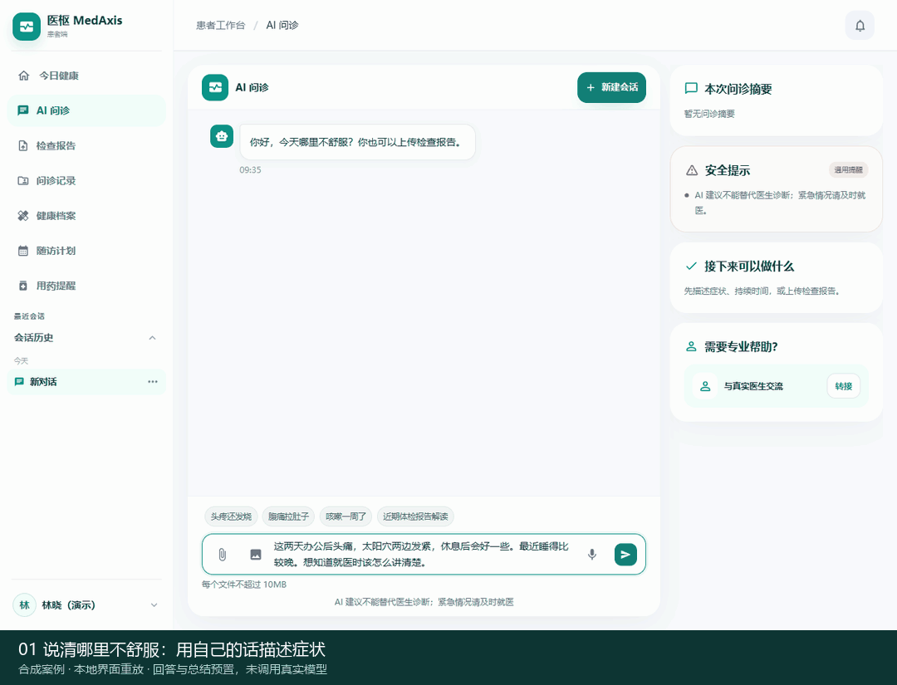](docs/media/patient-journey.gif)

> **录制范围：** 合成案例，API 与流式事件使用本地预置重放。问答、总结、参考资料和病例响应均预置；未调用真实模型、未执行实时检索、未写入业务数据库。它展示页面交互和信息组织，不作为真实模型效果、数据库恢复或临床有效性的验收证据。

**先看懂结果，再知道下一步。** 总结先呈现可能的原因，明确还没确认的信息，再给出可以和医生讨论的事项。

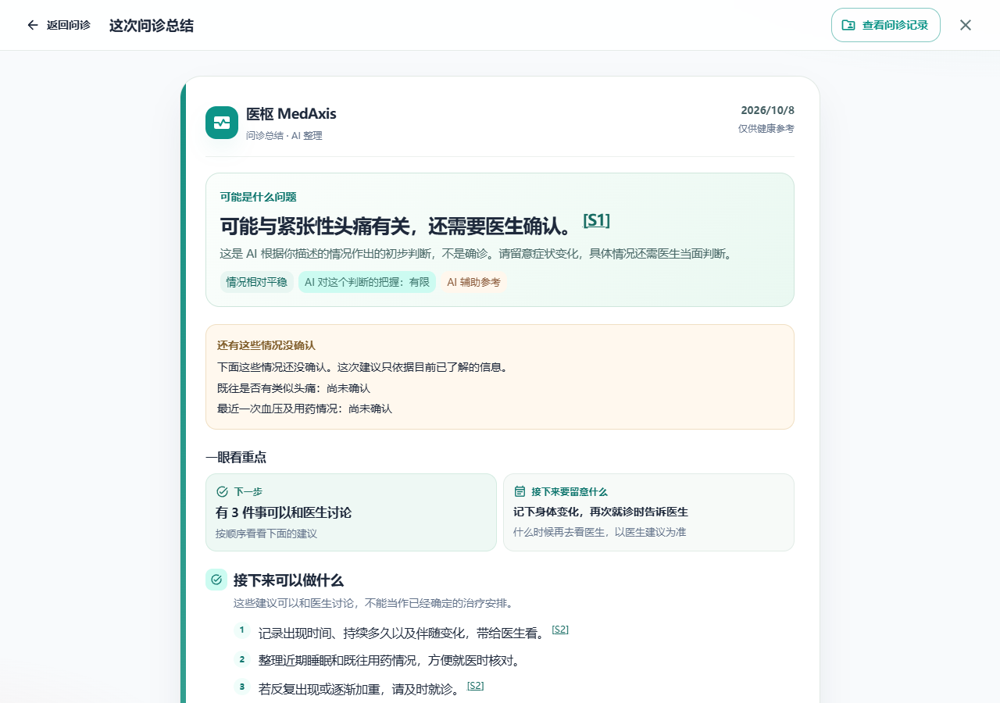

**把自己的话带给医生。** 就医摘要保留患者陈述、待本人核对的内容和想问的问题；没有填过的信息继续显示“未知”或“未填写”。

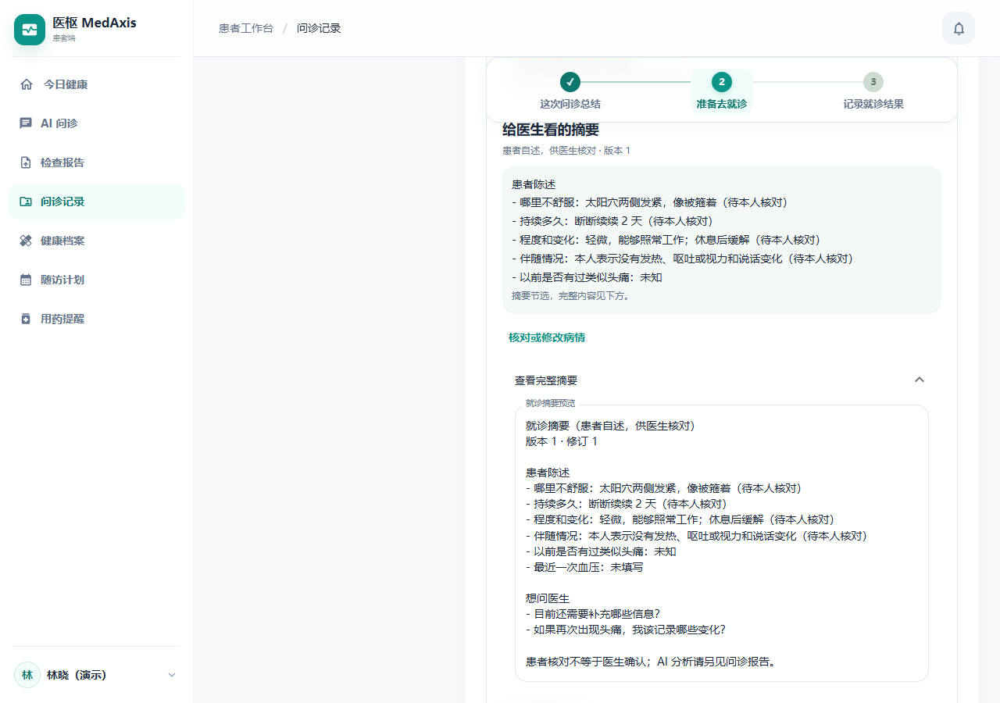

<details>
<summary>更多界面：补问、来源、日常记录、档案、随访与手机端</summary>

| 问诊补问 | 参考资料与核对状态 |
|---|---|
| 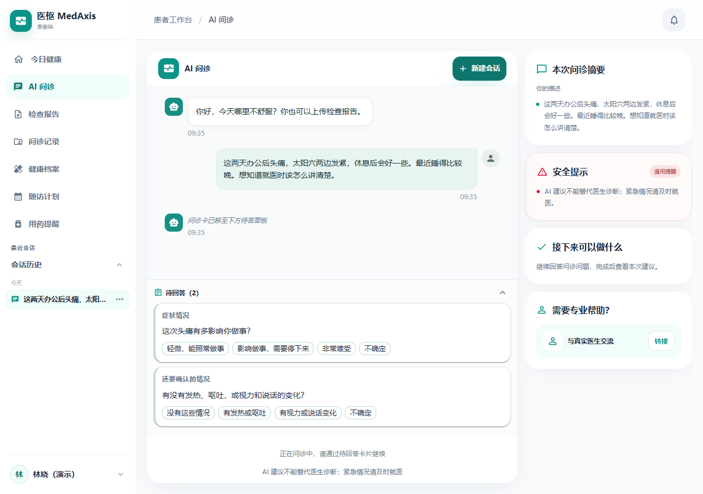 | 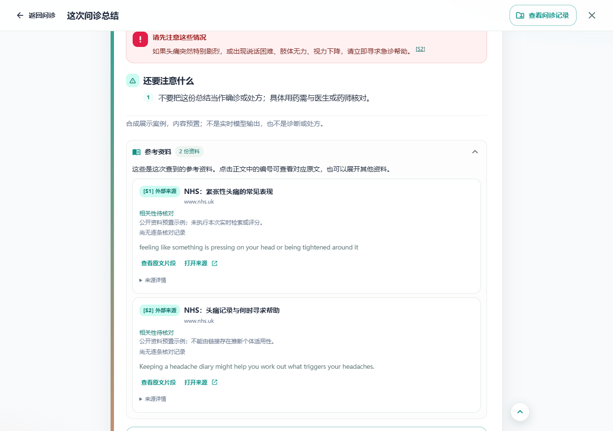 |

| 今日健康 | 健康档案 |
|---|---|
| 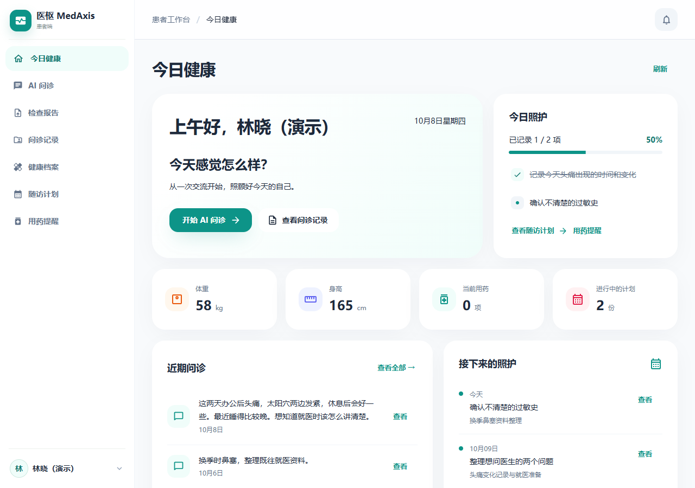 | 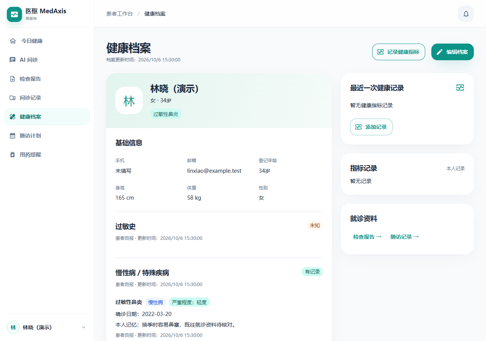 |

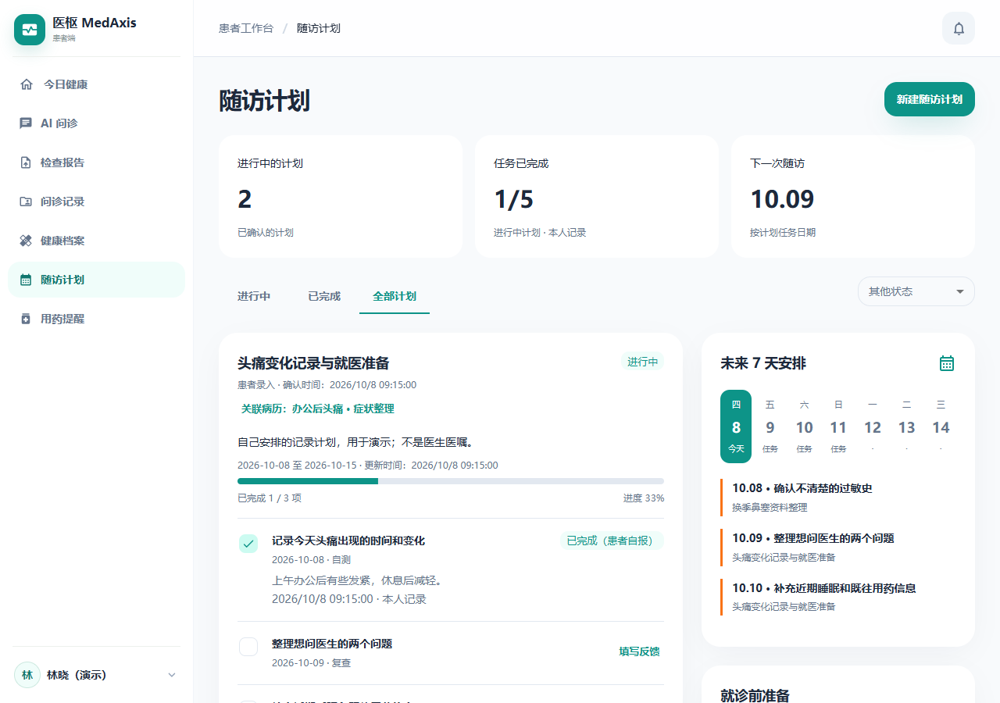

| 手机端随访计划 | 手机端健康档案 |
|---|---|
| 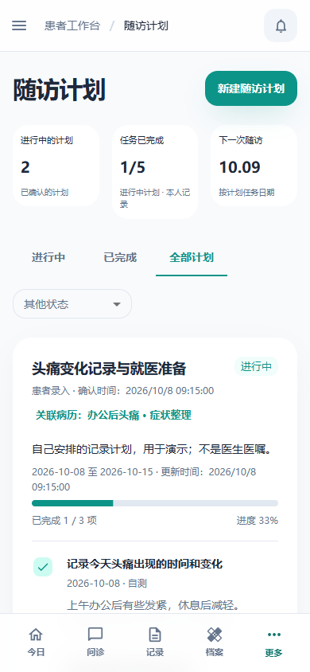 | 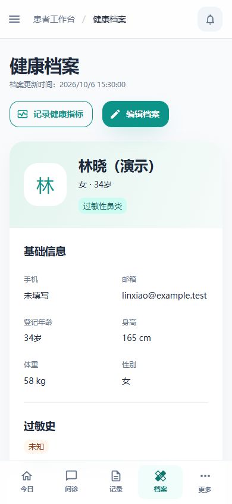 |

</details>

展示数据包含 1 位虚构患者、2 条病例和 2 份本人安排的记录计划，共 5 项任务；各页面关联同一患者与病例。可查看 [合成场景](docs/media/demo/scenario.json)、[录制与复现说明](docs/media/README.md) 和 [录制脚本](scripts/capture_readme.py)。

## 项目解决什么问题

就医前的信息往往分散在患者记忆、聊天记录和检查资料中。MedAxis 围绕「采集 → 整理 → 核对 → 保存 → 再次找回」设计患者侧流程，并让诊后自报反馈继续关联同一病例。

产品设计关注三个问题：

- **信息完整性：** 主诉、时间线、已知病史与未知项能否被清楚记录？
- **来源与确认：** 患者原话、AI 整理、参考资料和本人核对能否区分？
- **持续性：** 已保存的报告、就医准备与反馈能否围绕同一病例恢复？

当前验证基于工程测试与合成案例，真实患者收益和临床有效性仍需研究。

## 核心流程

### 1. 问诊与就医准备


- 复用已记录的信息，区分未填写、明确未知与前后矛盾。
- 辅助报告关联实际检索来源和摘录；缺少可核验来源或有效引用时阻止医学报告发布。
- 就医准备保留患者陈述、未知项与待问问题；患者核对和诊后自报分别保留各自的来源含义。
- 病例保存、准备修订和反馈记录包含归属校验与版本冲突处理。浏览器聊天缓存与服务端病例恢复分别管理。

### 2. 检查资料归档与核对

**当前本机演示尚未执行新报告中心迁移。** 合成 PDF 通过既有病例附件提供，尚未自动解析；新版报告中心的部署与完整链路验收仍待完成。

<details>
<summary>展开新报告中心的实现流程与发送边界</summary>


新报告中心的工作区代码包含多页原件、重复提交处理、核对历史、病例引用和回收站等能力。原件保存在平台数据库，AI 整理按预览发送文字；旧聊天附件入口仍保留原图／文件外发解析路径，两类入口的发送边界不同。

</details>

## 技术实现

| 设计点 | 实现方式与取舍 | 代码入口 |
|---|---|---|
| 显式问诊编排 | Track1 信息采集 → 按需检索 → 有结果时进入 Track2 补问；按阶段顺序推进 | [orchestrator.py](backend/app/services/orchestrator.py) |
| 有界模型与工具调用 | 诊断 Agent 最多 5 轮模型调用，最后一轮禁用工具；SSE 返回文本、问题、结果与错误事件 | [agents.py](backend/app/services/agents.py)、[agents API](backend/app/api/v1/agents.py) |
| 检索与证据约束 | 关键词与同模型向量独立召回 → 候选合并与可选 reranker → 锚点上下文及问题覆盖核对；保留实际来源编号 | [rag.py](backend/app/services/rag.py)、[knowledge_citations.py](backend/app/services/knowledge_citations.py) |
| 病例持久化与幂等 | 锁定来源会话，校验患者归属，按来源会话查找已有病例；准备与反馈处理版本冲突 | [patient_case_persistence.py](backend/app/services/patient_case_persistence.py)、[patient API](backend/app/api/v1/patient.py) |
| 原件与人工核对 | 原件、提取文字、AI 候选与本人核对版本分开；发送前预览与逐次同意 | [报告处理](backend/app/services/report_processing.py)、[报告核对](backend/app/services/report_review.py) |
| 演示访问与费用控制 | 专用患者身份，关闭访客/公开注册；模型 HTTP 发送前持久化扣额，重试计数、存储失败时拒绝发送 | [访问与额度控制](backend/app/services/) |

内部 RAG 的关键词与同模型向量语义召回独立执行，候选合并后可选重排；当前向量路径为应用层流式精确扫描，embedding 不可用时退回关键词结果。来源可扩展同文档锚点前后文，并按问题要点判断完整或部分覆盖；失败时回退既有来源策略。外部搜索按配置使用 SearXNG。问题覆盖、陈述支持与医学适用性分别判断，原文核验不等于临床正确性。

模型生成、资料检索与病例保存分别处理失败，错误显式返回；具体证据与迭代记录见 [验证与当前边界](#验证与当前边界)。

## 技术架构

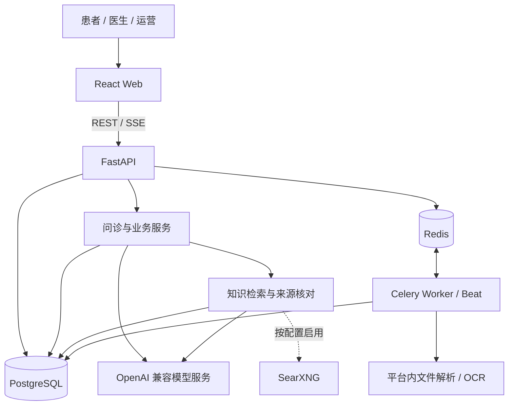

| 层 | 技术组成 |
|---|---|
| 前端 | React 19、TypeScript 6、Vite 8、MUI 9 |
| 后端 | Python 3.12+、FastAPI、Pydantic、SQLAlchemy Async |
| 数据与后台任务 | PostgreSQL、Redis、Celery、Alembic |
| AI 与文件处理 | OpenAI 兼容接口、RAG、可选 reranker / SearXNG、RapidOCR / ONNX Runtime |
| 本地运行 | Docker Compose |

[工程架构文档](docs/engineering/architecture.md)按 2026-10-06 工作区核对模块与文件处理边界；目标环境可用性另按带日期的验收记录判断。

## 本地启动

需要 Docker Engine / Docker Desktop 与 Docker Compose v2，另需配置模型和可检索的医学资料。

<details>
<summary>展开 Docker 启动步骤（从仓库根目录执行）</summary>

1. **准备本地配置。** 已有 `.env` 时保留原文件：

   ```powershell
   if (!(Test-Path .env)) { Copy-Item .env.example .env }
   ```

   修改 `SECRET_KEY`、`DB_PASSWORD`。如需运营后台，在 `.env` 中设置 `DEFAULT_ADMIN_PASSWORD`；数据库没有管理员且已配置该密码时，首次启动创建 `DEFAULT_ADMIN_EMAIL` 对应账号，首次登录需改密。密钥不提交到仓库。

2. **构建并启动数据库与 Redis：**

   ```sh
   docker compose config -q
   docker compose build
   docker compose up -d postgres redis
   docker compose ps
   ```

   等待 PostgreSQL 与 Redis 均显示 `healthy`。

3. **初始化或升级数据库，再启动应用：**

   ```sh
   docker compose run --rm --no-deps backend alembic upgrade head
   docker compose up -d
   docker compose ps
   ```

   升级已有数据库前先备份。应用健康检查正常不代表迁移已完成。

4. **配置模型和知识资料。** 在普通开发模式下，登录运营后台 `/admin/providers` 配置模型，通过知识库入口准备可检索资料。报告整理还依赖对应模型配置和任务 Worker；模型可连接不代表知识检索已有有效来源。

| 服务 | 默认本地地址 |
|---|---|
| Web | [localhost:3000](http://localhost:3000) |
| API / 健康 / 就绪 | [localhost:8000](http://localhost:8000)、[/health](http://localhost:8000/health)、[/ready](http://localhost:8000/ready) |
| 开发环境 OpenAPI | [/docs](http://localhost:8000/docs)，专用演示模式下不开放 |
| 数据库 / Redis 主机端口 | `127.0.0.1:5433` / `127.0.0.1:16379` |

SearXNG 属于 `external-search` profile，默认不启动。配置、日志与数据卷说明见 [部署文档](docs/engineering/deployment.md)。最近一次验证未覆盖全新环境安装或 Linux OCR。

</details>

### 受限演示模式

已实现专用普通患者账号和合成资料准备，关闭访客、公开注册及非演示身份访问，保留原密码、JWT 和业务归属校验。当前设置为共享 **20 次模型 HTTP 请求**总额度，重试和多轮分别计数；重启与重复准备不补充额度。

这个上限是请求数，不是固定金额的 token 预算。没有演示请求身份的后台 AI 调用暂停。公网 Funnel 尚未开启，账号密码不放在 README 或公开链接中。

## 验证与当前边界

### 页面展示验收：2026-10-09

本次录制覆盖桌面问诊、总结来源、就医准备、今日健康、健康档案与随访，以及 390 像素宽度的档案与随访。浏览器无页面异常、无未定义 API 请求；9 张 PNG 和 GIF 已逐帧解码，并核对尺寸、文件校验值与 README 素材链接。

复现命令与 [素材清单](docs/media/demo/manifest.json) 见 [素材说明](docs/media/README.md)。本次使用预置响应，不更新下方真实依赖验证的结论。

### 应用与真实依赖验证记录：2026-10-06

| 检查范围 | 结果 | 证据边界 |
|---|---|---|
| 后端问诊与演示保护定向测试 | 74 passed，exit 0 | 内存供应商验证额度、并发、重试、认证、恢复与问诊回归；不连接业务库，不证明完整临床流程 |
| 前端状态与辅助逻辑测试 | 90 passed，exit 0 | 逻辑回归，不等同于页面操作 E2E |
| 类型检查与前端构建 | exit 0 | 当前前端可检查与打包；仍有大 chunk 提示 |
| 原 Docker 容器与专用合成账号 | 登录、档案、两份病例、PDF 下载及访问拒绝检查通过 | 只覆盖指定合成账号与检查路径，不是全量权限审计 |
| 真实 AI 与费用持久化 | 两次短对话返回真实模型回答；累计 4 次请求，重复准备及后端重启后保持计数 | 验证普通对话与费用保护，不代表多轮临床问诊已完整验收 |

上表保留带日期的验证记录；下方列出问诊回归的本地验证命令。

<details>
<summary>展开本地验证命令与数据库测试护栏</summary>

已有开发依赖时，可从根目录运行定向验证：

```powershell
.\backend\.venv\Scripts\python.exe -m pytest backend/tests/test_intent_latency.py backend/tests/test_patient_llm_errors.py -q -p no:cacheprovider
Push-Location frontend
npm test
node node_modules/typescript/bin/tsc -b --pretty false
npm run build
Pop-Location
```

定向命令不需要真实模型。运行其他数据库测试前必须准备隔离库：PostgreSQL 名称以 `medaxis_test_` 开头、三个数据库 URL 一致，并显式设置 `MEDAXIS_ALLOW_DESTRUCTIVE_TEST_DB=1`；fixture 会建表和删表。完整约束见 [测试安全护栏](backend/tests/database_safety.py)。

</details>

### 尚未完成的范围

- **报告中心部署：** 当前本机缺少新版报告中心的表，上传浏览器 E2E、真实 OCR 和真实模型整理仍需分别验证。
- **医生协作：** 有工作台和咨询相关实现；医生病例详情仍有演示数据回退，计划指令接口返回 501，完整医生处置闭环尚未完成。
- **提醒与运营：** 不承诺提醒可靠送达、临床监护、异常升级或完整生产运维。
- **评测与用户价值：** 患者 10 场景题集为 `DEFINED_NOT_RUN`；没有临床准确率、真实患者效率或商业收益结论。
- **提交与分发：** 本说明按 2026-10-06 工作区整理；新报告中心和演示保护包含尚未提交的代码。克隆版本的功能以实际提交为准，发布前需同步对应源码与文档。

历史验证分别按日期、样本和替身范围阅读，不相加为统一覆盖率：

- [患者 10 场景冒烟](evals/patient-smoke/README.md)：题集与已执行范围。
- [问诊与来源回归](docs/product/CONSULTATION_REGRESSION_FIX.md)：固定重放的历史对比与控制约束。
- [真实检索局部修复](docs/product/SOURCE_EMPTY_RUNTIME_FIX.md)：合成输入的真实依赖探测及保存替身边界。
- [OpenMed 借鉴实验](evals/openmed-transfer/README.md)：合成样本探索与验证范围。

## 文档与代码导航

| 想了解什么 | 阅读入口 |
|---|---|
| 产品范围与核心取舍 | [患者侧聚焦 PRD](docs/product/PORTFOLIO_PRD.md) |
| 模块与部署配置 | [工程架构](docs/engineering/architecture.md)、[部署说明](docs/engineering/deployment.md) |
| 病例、准备与反馈验证 | [患者合成闭环与独立审查](docs/product/PATIENT_DEMO_CLOSURE_REVIEW.md) |
| 检查报告设计与实现进度 | [报告需求与证据](docs/product/PATIENT_REPORTS_REQUIREMENTS.md) |
| 其余资料 | [完整文档索引](docs/README.md) |

```text
backend/    API、问诊 Agent、业务服务、迁移与测试
frontend/   患者、医生与运营界面及状态测试
docs/       产品、工程与验证材料
evals/      合成题集、评分脚本与局部结果
design/     设计稿；运行截图另存 docs/media/
scripts/    部署、迁移与合成演示资料准备
```
