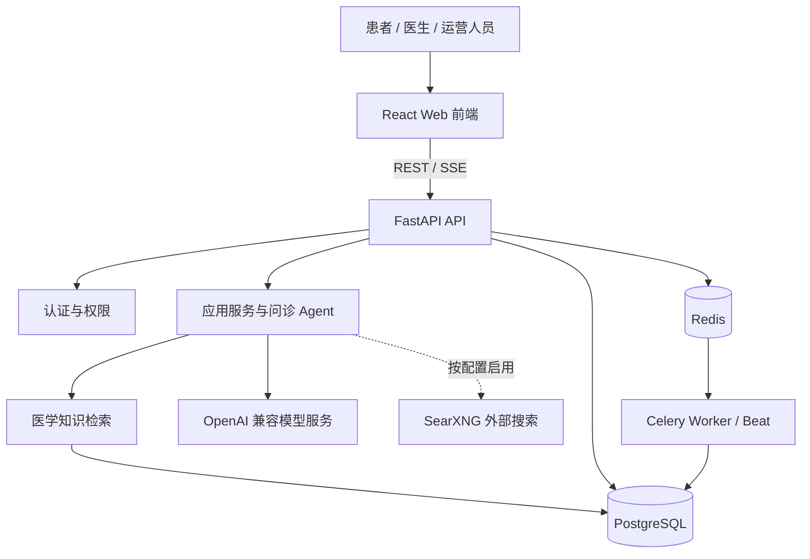

# 🩺 医枢 MedAxis

> 面向患者、医生与运营团队的 AI 辅助问诊和医疗协作原型。

MedAxis 将症状问诊、检查资料整理、病例查看与就医准备放在同一套 Web 应用中。患者可以通过多轮对话整理主诉并查看结构化辅助摘要；医生和运营人员可在各自工作台查看病例或管理平台配置。

**MedAxis 用于信息整理与沟通支持，不提供正式诊断、处方或急救服务。**

## 💡 项目能做什么

| 使用者 | 项目包含的能力 |
|---|---|
| 患者 | 多轮问诊与结构化辅助报告；病例、健康档案、就医准备和患者自报诊后反馈；报告上传解析入口；随访与提醒页面 |
| 医生 | 医生工作台、病例列表、统计概览与病例详情；部分页面仍含演示或模拟路径 |
| 运营人员 | 用户和医生管理、模型供应商配置、知识库与审核队列、邮件和站内通知、审计日志 |

问诊服务可接入 OpenAI 兼容模型；知识检索、报告上传解析和外部搜索也有相应接口或页面。外部搜索需单独配置，默认本地 Compose 栈不启动 SearXNG。

报告上传解析目前仅说明仓库中存在相应入口，端到端上传和解析尚未完成验证。

## 🧭 患者侧演示路径

仓库记录了一条隔离环境中的合成患者演示路径：


验收记录使用真实认证、API、前端和数据库流程，模型生成由明确标记的确定性替身提供。它只覆盖上述合成数据场景，不证明真实模型质量或临床有效性。具体范围和独立审查见[演示闭环说明](./docs/product/PATIENT_DEMO_CLOSURE_PLAN.md)与[独立审查](./docs/product/PATIENT_DEMO_CLOSURE_REVIEW.md)。

## ⚠️ 当前边界

- 项目仍是开发与演示原型，不应作为医疗诊断、处方或医生签署意见的来源。
- 就医准备提供有限的通用科室咨询参考，来源为医院公开导诊资料；未获临床审核，不代表具体医院挂号或预约。风险、冲突或范围不适用时转为人工咨询。行为与边界见[就医准备说明](./docs/product/VISIT_PREPARATION_SPEC.md)。
- 真实模型输出、临床内容、端到端文件上传解析、医生审核签署和生产部署尚未完成验证。
- 随访与提醒相关页面和接口不代表已具备可靠的自动送达闭环。

出现紧急、快速恶化或危及生命的症状时，请联系当地急救机构或合格医疗专业人员。演示时请使用合成数据，不要提交可识别的患者信息。

## 🛠️ 技术组成

- **前端：** React 19、TypeScript 6、Vite 8、MUI 9
- **后端：** Python 3.12、FastAPI、SQLAlchemy Async、Pydantic
- **数据与任务：** PostgreSQL、Redis、Celery、Alembic
- **AI 集成：** OpenAI 兼容模型服务、医学资料检索、可选 reranker 与可配置的 SearXNG 外部搜索
- **本地运行：** Docker Compose

## 🏗️ 系统架构



图中展示仓库当前的主要服务边界。外部搜索需要单独配置，本地 Compose 默认不启动 SearXNG。

## 🚀 快速启动

需要 Docker Engine（或 Docker Desktop）和 Docker Compose v2。首次运行按以下顺序操作。

### 1. 准备环境文件

macOS/Linux：

```sh
cp .env.example .env
```
Windows PowerShell：

```powershell
Copy-Item .env.example .env
```
打开 .env 并修改：

- 将 SECRET_KEY 换成随机密钥，修改 DB_PASSWORD。
- 如需运营后台，添加 DEFAULT_ADMIN_PASSWORD。首次启动且数据库中没有管理员时，系统会使用 DEFAULT_ADMIN_EMAIL 和该密码创建管理员；首次登录必须修改密码。未设置该密码时不会自动创建管理员。
- 要体验真实 AI 问诊，后续还需在运营后台配置可用的模型供应商和 API Key。

示例凭据只用于本机开发，不要用于公网部署。

### 2. 构建镜像

```sh
docker compose build
```
### 3. 启动数据库和 Redis

```sh
docker compose up -d postgres redis
docker compose ps
```
等待 postgres 和 redis 的状态都显示为 healthy，再继续下一步。

### 4. 初始化或升级数据库表

```sh
docker compose run --rm --no-deps backend alembic upgrade head
```
看到 Alembic 输出迁移版本后，数据库表结构已更新。

### 5. 启动应用并配置模型

```sh
docker compose up -d
docker compose ps
```
打开 Web 应用：<http://localhost:3000>。登录页可以使用访客会话或注册患者账号。管理员使用 .env 中配置的 DEFAULT_ADMIN_EMAIL 和 DEFAULT_ADMIN_PASSWORD 登录；首次登录后修改密码，再访问 /admin/providers 添加模型供应商。模型未配置或不可用时，无法进行真实模型问诊。

| 服务 | 本地地址 |
|---|---|
| Web 应用 | <http://localhost:3000> |
| API | <http://localhost:8000> |
| 健康检查 | <http://localhost:8000/health> |
| 就绪检查 | <http://localhost:8000/ready> |
| OpenAPI 文档 | <http://localhost:8000/docs>（development 环境）|

PostgreSQL 和 Redis 分别映射到本机 5433 和 16379，数据保存在 Docker 命名卷中。查看服务状态和后端日志：

```sh
docker compose ps
docker compose logs -f backend
```
停止服务但保留数据库和 Redis 数据：

```sh
docker compose down
```
后端热重载、测试和生产部署步骤见[部署说明](./docs/engineering/deployment.md)、[后端参考](./docs/engineering/backend.md)和[前端参考](./docs/engineering/frontend.md)。

## 🗂️ 仓库结构

```text
medaxis/
├── backend/                 # FastAPI 后端
│   ├── app/                 # API、问诊 Agent 与业务服务
│   ├── tests/
│   ├── pyproject.toml
│   └── uv.lock
├── frontend/                # React 前端
│   ├── src/
│   ├── tests/
│   └── package.json
├── docs/                    # 项目文档
│   ├── archive/
│   ├── engineering/
│   ├── medical/
│   ├── portfolio/
│   └── product/
├── evals/patient-smoke/     # 合成问诊评测
├── nginx/                   # 反向代理配置
├── scripts/                 # 部署与数据迁移脚本
├── searxng/                 # 搜索服务配置
├── .env.example
├── Dockerfile
├── docker-compose.yml
├── docker-compose.prod.yml
└── README.md
```

## 📚 文档

- [文档索引](./docs/README.md)
- [系统架构](./docs/engineering/architecture.md)
- [数据库与检索说明](./docs/engineering/database.md)
- [部署配置](./docs/engineering/deployment.md)
- [产品需求与实现差距](./docs/product/PRD.md)
- [患者侧演示计划与审查](./docs/product/PATIENT_DEMO_CLOSURE_PLAN.md)
- [患者侧合成冒烟案例](./evals/patient-smoke/README.md)
