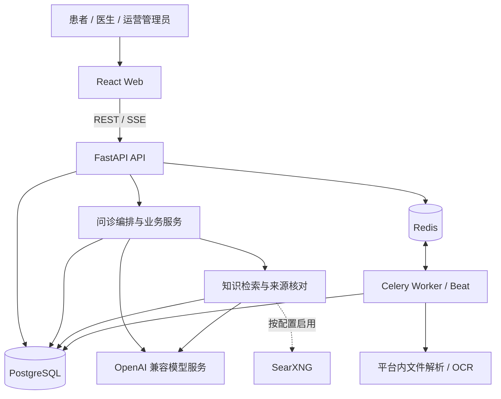

# 医枢 MedAxis

**面向患者、医生与运营团队的 AI 辅助医疗协作平台。** MedAxis 围绕问诊信息采集、检查资料管理、病例记录、就医准备和诊后跟进组织业务流程，提供患者工作区、医生工作台及运营管理后台。

系统将患者陈述、AI 整理、医学参考资料和人工核对分别记录，通过身份权限、来源追溯与版本控制支撑资料协作。AI 输出用于信息整理和沟通支持，不替代医生诊断、处方或急救服务。各模块的实现与验收状态见[项目状态与已知限制](#项目状态与已知限制)。

[角色与功能](#角色与功能) · [界面参考](#界面参考) · [核心流程](#核心流程) · [系统架构](#系统架构) · [部署与初始化](#部署与初始化) · [运行与维护](#运行与维护) · [安全与数据边界](#安全与数据边界) · [测试与验证](#测试与验证) · [文档导航](#文档导航)

## 项目概述

就医资料通常分散在患者描述、检查原件、历次沟通和诊后记录中。MedAxis 以病例为一次就医问题的组织单元，将相关信息采集、资料核对、保存与再次查阅连接起来：

- **诊前准备：** 补充主诉、病史和检查资料，保留未知项，整理可供医生核对的摘要。
- **资料管理：** 保存检查原件及各次整理、核对记录，按版本关联病例，保持资料来源可追溯。
- **协作与跟进：** 通过定向授权咨询共享资料，在同一病例下记录就诊反馈、随访计划和日常健康信息。
- **服务运营：** 管理账号与医生资质、知识资料、模型供应商、通知和邮件配置。

项目业务范围、领域对象和验收规格见[全项目产品文档](docs/product/medaxis/README.md)。该文档集处于评审状态；具体行为以当前源码和已批准的专项规格为依据。

## 角色与功能

| 角色 | 主要功能 | 工作边界 |
|---|---|---|
| 患者 | 多轮问诊、病例与就医准备、检查报告归档和核对、健康档案、随访及用药提醒、自报反馈 | 操作本人资料；AI 候选、本人口述和本人核对分别保存，分享时指定对象与资料范围 |
| 医生 | 工作台、病例查看与意见记录；定向咨询接口支持授权资料快照、回复、追问和结束咨询 | 定向咨询按授权读取资料；旧病例工作台与新咨询链路的集成、展示及权限差距见项目状态 |
| 运营管理员 | 用户管理、医生资质审核、知识库维护与审核、模型供应商和系统配置、通知、邮件、审计查询 | 管理权限用于服务运营，不能替代医生资质或患者资料分享授权 |

普通模式另提供访客问诊入口，试用额度与保存范围受系统配置限制。登录角色、账号状态与资料归属由后端接口校验，前端路由守卫负责对应页面的访问导航。

## 界面参考

### 演示预览

以下图片与 GIF 来自 2026-10-09 的合成 API/SSE 重放，仅用于了解页面布局和资料组织。它们与当前源码存在版本差异，不证明真实模型效果、检索质量或业务持久化；录制条件、场景与清单见[素材说明](docs/media/README.md)。

#### 桌面端

| 问诊采集 | 问诊总结 |
|---|---|
|  |  |

<details>
<summary>查看桌面端使用流程与更多页面</summary>

[](docs/media/patient-journey.gif)

| 参考资料 | 就医准备 |
|---|---|
|  |  |

| 今日健康 | 健康档案 |
|---|---|
|  |  |


</details>

#### 手机端

保留手机宽度下的竖屏布局，分别展示随访计划与健康档案。下方按 240 像素宽度呈现，可点击查看原图。

| 随访计划 | 健康档案 |
|---|---|
| [](docs/media/followups-mobile.png) | [](docs/media/health-mobile.png) |

## 核心流程

### 问诊、病例与就医准备


问诊复用已记录的信息，区分未填写、明确未知与前后矛盾。诊断报告生成流程在缺少可核验参考资料或有效引用时返回错误，不将证据不足当作成功报告。

病例保存、就医准备和诊后反馈分别处理归属、提交编号与版本冲突。浏览器聊天缓存和服务端已保存病例是两种恢复路径；重新登录后找回病例不等于完整聊天历史跨设备同步。详细行为见[就医准备规格](docs/product/VISIT_PREPARATION_SPEC.md)。

### 检查资料归档与核对


独立检查报告可脱离病例保存，也可按版本引用到病例。原件、AI 候选、人工草稿和本人核对历史分别管理，另提供回收站、恢复和删除流程。部署前需确认对应迁移、解析任务与模型配置；完整组合场景的验收范围见[报告需求与证据](docs/product/PATIENT_REPORTS_REQUIREMENTS.md)。

### 医生咨询与诊后记录

患者向指定医生发起咨询并授权资料快照，医生按咨询状态接收、回复或追问；患者可追加留言或取消咨询。咨询授权与患者全部历史资料、机构病例库及研究用途分别管理，后两者属于后续范围。接口实现见[定向咨询 API](backend/app/api/v1/consultations.py)，产品边界见[医生端规格](docs/product/DOCTOR_PRD.md)。

健康档案、测量、随访计划及提醒用于持续记录。诊后 AI 生成的行动候选需要患者确认后才能转成任务，患者自报和记录计划不能当作医生签署的医嘱。详细流程见[健康档案](docs/product/HEALTH_PROFILE_SPEC.md)、[随访计划](docs/product/FOLLOWUP_PLAN_SPEC.md)和[诊后行动规格](docs/product/POST_VISIT_AI_ACTIONS_SPEC.md)。

## 系统架构



| 组件 | 技术与职责 |
|---|---|
| Web | React 19、TypeScript 6、Vite 8、MUI 9；患者、医生和管理界面 |
| API 与业务服务 | Python 3.12+、FastAPI、Pydantic、SQLAlchemy Async；身份鉴权、业务接口及 SSE |
| 数据与后台任务 | PostgreSQL、Redis、Alembic、Celery Worker/Beat；资料持久化、迁移、解析和定时任务 |
| 模型与检索 | OpenAI 兼容接口、RAG、可选 reranker 和 SearXNG；生成、向量与来源评估 |
| 文件处理 | RapidOCR、ONNX Runtime 等；平台内取字与报告处理 |
| 部署 | Docker Compose、Nginx；服务编排、Web 与 API 代理 |

### 技术实现

- **显式问诊编排：** Track1 采集信息，按需检索后由 Track2 生成补问；必要缺口补生成有界，保留已问问题和原始回答。见[编排器](backend/app/services/orchestrator.py)。
- **检索与来源核对：** 关键词与同模型向量独立召回，候选合并后可选重排，扩展同文档锚点前后文，并评估问题要点覆盖。当前向量路径为 JSON 向量的应用层流式精确扫描，尚无数据库向量索引；模型评估失败时回退既有来源策略。见[RAG](backend/app/services/rag.py)和[来源服务](backend/app/services/knowledge_citations.py)。
- **有界生成与失败处理：** 诊断 Agent 最多五轮模型调用，最后一轮禁用工具；生成、检索和保存分别返回结果或错误。来源存在、摘录一致、问题覆盖、陈述支持与患者适用性是不同判断，引用门禁不能替代医学专业审核。见[Agent 服务](backend/app/services/agents.py)。
- **持久化与版本控制：** 病例按来源会话和归属处理重复提交；准备资料、核对记录及病例引用按版本处理冲突和来源变化。见[病例保存服务](backend/app/services/patient_case_persistence.py)。

模块职责与数据模型分别见[工程架构](docs/engineering/architecture.md)、[后端参考](docs/engineering/backend.md)和[数据库说明](docs/engineering/database.md)。

## 部署与初始化

### 本地启动

以下步骤从仓库根目录执行，使用 Docker Engine / Docker Desktop 和 Docker Compose v2。问诊与报告整理还需要可用的模型服务及相应知识资料。

1. **准备配置。** 已有 `.env` 时保留原文件；首次使用可复制模板：

   ```powershell
   if (!(Test-Path .env)) { Copy-Item .env.example .env }
   ```

   在本地 `.env` 中设置以下配置。模板未列出的 `API_KEY_MASTER_KEY`、`DEFAULT_ADMIN_PASSWORD` 需自行补充，填写值不进入版本控制。

   | 配置项 | 用途 |
   |---|---|
   | `SECRET_KEY` | 应用签名密钥；使用独立随机值 |
   | `DB_USER`、`DB_PASSWORD`、`DB_NAME` | PostgreSQL 账号与数据库；替换模板中的默认密码 |
   | `API_KEY_MASTER_KEY` | 模型供应商 API Key 的存储加密主密钥；保存和读取供应商凭据前必须配置 |
   | `DEFAULT_ADMIN_EMAIL`、`DEFAULT_ADMIN_PASSWORD` | 首次管理员初始化；库中无管理员且配置密码时创建，首次登录要求改密 |
   | `PUBLIC_APP_URL`、`CORS_ORIGINS` | Web 地址、邮件链接与允许访问 API 的前端来源；按环境设置 |

   已有数据的环境须保留原加密主密钥，直接换值会导致已有供应商凭据无法解密。Compose 为后端和任务进程配置容器内数据库、Redis 和 Celery 地址；本机独立开发的连接方式见[后端运行说明](docs/engineering/backend.md#本地运行与测试)。

2. **构建服务并启动数据依赖：**

   ```sh
   docker compose config -q
   docker compose build
   docker compose up -d postgres redis
   docker compose ps
   ```

   等待 PostgreSQL 和 Redis 的状态均为 `healthy`。

3. **先初始化或升级数据库，再启动应用：**

   ```sh
   docker compose run --rm --no-deps backend alembic upgrade head
   docker compose up -d
   docker compose ps
   ```

   升级已有数据库前备份数据；重启服务不会自动执行迁移。报告中心等模块依赖完整的 Alembic revision 链。

4. **初始化业务服务。** 普通模式下登录运营后台，在 `/admin/providers` 配置所需模型，通过知识库页面准备可检索资料；确认文件解析所需 Worker 与定时任务进程已启动。仅填写模板中的供应商环境变量不能代替后台的模型配置。

5. **确认业务可用。** 核对数据库与 Redis 就绪，使用受控合成资料检查登录、病例保存与再次读取、知识检索及报告处理路径。生产启用前仍需独立的权限、失败恢复和业务验收。

| 服务 | 默认本地入口 |
|---|---|
| Web | [http://localhost:3000](http://localhost:3000) |
| API | [http://localhost:8000](http://localhost:8000) |
| 健康与依赖就绪 | [/health](http://localhost:8000/health)、[/ready](http://localhost:8000/ready) |
| 开发环境 OpenAPI | [/docs](http://localhost:8000/docs)；受限演示模式不开放 |
| 数据库 / Redis 宿主机端口 | `127.0.0.1:5433` / `127.0.0.1:16379` |

外部搜索为可选服务，本地 `external-search` profile 默认不启动。启用时配置 `SEARXNG_SECRET`，启动 SearXNG 并核对后台检索设置，具体命令见[部署说明](docs/engineering/deployment.md)。

### 生产环境配置

[docker-compose.prod.yml](docker-compose.prod.yml)提供生产环境的服务编排，包含应用、数据库、Redis、任务进程以及外部搜索依赖；[nginx/nginx.conf](nginx/nginx.conf)提供 Web、API 与 SSE 代理配置。

部署时按目标环境设置 `ENVIRONMENT=production`、域名、TLS、CORS、邮件服务及持久化和备份策略，并核对数据库迁移、模型接收方与访问控制。已有配置文件不能证明生产环境已部署或已完成业务验收。

[scripts/deploy.sh](scripts/deploy.sh)面向已有基础设施的部署更新，当前顺序为启动服务、等待 `/health`、执行迁移；首次空库初始化需先完成数据库迁移，不能直接依赖该脚本的健康检查推进。发布、维护窗口和恢复步骤见[部署与迁移边界](docs/engineering/deployment.md#部署与迁移脚本边界)。

## 运行与维护

| 检查项 | 覆盖范围 | 维护动作 |
|---|---|---|
| `/health` | 后端进程可响应，返回版本与环境 | 用于存活探测；不验证数据库或模型 |
| `/ready` | 数据库 `SELECT 1` 与 Redis `ping` | 核对响应 JSON 的 `status=ready` 和两项 `checks=ok`；不覆盖迁移、模型、Worker 或 OCR |
| 模型与检索 | 后台配置、供应商连接、知识资料和来源返回 | 分别检查生成、embedding、重排与检索实际路径 |
| 后台任务 | Worker、Beat、任务状态与处理结果 | 查看任务进程日志，用合成报告核对处理状态；进程启动不等于任务成功 |
| 资料保存与权限 | 登录身份、对象归属、修订冲突及再次读取 | 按患者、医生和管理员分别验收，不以页面显示代替 API 授权检查 |

日常状态与日志检查：

```sh
docker compose ps
docker compose logs --tail=100 backend celery-worker celery-beat
docker compose logs --tail=100 frontend
```

PostgreSQL 保存账户、病例、知识资料，以及聊天解析和独立报告的原件字节；Redis 承载缓存、令牌撤销及任务队列。本地 Compose 使用命名卷，备份需要同时考虑数据库、运行配置和加密主密钥。文件、历史版本和删除边界见[数据库说明](docs/engineering/database.md)。

升级前记录当前版本与迁移状态，备份后再执行迁移；恢复方案须匹配数据版本和原密钥，回退应用代码不能代替数据库恢复。备份恢复、任务中断及重复投递仍需在目标环境演练。

## 安全与数据边界

- **身份与授权：** 登录角色、账号状态、资料所有权和定向咨询授权共同决定访问范围。医生身份不自动获得患者全部历史，管理角色也不等于医生资格；完整权限矩阵仍需验收。
- **模型外发：** 问诊模型输入可包含主诉、病史、问答记录和检索摘录等任务资料；旧聊天文件解析还可能发送原图或文件。独立报告中心先在平台内取字，再按脱敏预览、接收方和逐次同意发送文字。两类入口的边界分别维护。
- **资料与核对：** 原件、AI 候选、患者原话、人工草稿及本人核对版本分别记录。AI 生成的候选不自动成为处方或医生确认结果。
- **密钥与日志：** 运行密钥保存在本地配置或环境中，供应商凭据使用加密主密钥存储；排查日志、截图和导出资料时避免包含患者敏感内容或凭据。
- **保留与删除：** 回收、恢复、平台内删除、备份清理和外部已发送内容是不同范围。供应商保留策略与真实数据使用条件需要按实际接收方确认。

项目不承诺自动确诊、在线处方、自动调药、临床监护或急救服务。真实患者使用前需完成专业审核、权限和数据处理验收；不能仅凭本地测试推导临床有效性或合规认证。

## 测试与验证

已有开发依赖时，可从仓库根目录执行以下不调用真实模型的定向回归：

```powershell
.\backend\.venv\Scripts\python.exe -m pytest backend/tests/test_intent_latency.py backend/tests/test_patient_llm_errors.py -q -p no:cacheprovider
Push-Location frontend
npm test
node node_modules/typescript/bin/tsc -b --pretty false
npm run build
npm run lint
Pop-Location
```

前端单测、类型检查、构建和 lint 是独立检查，不应以其中一项通过代替全部通过。浏览器回归使用合成 API/SSE，运行方式见[前端测试说明](docs/engineering/frontend.md#测试与检查)。

数据库测试会建表和删表，必须准备与业务及演示数据隔离的测试库：PostgreSQL 名称以 `medaxis_test_` 开头，`TEST_DATABASE_URL`、`DATABASE_URL`、`ASYNC_DATABASE_URL` 指向同一库，并显式设置 `MEDAXIS_ALLOW_DESTRUCTIVE_TEST_DB=1`。完整约束见[测试安全护栏](backend/tests/database_safety.py)。

检索、来源核对和原文支持的评测资产位于 `evals/`，按[评测协议](docs/product/EVALUATION_PROTOCOL.md)分别判断召回、证据完整性、问题覆盖和陈述支持。部分复核脚本依赖不随仓库分发的本机冻结材料，运行前应检查对应 README 的前置条件。历史成绩只适用于注明的语料、源码、模型、样本和执行范围。

## 项目状态与已知限制

### 验证与当前边界

本文描述仓库实现及运行入口，不声明某个生产环境已验收。各模块成熟度不同，部署状态以目标环境检查为准。

| 范围 | 当前实现与待验证项 |
|---|---|
| 患者问诊与资料管理 | 已有编排、保存、就医准备及反馈实现；真实模型质量、专业效果和完整失败恢复需独立验证 |
| 独立报告中心 | 已有归档、取字、同意整理、核对、引用及回收实现；目标环境迁移、Linux OCR、上传与完整组合场景须逐项验收 |
| 医生工作台与咨询 | 定向咨询接口已实现；旧病例详情仍混用演示患者或时间线字段，计划指令接口返回 `501`，页面整合和权限矩阵仍有缺口 |
| 提醒与运营 | 已有记录计划、任务和管理入口；提醒可靠送达、异常升级及完整审计覆盖仍需验证 |
| 测试与评测 | 有工程回归及局部检索实验记录；患者 10 场景题集仍标记 `DEFINED_NOT_RUN`，不代表端到端验收完成 |
| 发布与运维 | 已有 Compose、Nginx 和部署脚本；全新环境安装、备份恢复、容量及生产业务验收需另行完成 |

详细状态与历史证据见[实现覆盖矩阵](docs/product/medaxis/EVIDENCE.md)、[开发就绪评估](docs/product/medaxis/DEVELOPMENT_READINESS.md)及[患者冒烟资料](evals/patient-smoke/README.md)。这些记录保留各自日期，不应相加为统一覆盖率。

## 文档导航

| 阅读目的 | 入口 |
|---|---|
| 全项目产品范围与领域对象 | [产品文档集](docs/product/medaxis/README.md)、[全项目 PRD](docs/product/medaxis/PRD.md)、[领域模型](docs/product/medaxis/DOMAIN_MODEL.md) |
| 架构与模块职责 | [工程架构](docs/engineering/architecture.md)、[后端](docs/engineering/backend.md)、[前端](docs/engineering/frontend.md) |
| 部署、迁移与存储 | [部署说明](docs/engineering/deployment.md)、[数据库说明](docs/engineering/database.md) |
| 角色与业务规格 | [医生咨询](docs/product/DOCTOR_PRD.md)、[检查报告](docs/product/PATIENT_REPORTS_REQUIREMENTS.md)、[健康档案](docs/product/HEALTH_PROFILE_SPEC.md)、[随访](docs/product/FOLLOWUP_PLAN_SPEC.md) |
| AI 评测与验收方法 | [评测协议](docs/product/EVALUATION_PROTOCOL.md)、[检索基线](evals/rag-baseline/README.md)、[原文支持评测](evals/evidence-support/README.md) |
| 受限演示配置 | [专用账号、入口和费用控制](docs/INTERVIEW_DEMO.md)；配置与恢复按专题说明执行，不作为默认运行方式 |
| 其他资料 | [完整文档索引](docs/README.md) |

```text
backend/    API、问诊编排、业务服务、数据库迁移与测试
frontend/   患者、医生与运营管理界面
docs/       产品规格、工程参考与验收资料
evals/      评测协议实现、题集构建及结果复核
design/     设计与交互资料
scripts/    部署、迁移和合成资料辅助脚本
```
