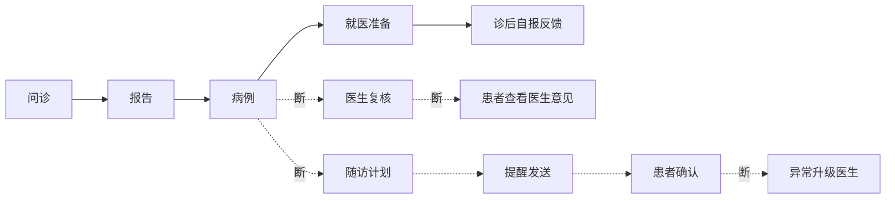

# 业务链路闭环路线图

> Status: DRAFT｜日期：2026-09-27
>
> 目标：逐条打通业务链路，最终形成“患者问诊 → 医生复核 → 随访执行 → 异常升级”的项目闭环。
>
> 依据：对当前工作区源码的静态核对（只读审查，未运行测试、构建或服务）。行号随后续改动可能漂移。本文是建议排期，不代表开发授权；需求定义见 [PRD.md](./PRD.md) 与 [PORTFOLIO_PRD.md](./PORTFOLIO_PRD.md)。

> 本文是 2026-09-27 的静态审查快照，不代表实时实现状态。患者端逐项状态、最新运行证据、执行 TODO 与验收标准以 [PATIENT_CLOSURE_TODO_ACCEPTANCE.md](./PATIENT_CLOSURE_TODO_ACCEPTANCE.md) 为准。

## 1. 链路现状

| 链路 | 状态 | 断点 |
|---|---|---|
| 患者主线 | 基本通（仅合成替身验证） | 真实模型未验收，当前库 provider 数 0/0；科室推荐固定 `insufficient_evidence`（`backend/app/services/case_preparation.py`）；访客仅在登录时迁移，注册页不调用 |
| 医生复核 | 断 | 病例只能由 admin 分配（`medical_cases.py`）；未认证医生可用全部医生 API（`doctor.py` `_require_doctor` 不查 `is_verified`，注册即 ACTIVE）；详情页合并 `MOCK_CASE`，仪表盘失败回退 `demoStats`；无确认/修正诊断 UI；`/doctor/cases/{id}/comment` 无路由；患者端不返回、不展示医生意见 |
| 随访提醒 | 断在源头 | `PlanningAgent.generate_care_plan` 无调用方，生产路径没有任何代码创建 CarePlan；提醒仅对 medication 建一次、固定 +1h；提醒列表默认只查 pending，已发送的不可见；ack/check-in 未知任务返回 success，JSONB 原地修改可能未落库 |
| 监测升级 | 未实现 | MonitoringAgent 的 alerts 仅作返回值，不入库、不通知；患者/医生无通知收件箱（通知路由仅 admin） |
| 健康档案 | 部分 | 出生日期、邮箱可编辑但保存时被丢弃；保存失败被吞；健康画像前端未展示 |

### 已修复、不再排期的旧问题

R01 注册角色、R02 医生详情与文档归属校验、R05 病例字段漂移、R06 医生审核响应体、R07 访客迁移双 token、R09 解析任务持久化、A03 模型配置页、随访页未定义变量。

## 2. 排期

### P0-1 止血：假成功与权限（小改动，不依赖待决策事项）

| # | 事项 | 位置 | 验收 |
|---|---|---|---|
| 1 | 未认证医生不能使用医生能力 | `backend/app/api/v1/auth.py` 医生注册状态；`backend/app/api/v1/doctor.py` `_require_doctor` | 未审核医生调用 `/doctor/*` 返回 403 |
| 2 | 管理后台失败即拒绝并检查角色 | `frontend/src/admin/layout/AdminLayout.tsx` | 患者/医生登录态、网络错误、5xx 均不显示后台壳 |
| 3 | 移除医生端演示数据 | `frontend/src/doctor/pages/CaseDetailPage.tsx`（`MOCK_CASE`）、`DoctorDashboard.tsx`（`demoStats`） | 请求失败显示错误态；真实病例不出现演示患者或报告 |
| 4 | 提醒确认检查响应 | `frontend/src/patient/pages/MedicationReminderPage.tsx`；删除或修正 `frontend/src/api/patient.ts` 中调用不存在 `POST /ack` 的 helper | 后端 4xx/5xx 时不标记已确认 |
| 5 | ack / check-in 拒绝未知任务并正确落库 | `backend/app/api/v1/patient.py` | 未知 task_id 返回 404；确认后刷新仍为已完成 |
| 6 | SSE 自动建访客使用统一配额 | `backend/app/api/v1/agents.py`（`max_messages=999`） | 与 `/auth/guest` 同读 `DynamicConfigService` |
| 7 | 非流式 route 的 research/general 不再 500 | `backend/app/services/agents.py` `AgentSessionType(intent)` | intent→会话类型映射，两类意图可创建会话 |
| 8 | 删除占位诊断任务 | `backend/app/tasks/agent.py` 及 `celery_app.py` 注册 | 不再存在返回假 completed 的任务 |
| 9 | 测试默认使用 PostgreSQL | `backend/tests/conftest.py` | 后端全量测试无 JSONB/TSVECTOR 建表错误，可作为回归门禁 |

### P0-2 患者主线用真实模型收口

1. 配置真实 provider，运行 `evals/patient-smoke`（SM-01–SM-10），并按 [PATIENT_DEMO_CLOSURE_REVIEW.md](./PATIENT_DEMO_CLOSURE_REVIEW.md) 手工步骤 1–8 验收。
2. 未配置 provider 时，向患者显示可理解的提示，不透出管理端路径。
3. 注册成功后执行访客迁移，而不仅在登录页执行。

验收：真实模型下完成首轮→补问→报告→唯一病例→准备→反馈→清缓存重登恢复，并记录错误与耗时。

### P0-3 医生复核闭环

1. 病例到达医生：患者授权共享或医生认领（待决策 D1），替代仅 admin 分配。
2. 医生详情返回真实患者档案与来源会话结构化报告；AI 字段与医生字段分开；时间线只取本病例会话。
3. 前端确认/修正 UI，调用已有 `PATCH /api/v1/medical-cases/{id}/diagnosis`。
4. 患者病例页展示医生意见，区分“AI 草稿 / 待复核 / 医生已确认”。
5. 统一状态词表（后端 `pending_review` 等 vs 前端 `pending/followup`），风险由 `severity`/`is_emergency` 计算。
6. 评论与患者回复在本链路打通后再做。

验收：两角色 E2E——授权医生保存修正，患者重开看到作者、时间、状态；非授权医生提交被拒；保存失败保留草稿。

### P1-1 随访链路

1. 医生确认诊断后生成 CarePlan（触发点待决策 D2）：`generate_care_plan` 改用结构化输出，任务统一为带 id 的数组；以此实现当前返回 501 的 `/doctor/cases/{id}/plan`。
2. 提醒调度按频次 × 疗程展开，覆盖 follow_up 任务；重试上限后进入 `failed` 终态。
3. 提醒列表显式传 status；`goals`、`progress_percent` 真实计算。

验收：计划→提醒→确认→取消链；暂停 worker、重复投递、发送失败、重启后无漏发/重复，状态一致。

### P1-2 监测与异常升级

check-in → MonitoringAgent 评估 → `health_alert` 事件入库 → 通知负责医生；新增用户范围 `/notifications/me` 与患者/医生收件箱。

验收：异常 check-in 产生持久事件，负责医生可见并能回执，患者可见处理状态。

### P1-3 档案与运营治理

1. 出生日期加列或改只读；档案保存失败提示；展示健康画像及刷新状态。
2. 停用 / 驳回 / 删除语义落地（待决策 D3），当前 kick 与驳回医生均为硬删除。
3. 补审计：用户更新、kick、医生审核、单项设置增删改；通知使用独立资源类型。
4. 邮箱验证是否恢复（待决策 D4）。

### P2 扩展

- 个性化科室推荐（FR-11 / VP-01），前提是确定科室词表与规则审核人（PRD Q08）；在此之前保持“依据不足”降级。
- 患者云端会话历史（当前会话列表仅 admin/doctor 可用，前端只存 localStorage）。
- provider 跨供应商故障切换。
- SearXNG 纳入 compose 或显式标记外部搜索不可用；流式问诊的非诊断意图接入 ResearchAgent。
- pgvector、MCP、GraphRAG。

## 3. 待决策

| ID | 问题 | 影响 |
|---|---|---|
| D1 | 病例如何到达医生：患者共享还是医生认领 | P0-3 的数据模型与权限 |
| D2 | 随访计划是否须医生确认后生效 | P1-1 的生成触发点 |
| D3 | 停用、驳回、删除的区分与保留策略 | P1-3 账号与资料处理 |
| D4 | 是否恢复邮箱验证 | 注册与登录流程 |

P0-1 不依赖以上决策，可立即开始。
