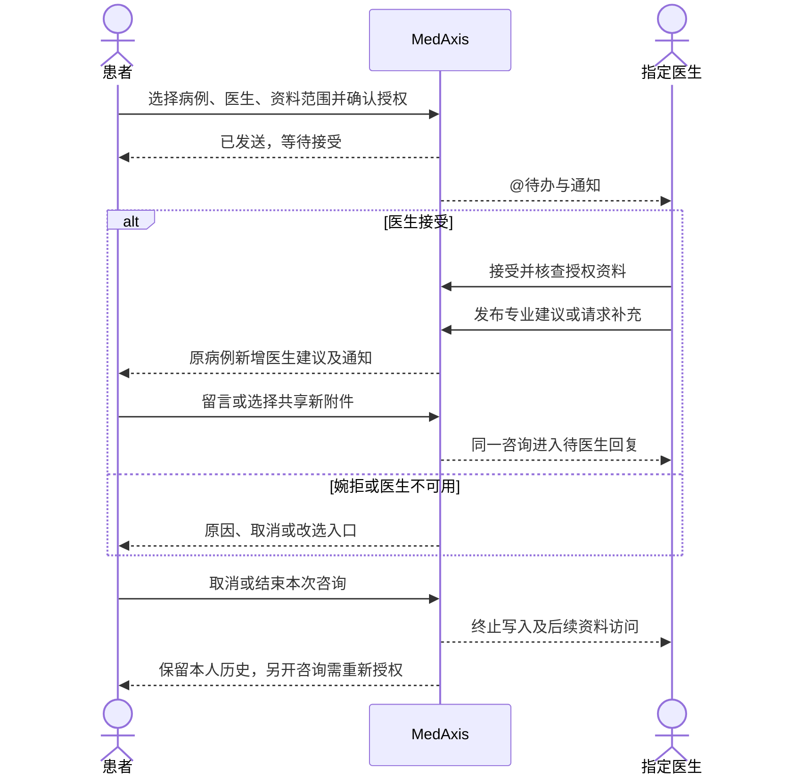

# MedAxis 医生端 PRD：定向咨询与授权病例协作

> Status: REVIEW｜版本：0.1｜日期：2026-10-03
>
> 本轮交付：医生端产品定义及患者端、管理员端必须配套的行为；不包含业务开发。三项关键决策已确认，其余标为建议或待定，整稿尚未获批。
>
> Amends：[历史 PRD](./PRD.md) 的医生协作需求和[闭环路线图](./CLOSURE_ROADMAP.md)的医生闭环方向。首期采用健康咨询边界，历史“确认诊断、调整治疗方案”不作为本期验收目标；这不表示历史代码已经迁移。患者端既有能力仍以对应专项规格为准。本文是本次医生端增量的评审真源。

## 1. 产品结论与边界

**医生端帮助已认证医生处理患者定向咨询，核查患者授权的病例资料，以可追溯的专业建议回复患者，并在同一病例内持续沟通。**

核心闭环：患者在已保存病例中选择医生并授权 → 医生收到“@我的病例” → 查阅资料、接受或婉拒 → 发表建议 → 患者在原病例看到回复并追问 → 医生继续处理或结束本次咨询。

| 层级 | 本次定义 | 证据状态 |
|---|---|---|
| Owner Mission | 设计医生端，并将 @病例、专业建议与患者端连接起来 | OWNER_DECISION：本次用户请求 |
| Current Product | 有医生注册审核、工作台和分配病例入口；详情仍混有演示资料，评论与患者接收尚缺完整路径 | FACT：附录 A 的静态源码证据；本轮未运行应用 |
| Future Target | 医患连续健康管理、机构内病例协作及科研分析，未来可评估 R/RStudio 集成 | 用户提出的方向；不等于本期全部交付 |
| Current Scope | 认证与停用、定向咨询、病例阅读、双向留言、消息、授权病例库与 CSV 导出的产品边界和验收 | 已授权整理 PRD；具体优先级仍为 ASSUMPTION |

### 1.1 已确认决定

| ID | 用户决定（OWNER_DECISION） | 影响 |
|---|---|---|
| Q1 | 首期是健康咨询与就医建议，支持持续留言和资料解读；不做在线处方、调药或正式诊断 | 回复分类与展示不得暗示诊断签署；医生回复不自动产生用药或随访任务 |
| Q2 | 每个病例同时只咨询一位医生；支持同一对话连续追问，患者可取消后改选 | 单一活动咨询；不默认长期绑定医生，不支持多医生同时处理同病例 |
| Q3 | 授权病例库仅同机构已认证医生可见，需患者另行授权及脱敏审核 | 不提供全平台公开病例；咨询授权、病例库授权、科研授权相互独立 |

`FACT` 指有出处的事实；`OWNER_DECISION` 指本次明确裁决；`ASSUMPTION` 指可修改的产品建议；`UNKNOWN` 指仍需确认。以下未标已确认的设计和分期均为 `ASSUMPTION`，不以沉默视作批准。

### 1.2 目标用户与问题假设

- 已认证医生：知道哪些患者正在等自己处理，快速辨认来源和新增资料，避免在不同页面重复找上下文。
- 注册患者：明确向谁咨询、分享了什么、医生是否接受，以及哪里查看回复、补充或取消。
- 管理员：核验资质和机构归属，处理停用及无人承接咨询，审核病例公开范围及科研申请。

用户提出了明确功能需求，但尚无医生访谈、处理量、耗时、付费或临床效果数据，价值验证仍为 `HYPOTHESIS_MODE`。反证包括：医生可能不愿承担持续留言工作量；患者可能期待即时诊疗；单机构病例不足以支撑科研；OCR 与脱敏审核成本可能高于收益。先验证定向咨询是否能完成真实沟通，再扩大病例库和科研能力。

首轮演示建议使用合成案例和成年测试账号。儿科真实使用涉及监护人身份、被照护人归属及授权，未定义完成前不接受真实儿童数据；医院及职称示例不是默认机构或默认医生档案。

## 2. 范围与信息架构

优先级建议沿用原 PRD 的口径：P0 是核心闭环及权限成立的必要条件，P1 是协作与效率增强，P2 是后续扩展。用户要求的模块全部保留在本 PRD，分期不等于删除需求。

| 模块 | 范围与用户价值 | 建议优先级 |
|---|---|---|
| 认证与身份 | 申请、审核、补正、停用、恢复；展示已审核档案 | P0 |
| @我的病例 | 接收定向咨询、接受/婉拒、待回复与待患者补充、取消/改选 | P0 |
| 病例详情与专业建议 | 真实资料、AI 辅助分析、来源、附件、患者可见回复及连续留言 | P0 |
| 工作台与消息 | 待办计数、回复通知、审核/停用通知；失败可识别 | P0 基础版；扩展统计 P1 |
| 病例管理 | 查找自己当前授权的病例、按状态筛选和查看历史咨询 | P0 基础版 |
| 授权病例库 | 同机构内独立授权的脱敏病例、发布审核、撤回 | P1 |
| 科研导出 | 单独批准的结构化 CSV、字段预览、任务历史、撤销下载 | P1 |
| 站内信与个人中心 | 查看档案和认证状态、业务申请与管理员回复 | P0 状态通知；自由会话/申请管理 P1 |
| 未来扩展 | R/RStudio 插件、多医生会诊、长期责任医生绑定、正式互联网诊疗 | P2，首期不实施 |

建议左侧导航：**工作台、@我的病例、病例管理、科研导出、站内信、个人中心**。“病例管理”含“我的授权病例 / 授权病例库”两个页签；前者是资料归档，@列表是待办队列，进入同一病例详情。未上线能力不展示假计数或可点击的空操作。

## 3. 术语、关系与权限

| 术语 | 唯一含义 |
|---|---|
| 病例 | 患者某次健康问题的资料归属单元；不因换医生创建重复病例 |
| 咨询请求（@） | 患者将某病例、明确资料范围和问题发给指定医生的业务记录；不是普通文本提及，也不表示医生已接受 |
| 咨询轮次 | 某病例与某医生的一次持续沟通；结束、取消或换医生后另起轮次，保留历史关联 |
| 专业建议 | 医生本人发布、患者可见的健康咨询回复，具有作者、时间、分类和版本；不等同于正式诊断或处方 |
| AI 辅助分析 | 模型输出，独立保存来源和生成时间，不因医生浏览、接受咨询或回复而整体变为医生确认 |
| 授权病例库条目 | 由原病例生成的经审核脱敏版本；限定机构、用途和发布版本，不是原病例的全部访问权 |
| 机构归属 | 管理员核验的医生机构关系；首期建议每位医生一个有效机构，不能靠自由填写医院名称取得权限 |
| 通知 | 指向业务记录的提醒；已读不等于接受咨询、完成处理或患者已理解建议 |
| 科研授权 | 针对批准用途、范围和字段的数据使用依据；拥有咨询或浏览权限不自动获得科研权限 |

核心不变量：一个病例最多一条活动咨询（待接受、待医生回复、待患者补充）；病例归属不随医生变化；草稿不是已发布；敏感数据读取和所有写操作均检查当前资质、机构与对象权限；医生不能替患者默认同意公开或科研使用。

| 角色/关系 | 咨询资料 | 发布专业建议 | 授权病例库 | 原件下载 | 科研导出 |
|---|---|---|---|---|---|
| 病例所属患者 | 本人病例及自己的沟通记录 | 只能患者留言 | 决定自己的病例是否授权、可撤回 | 本人材料 | 不因患者身份获得科研权限 |
| 当前受邀且有效认证医生 | 待接受时先看诉求和明确授权的预览；接受后看选定范围 | 仅当前活动咨询；待接受先接受 | 本机构且已发布的脱敏版本 | 需患者单独允许该原件的查看/下载范围 | 另行审批，不由咨询权限推导 |
| 同机构其他认证医生 | 无权读定向咨询 | 首期不可评论他人的定向咨询 | 可读本机构已发布版本 | 无原件权限 | 仅在批准范围内，不可导出所有可浏览病例 |
| 未认证/暂停/撤销医生 | 无 | 无 | 无 | 无 | 无 |
| 管理员 | 按审核、支持职责最小访问，不默认浏览全部临床内容 | 不代医生发表 | 审核/下架有审计 | 仅相应职责授权 | 审批与审计权限，不默认取得研究用途 |

## 4. 详细功能要求

### D01 资质认证、执业状态与个人中心

1. 申请字段：姓名、执业机构、科室、专业领域、职称、执业证信息和联系方式；上传医师资格及执业证明。材料类型、大小限制、上传失败和重新上传状态明确可见。是否需要更多材料由实际业务审核方确认，不把上传成功当作资质真实性已核验。
2. 认证生命周期：草稿 → 待审核 → 已通过 / 待补正 / 已驳回；通过后可暂停或撤销；恢复需重新审核。驳回保留原因和重新申请入口，不以删除账号代替驳回。
3. 只有已通过且账号可用的医生可进入业务工作台；待审核人员仅访问申请状态入口。认证、账号状态、接受新咨询的开关分开：暂不接收新咨询不等于撤销资质。
4. 用户提出离职/退休后撤销平台权限：医生可申请，管理员核实后停用该机构的医生端权限；不将“退休”自动推断为国家执业资格无效。当前没有人事系统自动联动的证据，首期建议管理员操作。
5. 停用立即阻断新登录及已有会话的病例读取、发布、原件下载和导出；界面已有敏感内容清空。未完成咨询转为“医生不可用”，患者收到通知，可改选；不自动将完整资料转交其他医生。
6. 历史建议保留发布时作者身份，并标记当前停用状态，不因医生停用抹去沟通历史。暂停恢复后不自动恢复已终止咨询或被撤销的授权。
7. 个人中心展示已审核姓名、医院、科室、专长、职称及认证状态。执业机构、职称等重要变更进入审核，未通过前不覆盖已审核档案。

下表为建议状态规则；“撤销”均指平台认证/机构权限，不是代主管机关撤销医师执业资格。

| 状态 | 医生端业务权限 | 现有咨询 | 恢复条件 |
|---|---|---|---|
| 待审核/待补正/已驳回 | 无，仅申请状态入口 | 不允许创建 | 补正并审核通过 |
| 已通过且接收新咨询 | 可使用授权业务 | 正常处理 | 不适用 |
| 已通过但暂不接收新咨询 | 可处理已有咨询，不接收新的 @ | 不自动终止 | 医生恢复接收开关，不涉及重新认证 |
| 平台暂停 | 禁止业务登录和已有会话读写，仅账号支持入口 | 转医生不可用并终止原授权 | 管理员核验暂停原因已解除、重新审核后恢复；旧咨询不复活 |
| 平台认证撤销 | 禁止业务登录和已有会话读写，仅账号支持入口 | 转医生不可用并终止原授权 | 重新申请并通过审核；旧咨询不复活 |

离职/退休申请待核实本身不自动撤权，可先关闭接收开关；管理员确认该机构服务资格终止后进入“平台认证撤销”。若核实过程中需先限制权限，由管理员明确执行“平台暂停”并记录原因。

### D02 工作台与统计口径

| 卡片 | 统计定义 | 点击行为 |
|---|---|---|
| @我的病例（待处理） | 当前医生有效活动咨询中“待接受 + 待医生回复”的去重病例数；不包含待患者补充、已结束、已取消 | 打开对应过滤条件的 @列表 |
| 可访问授权病例 | 当前机构、认证和发布权限下可见的病例库条目数；不包含定向私有病例 | 打开授权病例库 |
| 今日新增咨询病例 | 按机构业务时区，当天首次进入当前医生队列的去重病例数；同病例补充留言不重复计数 | 打开今日队列；建议替代含义模糊的“今日新增病例” |
| 已导出科研数据 | 累计成功生成的导出任务数，附累计导出记录行数；重下同一文件不增任务数 | 打开科研导出历史 |

业务时区建议首期统一 `Asia/Shanghai`，属于待批准默认值；界面注明统计更新时间。无权限的卡片隐藏，读取失败显示“暂不可用”并可重试，不用 0 或演示数据掩盖失败。快捷入口复用同一筛选口径。

### D03 @我的病例与患者发起入口

1. 患者在已保存病例或该病例的报告页点击“咨询医生（@）”，选择有效认证且接受新咨询的医生。展示已审核机构、专业领域和职称，不将推荐排序包装为医疗适配保证。
2. 提交前展示问题、将共享的病例版本、选定附件和相关档案摘要；其他病例、完整健康档案、后续新附件不自动共享。原件访问与下载单列授权项。
3. 患者确认后创建咨询记录，患者看到“等待医生接受”，医生待办可见。请求与队列落库成功才显示已发送；通知失败不丢失请求，后台重试通知，患者可在原病例查状态。
4. 医生接受后进入待医生回复；婉拒须选择或填写原因（范围不合适、暂无法处理等），患者可重新选择。接受不是诊断，也不承诺固定答复时限；待办按等待时长排序，风险提示独立可见。
5. 重复点击或请求结果未知时，查询已有提交状态并复用同一业务记录；不能产生多个活动请求。冲突时展示当前有效医生及继续/取消入口。
6. 患者可取消待接受或进行中的咨询；改选先终止原咨询，再向新医生授权。原医生立即失去后续资料与写入权限；患者仍可查看自己的历史回复。新医生不会自动看到旧私有对话，患者可另行选入资料。
7. 首期不自动因超时关闭。长时间未回复显示等待时长，允许患者取消或向管理员反馈，不出现未经批准的“24小时必回复”等承诺。

授权建议支持逐项撤回：患者可撤回单份附件的查看/下载授权而保留咨询，或仅关闭原件下载。医生立即不能再次访问被撤回内容，界面仅留“资料已撤回”占位；引用该资料的旧回复保留来源失效标记，不能重新展开原文。若撤回的是整份病例咨询授权，则终止本轮咨询；患者仍可看自己的历史。医生已发布的独立建议不因附件撤回自动删除，必要时追加更正；已下载副本无法远程收回。逐项撤回与发布并发遵循第5节服务端生效顺序。

列表显示：病例标题、授权范围内患者称呼/必要年龄信息、咨询问题、特慢病/过敏风险标记及来源、咨询状态、最新留言摘要、等待时长和未读标记。可按状态、时间、疾病标签和关键词筛选；不在列表暴露不必要的身份信息。

“今日新增”是统计项，不新增医生代患者建档入口；首期病例仍由患者侧既有流程保存。医生代建病例属于另行确认的范围。

### D04 病例详情、AI 辅助分析与附件

建议阅读顺序：患者诉求与风险提示 → 当前授权资料及新增变化 → AI 辅助分析和来源 → 原始材料 → 咨询对话。

- **疾病与特慢病标签**：区分患者自报、外部报告记载、AI 推测；ICD-10 编码采用注明版本的词表，映射未知时不补造编码。疾病分类不等于地方医保“门诊慢特病”资格，两类标记分开。具体提示依据由医学审核方确定，不按标签自动生成停药/调药意见。
- **风险展示**：既往疾病、过敏和用药信息附来源及更新时间，未知不写成“无”；可提示“存在需核对的病史/用药信息”。医生可指出资料问题，不能静默覆写患者原始事实。
- **AI 分析**：呈现生成时间、所用报告/病例版本、异常指标及原文位置、依据和不确定性。AI 疾病推测保持独立标签；医生意见另列，不用同一“诊断”字段覆盖二者。
- **知识来源**：显示来源标题、机构、版本/日期及可定位片段，说明关联哪条解释。检索相关度不等于诊断概率或指南适用性，首期不展示没有校准含义的“匹配度百分比”；无来源则注明未找到可核查依据。
- **附件三层分开**：原件、提取文本、脱敏版本分别显示处理状态。支持范围内的图片/PDF在线预览；Word等格式可显示提取文本，预览失败有替代入口。专业影像阅片、DICOM处理不在首期承诺内。
- **原件权限**：仅当前被授权医生可在患者明确允许的范围内查看/下载；每次访问重新校验，记录操作者、用途和时间。病例库和科研文件不继承原件权限。已下载文件无法远程收回，授权界面必须说明。
- **脱敏限制**：用户所述“MinU”具体指代待确认；本稿不将其等同于已接入并验证的脱敏能力。文本提取、图片遮挡、文档元数据清理和再识别风险审核是不同要求；自动处理失败或审核未通过的材料不能进入病例库或科研包。
- **变更和异常**：医生编辑回复期间患者追加资料，显示“有新资料待核对”；发布前提示确认所依据版本。缺失、删除、过期授权、解析失败分别呈现，禁止补入 MOCK 患者、报告或固定风险等级。

### D05 专业建议与双向留言

医生端区块建议命名为“咨询回复”，患者端为“医生建议”；不使用一个“专业讨论”入口混合患者沟通和院内私密讨论。首期暂不提供医生内部私聊式讨论。

| 动作 | 医生端行为 | 患者端联动 |
|---|---|---|
| 发表建议 | 选择资料解读、健康管理建议、就医建议、补充资料请求；预览后本人发布 | 同病例显示医生姓名、机构、发布时认证信息、时间、分类、内容与来源 |
| 请求补充 | 明确需补充的问题；咨询进入待患者补充 | 患者得到待办，可回复、选择共享新附件或取消 |
| 患者追问 | 新留言将活动咨询放入待医生回复队列 | 显示已发送/发送失败；不自动另建病例或重复 @ |
| 结束本次咨询 | 医生或患者结束，记录操作者与时间 | 历史只读；继续咨询需新建轮次、重新确认授权；不能显示“已治愈” |
| 更正已发表内容 | 追加更正版本及理由，关联原回复，不静默改历史 | 显示更正提示并产生新通知；患者已读状态不沿用到新版本 |

回复发布成功需服务端确认，失败保留当前页面草稿并明确未发送；跨设备草稿同步不在首期承诺内。超时显示“结果待确认”，重查后再决定重试；已发布一次的内容不能因网络重试生成重复记录。

医生主动选择“等待患者回复”或“结束咨询”，不把任意一句回复自动当作结案。首期医生回复不创建处方、调药指令或自动随访/用药任务；患者可另行使用已有随访功能，来源仍须遵循其独立规格，不将这类咨询文本当作已签署医嘱。

如提及紧急或明显恶化情形，提供经审核的线下就医/急救指引；不能要求患者等待本站留言回复。具体临床规则和文案需合格专业人员审核，本 PRD 不制定医学阈值。

### D06 授权病例库

患者另行选择发布范围、用途及资料 → 生成脱敏候选版本 → 指定审核人员检查文本、图片、附件、元数据及再识别风险 → 发布到明确机构。定向咨询医生不能单方发布患者病例。

生命周期：未申请 → 待审核 → 已发布 / 退回补正；已发布可撤回或管理员下架。原病例更新不自动更新已发布版本，需重新审核；患者撤回后停止新访问，撤销待执行导出与后续下载授权，既有下载无法保证追回。

首期以只读学习浏览为主：疾病分类、必要临床信息、去标识化经过及审核过的结论；不含原始身份、私有对话、默认全部附件。转院或医生机构变更时重新计算权限，跨机构请求被拒绝。机构身份核验、审核责任人未确定时保持关闭。

### D07 科研 CSV 导出

1. 默认从“本人管理且取得独立科研使用授权的病例”中筛选；病例库可读不等于可导出。真实研究还需明确项目用途、负责人及适用的伦理/机构审批要求，未具备依据时只用合成数据演示。
2. 导出前展示纳入/排除记录数、排除原因、字段预览、用途和审批状态；不得只给“导出全部”按钮。建议先支持去标识化病例编号、必要人口学分组、疾病标签及来源、检查项目/值/单位/参考区间、资料时间和缺失状态。
3. 自报、AI 推测、报告记载和医生咨询建议作为不同来源；缺失值不填 0，“未检查”和“无异常”不能合并。数据字典、抽取规则版本、时区和生成时间随导出提供，便于复现。
4. 姓名、联系方式、证件信息、可识别原件、未经审核自由文本默认排除；组合字段仍可能再识别，不能仅删姓名就宣称匿名化。CSV按数据编码输出，防止公式注入，并以 R/表格软件抽样核对数值、日期与单位。
5. 任务状态：待审批 → 排队 → 生成中 → 成功 / 失败 / 已取消；成功后可过期或撤销。生成时与下载时均重验范围和授权，已撤销资料不继续生成或提供下载；失败重试不重复累计成功数。
6. 导出审计记录申请人、用途、条件、批准人、字段版本、行数及下载事件；不在普通日志写原始病例内容。文件保留/过期时限须另行批准，未配置有效策略不能启用真实数据导出。

R/RStudio插件、自动统计、论文结论生成均后置，本期不冻结技术集成方案。

### D08 站内信、通知与运营协作

- 咨询通知和管理员业务消息分组：前者进入原病例，后者进入申请/会话详情，避免把患者留言复制成另一份沟通真源。
- 首期关键通知包括新咨询、接受/婉拒、患者补充、医生回复/更正、取消/结束、医生停用、审核结果；患者与医生都能从各自站内入口找回。
- 业务消息支持信息变更、退休/离职申请、资料问题等类型，显示提交、处理中、待补充、已解决和重新反馈状态。停用后通过独立账号支持入口查询结果，不恢复病例权限。
- 业务记录落库、通知生成、通知已读分别记录；发送失败可重试但不重复创建业务事实。站内收件箱为首期可靠入口，不将邮件发出视为患者已读，不承诺外部即时推送。
- 消息摘要避免暴露疾病详情，打开时重验权限；授权失效的旧通知显示状态说明，不保留可绕过权限的附件链接。

## 5. 跨端流程与状态一致性

下图是目标流程，不是当前实现证明。

活动状态：待接受 → 待医生回复 ↔ 待患者补充。终态：已婉拒、患者已取消、已结束、医生不可用。咨询终态不改写病例疾病结局；未读与通知状态是独立维度。

| 动作 | 咨询/权限 | 消息/历史 | 队列/通知 | 失败与恢复 |
|---|---|---|---|---|
| 发起 @ | 唯一活动咨询与明确授权同时有效 | 保存初始问题及资料版本 | 待接受、通知待送 | 任一关键记录失败不显示已发送；通知单独补送 |
| 发布回复 | 发布时校验资质和授权；指明下一等待方 | 草稿转正式记录及版本 | 更新待办并通知患者 | 保存失败保留草稿；结果未知先查询 |
| 患者补充 | 仅同意的新增资料进入范围 | 原记录不覆盖，新增留言 | 转待医生回复 | 未保存不增加未读和待办 |
| 取消/整份授权撤回/停用 | 立即停止原咨询新读写；单附件撤回按D03局部规则 | 患者本人保留历史，审计留存受限 | 移除活动待办，通知有关方 | 与发布并发按服务端生效顺序：撤回后提交拒绝；此前已发布保留 |
| 更正建议 | 不改变病例原始事实 | 追加版本与更正原因 | 生成更正通知 | 不能承诺撤回患者已看到的旧内容 |
| 科研授权撤销 | 停止相关生成和下载 | 保留最小必要审计 | 任务标取消/撤销 | 对已下载副本按批准的数据治理流程通知，不声称已追回 |

取消后的历史：患者仍能看自己的记录；原医生不再通过普通病例页读患者资料，仅有合规审计需要时走受控审批。结束咨询也停止原授权的新读取，若需继续则重新授权。敏感数据保留时长和审计查阅制度是上线前待定项，不预设永久保留。

非功能要求：列表分页、筛选和计数范围一致；切换病例清理旧内容，迟到响应不得覆盖新病例；慢加载、无数据和失败分别呈现。键盘可操作，状态不能仅依赖颜色，图片/文档不可预览时有文字说明。性能基线用实际列表规模和资料体积测量，阈值在测试前确定，本稿不虚构响应时延。

## 6. 验收与证明要求

以下均为**待执行验收**。每条记录服务端结果、两端可见状态、持久化核对及失败证据；不能用页面截图代替数据与权限验证。

| ID | 场景与预期（Given / When / Then） | 对应需求 |
|---|---|---|
| AC-01 | 未认证医生持有效登录凭据访问列表、详情、回复、附件或导出均被拒；通过审核才可操作；已停用旧会话也立即被拒 | D01 |
| AC-02 | 患者从病例发起 @，医生看到正确诉求/授权范围，患者能重登恢复等待状态；重复或并发提交只有一个活动咨询 | D03 |
| AC-03 | 医生接受并回复，患者清缓存重登后在原病例看到相同内容、作者和时间；患者追问使同一咨询回到待回复 | D03、D05、D08 |
| AC-04 | 换患者/换病例ID/换医生/跨机构请求不得读取他人私有资料；仅同一患者另一病例的会话也不能混入本病例 | D03、D04、D06 |
| AC-05 | 回复失败保持未发送草稿；超时结果待确认，重试仅生成一条回复；通知发送失败不撤销已发布建议，恢复后补送 | D05、D08 |
| AC-06 | 取消后旧医生无法再读写；新医生只能看新授权范围；停用时患者可见医生不可用，恢复认证不复活旧咨询 | D01、D03 |
| AC-06a | 患者只撤回一份附件后咨询仍活动，该附件不可再次预览或下载，其他授权资料仍可读；撤回全部病例授权则终止咨询；旧引用显示来源失效 | D03、D04 |
| AC-07 | 原件、提取文本、脱敏版显示不同状态；缺附件/解析失败不补演示数据；无原件授权的医生不能凭链接下载 | D04 |
| AC-08 | 医生发表建议不覆盖 AI 或患者原始事实；更正保留历史并通知；AI 引用缺失有说明；不生成处方、调药或自动任务 | D04、D05 |
| AC-09 | 授权病例库须患者另行同意与审核；本机构可见、另一机构不可见；更新要复审，撤回后旧链接不可访问 | D06 |
| AC-10 | 科研导出排除未授权数据，预览与CSV一致；缺失/零值/单位/来源可辨；撤权后的生成和下载被拒；已下载不可追回有提示 | D07 |
| AC-11 | 仪表盘与对应过滤列表一致；跨日按业务时区统计；服务失败不显示演示数字或把未知显示成0 | D02 |
| AC-12 | 已读通知不改变处理状态；旧通知打开时重验权限；医生停用后只能走账号支持入口，不能借站内信读取病例 | D01、D08 |

| 建议 P0 承诺 | 不变量及主要失败 | 所需证据/真人动作 | 当前允许表述 |
|---|---|---|---|
| 认证医生才有业务权限（D01） | 有账号不等于已认证；停用不得留下旁路 | AC-01/06/12的接口矩阵及双端测试；审核人员核验材料与停用流程 | 已有认证代码，闭环待补齐 |
| 患者主动 @ 形成唯一队列（D03） | 不能错医生、重复分配或默认共享其他病例 | AC-02/04/06及并发记录；患者本人确认共享范围 | 已定义产品行为，未验证 |
| 同病例资料真实且可核查（D04） | 不混病例、不混演示数据，不将提取当脱敏 | AC-04/07/08及原文比对；专业人员审核资料解释 | 当前详情部分实现且存在明确差距 |
| 双向回复持久且不假成功（D05） | 只有医生本人发布才出现正式建议；重试不重复 | AC-03/05/08两角色操作与重启重登；真人医生检查表述边界 | 已定义目标，未形成已验证闭环 |
| 待办与通知可信（D02/D08） | 业务状态与已读分离；失败不得显示伪数字 | AC-05/11/12，通知失败注入及恢复核对 | 现有统计/通知不足以证明闭环 |

最小验证切片：用一个合成患者、两名同机构医生、一名其他机构医生和管理员，完成认证 → @ → 接受 → 回复 → 患者追问 → 取消改选，并加入未认证、跨病例和断网重试；先证明此闭环，再扩展病例库与科研导出。真实数据启用前还须完成专业内容、机构责任及隐私授权审核。

## 7. 成功指标

下列 baseline、数值 target 均为 `UNKNOWN`。先以合成场景和小规模真人任务观察取基线，再由产品负责人在下一轮评估前定目标；不以本稿虚构收益。

| 指标 | 定义与取数口径 |
|---|---|
| 咨询闭环完成率 | 观察窗口内医生发布建议且患者成功打开的咨询数 / 合法提交咨询数；取消、婉拒与未满观察期分别列出 |
| 首次响应耗时 | 首次接受或婉拒时间减提交时间；与首次实质建议耗时分别统计 |
| 医生资料核对耗时 | 医生完成指定案例资料核对任务的时间；与现有资料查看方式对照，保留错误和遗漏 |
| 持久一致性 | 两端及重登后业务记录一致的验收场景数 / 执行场景数；失败单列 |
| 权限拒绝覆盖 | 通过的角色×对象×操作拒绝用例 / 已定义拒绝用例；仅代表测试范围 |
| 消息可达性 | 已落库业务事件中已生成可读站内通知的比例；与患者实际打开分别统计 |
| 病例库与导出质量 | 审核退回原因、字段缺失/来源错误、授权排除和抽样再识别问题，不能只统计导出量 |

## 8. 依赖、风险与待讨论项

### 8.1 法规与真实业务前提

以下用于确定产品审核边界，不构成上线合规结论。国家卫健委的互联网诊疗监管文件要求诊疗服务不得由 AI 冒用或替代医师，处方由接诊医师本人开具。本期不提供这些能力，但“健康咨询”名称本身不保证具体服务行为不进入互联网诊疗范围，真实运营需由承接机构核定。[官方监管文件](https://www.nhc.gov.cn/yzygj/c100068/202203/2072f0e8988249e59d942e1b2a933916.shtml)

医疗健康信息属于敏感个人信息；敏感信息处理涉及单独同意等要求，不满十四周岁未成年人信息另有监护人同意要求。因此咨询共享、机构内发布、科研使用必须分别明确处理依据、目的、范围和退出方式；真实研究是否需要伦理审查还取决于具体项目，不能用“已脱敏”统一豁免。[个人信息保护法官方全文](https://www.samr.gov.cn/zw/zfxxgk/fdzdgknr/bgt/art/2023/art_f374e8245320413181742e6d1baf4366.html)

### 8.2 未决项（不影响本稿形成，影响相应开发或真实数据启用）

| ID | 问题、建议与默认值 | 不决定的影响 / 责任方 |
|---|---|---|
| Q4 | 科研导出建议 P1，不进入首个医患闭环；候选为P0合成数据演示、P1真实研究准备、暂缓。当前按P1建议写 | 影响首期范围，需产品负责人裁决 |
| Q5 | 真实机构、机构管理员与资质审核人是谁；首期建议一医生一个有效机构 | 无核验真源就不能开放真实机构病例库；机构负责人确认 |
| Q6 | 是否面向真实儿童/监护人；建议先合成数据演示，真实儿科启用前补监护人和就诊人模型 | 影响数据归属与同意，不能默认沿用一个账号一个患者；产品与业务方确认 |
| Q7 | 接受咨询后的工作量、答复时限、无人响应处理；建议先人工处理且不承诺固定时限 | 无法承诺服务SLA；产品/运营与医生确认 |
| Q8 | 病例、咨询、审核记录和导出文件的保留/删除制度，科研用途与审批、审核人员 | 未确定前不启用真实数据科研导出；隐私/机构/研究负责人确认 |
| Q9 | “MinU”所指组件及图片/PDF/Word样本范围；建议以处理结果验收，不绑定组件名称 | 不宣称自动完整脱敏；技术核验与人工抽样审核 |

### 8.3 对抗审查：最可能失败的五处

1. 页面名虽叫“健康咨询”，内容仍在给正式诊断或调整药物：需专业评审实际分类、模板与样例，不能只加免责声明。
2. “@”和病例分配共用旧状态，导致咨询取消后仍有访问权：独立定义咨询生命周期，并覆盖并发撤回与旧链接。
3. 机构名自由填写、删姓名即当脱敏，导致病例外泄：核验机构关系，区分脱敏候选和审核发布版本。
4. 回复写库成功而通知失败，界面反复发送造成重复：业务事实与通知分开恢复，验收断网和故障重试。
5. 仅把原件与导出权限藏在界面，旧会话仍可下载：每次服务端校验，明确已下载副本不可追回，研究授权不继承咨询权限。

## 附录 A. 本轮现状证据与实现差距

基线为2026-10-03读取的本地未提交工作区，不等于HEAD或生产环境。只读查看了医生API/页面、认证审核片段、病例分配、患者病例恢复、解析服务和通知路由；未做全仓安全审计、运行应用或读取真实数据。历史文档只作背景，不把旧缺陷或旧测试结果当成本轮事实。

| 范围 | 当前静态事实（FACT） | 已确认方向/建议目标与差距 | 规划影响 |
|---|---|---|---|
| 注册与认证 | [register_doctor](../../backend/app/api/v1/auth.py#L159)创建 `ACTIVE`且`is_verified=False`；[医生依赖](../../backend/app/api/v1/doctor.py#L29)只检查角色，通用依赖另检查账号active | 用户要求审核后开通；需覆盖所有医生业务入口的认证状态 | 认证门禁是首个闭环前提 |
| 审核 | [verify_doctor](../../backend/app/api/v1/admin.py#L907)有通过及驳回逻辑，驳回路径删除用户和资料 | 建议驳回/补正/停用独立，不丢历史；不能直接将驳回当退休停用 | 需重新定义状态和恢复语义 |
| 病例到医生 | [病例更新](../../backend/app/api/v1/medical_cases.py#L228)仅管理员可修改 assigned_doctor_id | Q2确定患者单医生咨询；当前分配不能作为患者同意及接受记录 | 新增请求和授权语义，不能只改按钮 |
| 工作台 | [stats](../../backend/app/api/v1/doctor.py#L74)只有待审核病例真实计数，另外三项返回0；[仪表盘](../../frontend/src/doctor/pages/DoctorDashboard.tsx#L25)有demoStats | 建议真实待办和明确统计范围；不可直接沿用当前数字 | 改统计口径并去掉演示回退 |
| 详情与来源 | [病例详情](../../backend/app/api/v1/doctor.py#L160)校验assigned医生，但会话按患者汇总；[页面](../../frontend/src/doctor/pages/CaseDetailPage.tsx#L190)混入MOCK_CASE | 仅当前病例及明确共享资料；AI与医生建议分区 | 补病例级来源和权限，清除模拟混入 |
| 回复 | [前端addComment](../../frontend/src/api/doctor.ts#L65)调用 `/doctor/cases/{id}/comment`；完整doctor.py未见对应路由 | 用户明确要求双端联通；已查范围不足以证明现有评论可用 | 需持久对话、患者读写及通知 |
| 患者恢复与原件 | [get_case_recovery](../../backend/app/api/v1/patient.py#L187)返回病例、report、lab_reports、materials；[原件下载](../../backend/app/api/v1/patient.py#L253)校验患者本人 | 当前读取未提供医生回复；患者可下载不等于医生可下载 | 新增授权医生读取及原病例回复展示 |
| 通知 | [路由聚合](../../backend/app/api/v1/__init__.py#L14)将现有notifications挂载在/admin/notifications | 需患者和医生各自可读的通知入口；不能把后台通知等同双端收件箱 | 补目标用户收件与重试验证 |
| 解析/脱敏 | [document_parser](../../backend/app/services/document_parser.py#L54)使用pypdf等提取文本；[text_privacy](../../backend/app/services/text_privacy.py#L34)另有文本遮蔽函数 | 不证明“MinU”已接入或原件完整脱敏 | 核验用户所指组件及图像/元数据处理 |
| 病例库/科研 | 已查doctor.py和医生API客户端未见完整病例库或科研导出路径 | Q3机构内病例库已定；导出范围为本稿建议 | 实现状态UNKNOWN/未在本轮范围确认，需专项规划 |

上述能力的本轮自动化验证、目标环境验证和真人验证均为 `NOT_RUN`。静态代码存在仅允许说“已有部分实现”；本文完整描述的新增行为只允许说“已设计待评审”。

## 附录 B. 开发就绪与文档验证

**Readiness：NOT_READY（整稿待评审，尚未达到正式开发规划门禁）。** 不影响继续讨论或用合成数据做限定验证。

| 门禁 | 状态与证据 | 下一步 |
|---|---|---|
| G1–G3 问题、人群、价值 | PARTIAL：有用户需求及问题假设，缺真实使用证据；已显式HYPOTHESIS_MODE | 医生/患者任务观察，或用户确认先做合成实验 |
| G4 范围 | PARTIAL：第2节建议分期，Q1–Q3已确定；整期范围未批准 | 确认P0/P1及Q4 |
| G5–G7 行为、模型、验收 | PASS（定义层）：第3–7节含状态、权限、失败和验收；不是运行通过 | 在规划阶段细化测试数据与数值目标 |
| G8 风险与可行性 | PARTIAL：第8节列出机构、数据、临床审核前提；真实数据启用受阻 | 明确Q5–Q9及允许的演示边界 |
| G9 决策一致性 | PARTIAL：Q1–Q3可追溯，其余为假设；旧诊断方向在本稿明确限定 | 整稿批准后同步路线图和后续实施引用 |
| G10 Owner Review | FAIL：尚无整稿批准 | 用户评审本文件 |
| G11 承诺与证明 | PASS（定义层）：第6节有不变量、失败、证据和真人边界 | 后续执行并记录实际结果 |

本轮没有生成开发交接、排期、数据库/API契约或实施指令。患者端需要新增咨询入口、授权确认、状态、回复与通知；管理员端需要补资质生命周期、机构核验及病例库/科研审核，这些是医生端需求的配套范围，不能留到开发时猜测。

文档检查：核对Q1–Q3记录、D01–D08至AC场景映射、相对链接、编码和改动范围；应用验收不在本轮执行。初次两项广域探索未在收紧后的等待内返回，已中断，现状证据由主代理缩小范围直接核对；不将其当作独立验证结果。后续独立文档审查已完成：采纳状态语义及逐项撤回授权两项意见并补规则/验收；“新增入口缺失”经核对原始需求属于统计项歧义，不扩展代建病例功能，已明确边界。独立审查不等于产品批准。
