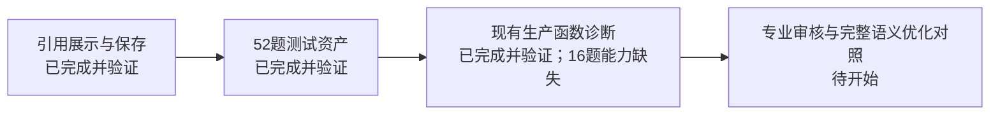

# 第七阶段：原文支持测试集与验收入口

**2026-10-09问题覆盖优化更新：** 已用真实模型完成相同输入对比，开发24/24分类正确、回归问题相关性切片15/16；完整及部分回答保留，无关误保留开发8→0、回归6→0。已最小接入来源筛选，124项本地测试及16组/40候选历史JSON引用回放通过；真实新问诊/页面/数据库保存刷新待验收。已保留NG143误判和额外模型成本，未测Recall@K或临床正确率。查看[对比报告及证据](D:/CAI-Projects/medaxis/.ai/tasks/2026-10-09-evidence-support/query-assessment-v3/REPORT.md)、[验收步骤](D:/CAI-Projects/medaxis/.claude/manual-test-query-coverage.md)。下文“未改算法/下一步判别”是此前历史阶段记录。

**2026-10-09开发集更新：** 当前采用[query-development-v2的24条开发样本](D:/CAI-Projects/medaxis/.ai/tasks/2026-10-09-evidence-support/query-development-v2/QUESTIONS.md)：8个新问题，完整/部分/另一用途候选各8条；旧gold范围重叠0、规范化字面查询复用0，未完成系统语义去重，共享语料、非盲测。容器基线24条全部执行，三类各8条均保留，未改算法。v1候选编号可能提示部分回答，已保留试跑并另冻v2，正式执行使用不透明来源ID。部分回答不能直接当无关删除。见[开发集报告与验收](D:/CAI-Projects/medaxis/.ai/tasks/2026-10-09-evidence-support/query-development-baseline-v2/REPORT.md)。v4仍作为回归集；下一步进入判别/排序优化，专业标签审核仍待办。

**2026-10-09当前有效修订版为v4：** [53题列表](D:/CAI-Projects/medaxis/.ai/tasks/2026-10-09-evidence-support/frozen-v4/QUESTIONS.md)，47题继承、5题修订、1题新增；已建立对应容器基线，53记录/36执行/17能力缺失/0异常。48条同输入观测不变，本轮没有算法改善。原v3和历史证据保留。查看[新版报告、前后对照与验收命令](D:/CAI-Projects/medaxis/.ai/tasks/2026-10-09-evidence-support/baseline-v4-authorized/REPORT.md)。专业审核仍为0题，独立开发集待建立。下文52题内容是v3历史说明；脚本默认v3保持兼容，验收v4请使用新版报告的显式资产参数。

**2026-10-09审核更新：** 已接收用户提供的DeepSeek报告，核对52个题目ID完整覆盖，外部判断与草稿51题一致、1题不同。已记录1条标签异议、3处措辞建议，另补判定范围及引文完整性问题。见[外部意见复核与下一步](D:/CAI-Projects/medaxis/.ai/tasks/2026-10-09-evidence-support/deepseek-review-v1/REVIEW.md)。这是另一份AI审核及证据关系复核，不是专业医学审核；冻结v3和基线未改，新版修订待开始。

**2026-10-09最新状态：测试资产已验证，当前生产函数诊断已运行；完整语义判断仍有能力缺口。** 全部52题记录中36题实际调用现有函数、16题适用性无入口，执行异常0。8个不回答具体问题的候选中6个仍被保留，16条陈述均待核对。[基线报告与逐题证据](D:/CAI-Projects/medaxis/.ai/tasks/2026-10-09-evidence-support/baseline-v2/REPORT.md)说明实际入口、指标边界和验收命令。本轮未改生产算法，不能称优化有效。上阶段引用展示与保存链路已通过，问诊完整性及医学陈述支持仍未通过。

## 为什么做，以及与以前的区别

以前的旧45题和新增20题主要检查“能不能找到指定原文”。找到指南，并不等于它回答了这个问题，也不等于指南内容适合当前患者，更不等于它支持报告里的那句话。

本次先固定52个候选资料判别问题：问题具体要求16题、陈述支持16题、合成条件适用性16题、版次错误4题。它们来自4份既有语料的8个新原文主题，包含24组正反对照。例如同一段说“不推荐”，正例保留这个意思，反例改成“优先推荐”，检查系统能不能发现差别。52题不是52个独立临床病例。

**没有优化生产检索算法，也没有证明医学准确率提高。** 测试题原文、坐标、限定词、哈希以及旧题重用检查已通过。之后新增的生产函数诊断记录了现有筛选及逐字核对行为，未运行新的语义判断模型。原文与两套已暴露gold的范围重叠0，题目复用0，但同一语料仍有相邻chunk共享，且题目由主代理构造可见，不能称独立盲测。

## 如何查看、如何验收

1. 看题目：[52题列表](D:/CAI-Projects/medaxis/.ai/tasks/2026-10-09-evidence-support/frozen-v3/QUESTIONS.md)。抽查E01-S正反例的血钠数值、E05吸入性扎那米韦限制、E08支气管镜“不推荐”的否定条件。
2. 看原文和条件：[dataset.json](D:/CAI-Projects/medaxis/.ai/tasks/2026-10-09-evidence-support/frozen-v3/dataset.json)。gold_units有官方URL、版次、文档SHA、字符起止位置、逐字摘录和限定词；cases有合成条件、预期判断及解释。审核状态全部为AI草稿。
3. 执行校验：在MedAxis根目录运行下列两个命令。第一个应输出52题、8原文、24组对照、旧gold重叠0、`PASS_ASSET_VALIDATION_ONLY`；第二个应输出16项OK。

```powershell
backend/.venv/Scripts/python.exe -X utf8 evals/evidence-support/verify.py --check-production
backend/.venv/Scripts/python.exe -X utf8 evals/evidence-support/test_assets.py
```

4. 看实际验证记录：[asset-validation-v3.json](D:/CAI-Projects/medaxis/.ai/tasks/2026-10-09-evidence-support/asset-validation-v3.json)、[阶段过程记录](D:/CAI-Projects/medaxis/.ai/tasks/2026-10-09-evidence-support/REPORT.md)。预期标签专业审核0题，不应勾选“医学判断已通过”。
5. 查看下一次真实执行和评分协议：[evals/evidence-support/README.md](D:/CAI-Projects/medaxis/evals/evidence-support/README.md)。执行器只看inputs.json；审核者看dataset.json，避免预测照抄答案。执行编号无正反提示、顺序按指纹排列。

6. 本次基线验收：运行`backend/.venv/Scripts/python.exe -X utf8 evals/evidence-support/baseline_verify.py`，应看到52记录、36执行、16能力缺失，完整语义准确率null；运行`evals/evidence-support/test_baseline_verify.py`（同一Python入口），应有9项OK。打开[逐题诊断](D:/CAI-Projects/medaxis/.ai/tasks/2026-10-09-evidence-support/baseline-v2/CASES.md)查看6个仍保留的不回答问题候选。

## 凭什么确认本阶段可用

构建v3、verify.py及16项错误注入测试均exit0；验证器实际抓到v1把“而非”转述为“并非”的限定词错误，没有把失败标为通过。交付自审进一步发现v2的正反编号泄漏答案，v3改成无提示执行编号并增加检查。v1、v2原件保留，只有v3作为当前冻结版本。

校验与评分工具能检测错误原文、错坐标、缺失限定词、已暴露gold重叠、题目/预测重复、缺题、额外题、非法标签，以及把“未知”误当适用。测试中人为预测仅检验评分工具，不计入生产基线。

## 下一步如何证明优化有效

现有生产函数基线已记录；完整语义判别尚缺能力，不能用缺失预测计算总分。接下来专业审核标签及用途边界，另建独立开发样本；之后才实现问题具体要求判断和适用性/陈述支持能力。用相同输入重跑时明确哪些是同协议比较、哪些是新增能力；逐题列改善、退步与不变，不能只给平均分，也不能把新判断模型的分数算成旧算法本就具有的能力。

当前未覆盖：真实多轮必要补问恢复、未追问缺失信息、外部来源配额、全报告医学安全，以及版本正例/支持不足金标。上一阶段29条支持关系仍待核对，病例关联报告仍报错。README展示素材保留待办，不用本报告假装展示任务已完成。


