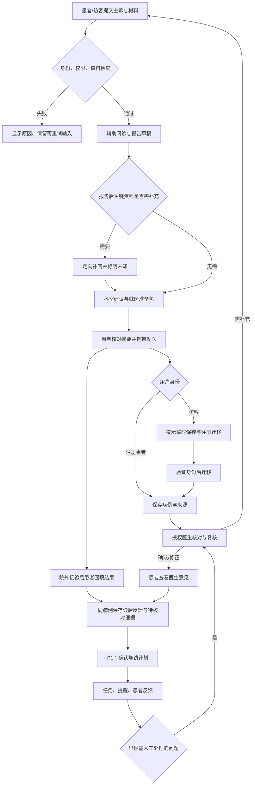

# 医枢 MedAxis 产品需求文档与实现差距盘点

> **2026-09-27 阅读说明**：面向当前简历作品定位，请先读[患者侧聚焦 PRD](./PORTFOLIO_PRD.md)和[双岗位作品集指南](../RESUME_GUIDE.md)。本文件保留 9 月 23 日审查及后续增量，正文的旧缺陷、测试结果与优先级不是当前工作区统一快照；不得据此认定权限、类型检查等旧问题仍然存在。患者侧已验证范围及限制还需结合[9 月 26 日独立审查](./PATIENT_DEMO_CLOSURE_REVIEW.md)。本次未重跑应用，也未将原医生复核/个性化推荐需求标为完成。

> Status: REVIEW ｜ 版本：0.2 ｜ 审查/修订日期：2026-09-23
>
> 基线：本地 HEAD `8ce41c93f8a40f1bab9767462a3561f7eb5232c4` **及当前未提交工作区**。结论不等同于该提交、远程仓库或生产环境的状态。
>
> 本轮任务：review 当前项目，梳理已实现和未实现功能，形成 PRD；根据用户补充，增加“报告后的科室推荐与就医准备”需求。仅更新文档与审查辅助材料，不实现业务功能。
>
> 文档关系：对 [历史提案](../archive/PROPOSAL.md)、[架构说明](../engineering/architecture.md)、[问题摘要](./todos.md) 做现状补充；不追认历史提案中的排期、效果数据与“已完成”声明。本文件第 4、5、11 节为代码盘点；用户已确认增加科室推荐与就医准备这一需求方向，具体行为、优先级及其余范围仍待评审。

## 当前阅读入口（2026-10-06 文档复核）

本文件的第 1–10 节以 2026-09-23 审查和后续注明日期的增量为基线，**不是当前缺陷清单**。旧角色/归属、解析持久化、病例字段与类型错误已有后续修复；本次保留原编号与实际测试结果，避免改写历史。

- 当前功能与剩余问题见[当前 TODO](./todos.md)、[工程说明](../engineering/backend.md)及各专项规格。
- 已实现有限的通用科室参考、档案来源/版本、患者手动计划及诊后 AI 候选确认；不代表完整专业分诊、医生协作或可靠提醒送达。
- 新报告中心已有归档/整理/核对/引用/去重/回收站代码，当前演示库迁移与最终验收仍待完成。
- 普通模式与专用面试模式不同：后者关闭访客和公开注册、限制模型请求。最近演示验证见[演示说明](../INTERVIEW_DEMO.md)，只覆盖指定合成账号和两次普通对话。
- 历史测试命令仅用于读懂当时记录；实际复跑数据库测试须遵循[当前护栏](../../backend/tests/database_safety.py)。

## 1. 2026-09-23 审查结论（历史）

**项目已经具备 AI 辅助问诊、检验报告解析、诊断后追问以及较广的管理后台实现，但尚未形成可靠的“患者问诊 → 医生确认 → 随访执行 → 异常处理”闭环。**

- **已落地的主干**：患者/访客入口、三轨问诊与 SSE、结构化报告、诊断后独立对话、本地聊天历史、知识库管理、模型配置、邮件和后台通知管理。
- **部分实现**：患者档案、病例管理、医生工作台、护理计划、提醒发送与确认、医生认证。存在字段不一致、模拟数据、入口未接通和权限缺口。
- **尚未落地的目标**：真实医生评论与指令执行、稳定的计划到提醒闭环、异常升级医生、DoctorAgent、独立 KnowledgeAgent、任务 DAG 执行/恢复、MCP、GraphRAG、Android 客户端。
- **先修复再扩展**：公开注册接受管理员角色、敏感结果读取缺少所有权检查、医生页面将模拟结果当成功、前端类型检查失败、病例 API 与模型漂移，应优先于新增 Agent。
- **新增需求方向（用户确认，未实现）**：在初步询问生成报告后提供科室推荐与就医准备，把主诉补充、可核查的诊前摘要、医学依据和诊后反馈连接起来；详细行为见第 6.3 节。

不能给出可信的“完成百分比”：历史需求粒度不一，也没有经确认的验收分母。本文件用逐项状态和证据替代主观百分比。

## 2. 产品定位、问题与证据边界

### 2.1 四层边界

| 层级 | 本轮定义 | 证据状态 |
|---|---|---|
| Owner Mission | 项目材料描述为“患者驱动、AI 辅助、医生验证”的医疗协作平台；真实经营目标、服务地区与使用机构尚待确认 | FACT：README 的定位；UNKNOWN：实际业务决策 |
| Current Product | 以问诊聊天为中心，具有患者、医生、管理端页面及部分后台服务；功能广度超过旧 TODO，端到端完整度不足 | FACT：第 4、5 节代码盘点 |
| Future Target | 主动健康管理、多 Agent 协作、医生自然语言指令、知识图谱和外部系统集成 | FACT：历史提案写有这些愿景；不是已批准的新范围 |
| Current Scope | 建立实现基线，并补充报告后的科室推荐、就医准备及与诊后连续性的衔接 | OWNER_DECISION：盘点及新增功能方向；具体方案仍为建议 |

### 2.2 问题与反证

产品假设：患者需要把主诉、报告、既往信息放在一个连续流程中；医生需要可核查的摘要和协作记录；运营人员需要管理模型、知识与身份权限。现有页面与接口支持这些方向，但**没有用户访谈、真实使用频次、转化数据、临床效果或成本基线**，因此价值与目标人群采用 `HYPOTHESIS_MODE`。

2026-09-23 用户补充的问题陈述：患者主诉采集不完整、医生问诊前信息整理成本高、医学知识依据分散、诊后随访缺乏连续性；明确要求初步询问并生成报告后提供推荐科室和就医准备。该需求方向记为 `OWNER_DECISION`，但问题发生频次、成本大小和改善效果尚无量化证据，不能由用户提出需求推导为效果已证实。

反证包括：医生主流程夹杂示例数据；随访页存在未定义变量；护理计划持久化方法没有发现生产调用方；现有自动测试并不覆盖完整医疗协作链。这些事实削弱“平台已全面可用”的判断，但不否定已存在的问诊和管理代码。

### 2.3 判定口径

| 状态 | 定义 |
|---|---|
| 已实现 | 存在真实处理逻辑和相应入口/调用，未发现本次范围内的明确占位；仅代表代码层面 |
| 部分实现 | 有页面、接口、服务或持久化中的一部分，但契约、权限、实际调用或恢复路径不完整 |
| 未实现 | 在审查范围内未发现目标执行路径，或明确只有 TODO/placeholder；不等同于历史上从未开发 |
| 待验证 | 正交的验证标记：代码存在，但尚无本轮自动化、目标环境或真人验收证据 |

所有线上可用性、医疗有效性、SMTP 实际送达、外部模型效果及浏览器完整流程均为**待验证**。前端“已实现”也不表示全量类型检查通过。证据链接锚点按本轮工作区行号记录，后续改动可能使行号漂移。

## 3. 用户、目标与范围

| 角色 | 触发场景 / 要完成的事 | 产品边界（待确认） |
|---|---|---|
| 访客 | 初次描述问题、上传报告、理解 AI 辅助结果 | 临时身份、明确配额和数据保留提示；注册迁移需成功或可解释失败 |
| 注册患者 | 连续问诊、查历史、更新档案、查看与确认随访任务 | 只能访问自身数据；本地缓存与服务端记录的差异必须可感知 |
| 已认证医生 | 查看授权病例、核对原始资料、确认/修正意见、安排随访 | AI 输出、医生意见与计划生效状态分离；不以浏览器角色字段授权 |
| 管理员 | 管理身份认证、知识库、模型、系统配置与运营记录 | 授权产生的管理员账号；敏感操作可追溯且区分停用与永久删除 |

**建议目标**：首先交付“主诉整理 → 辅助报告 → 科室推荐与就医准备 → 医生核对 → 诊后反馈”的连续流程，减少患者遗漏和医生重复整理。AI 输出为待核查的辅助建议；医生确认应形成独立记录，不能被聊天中的“已处理”替代。目标效果待验证。

**非目标**：本轮不开发、不上线、不改基础设施；下一版建议不包含自动处方/自动调整药物、自动预约/HIS 写入、无人监督的高风险医疗决策，也不以 GraphRAG/MCP/移动端作为 MVP 必选项。已有药物建议工具的存在不等于具备安全处方能力。

## 4. 功能实现矩阵

本表保留原审查日的行为、缺口与建议目标；当前状态见本页开头的阅读入口。U15 的功能方向已由用户明确提出，具体行为仍待评审；其余目标未因本轮补充而自动获批。优先级见第 6 节，不把目标写成当前能力。

### 4.1 患者与访客

| ID | 功能 | 状态 | 当前行为 / 证据 | 差距及目标影响 |
|---|---|---|---|---|
| U01 | 患者注册、登录 | 已实现 | [注册/登录 API](../../backend/app/api/v1/auth.py#L70)、[注册页面](../../frontend/src/auth/RegisterPage.tsx#L137) | 注册角色白名单存在高优先级缺口，见 R01；邮箱验证目前关闭 |
| U02 | 邮箱验证 | 部分实现 | [注册直接设为已验证](../../backend/app/api/v1/auth.py#L97)；验证相关字段/流程仍在仓库 | “邮箱已验证”不能代表完成真实验证；是否恢复验证待裁决 |
| U03 | 访客会话与配额 | 部分实现 | [访客创建读取配置](../../backend/app/api/v1/auth.py#L395)、[SSE 自动创建](../../backend/app/api/v1/agents.py#L823) | 两条入口配额不一致，后者使用 999；到期/额度需统一验收 |
| U04 | 访客注册后数据迁移 | 部分实现 | [前端迁移请求](../../frontend/src/api/agent.ts#L311)、[迁移 API](../../backend/app/api/v1/auth.py#L638) | Bearer 优先解析使 guest_id 缺失，可能返回 migrated=0；不应宣称已无缝迁移 |
| U05 | 三轨问诊与续答 | 已实现 | [SSE 首轮](../../backend/app/api/v1/agents.py#L793)、[续答](../../backend/app/api/v1/agents.py#L1235)、[问诊编排](../../backend/app/services/orchestrator.py) | 病史采集、搜索增强、多模态数据进入问诊；真实模型质量/并发/恢复待测 |
| U06 | 结构化诊断报告与展示 | 已实现 | [报告 schema/诊断服务](../../backend/app/services/agents.py#L210)、[全屏报告](../../frontend/src/components/FullScreenReport.tsx) | 有警示和免责声明展示；来源充分性及临床合理性没有本轮验证 |
| U07 | 诊断后追问 | 已实现 | [专用 chat API](../../backend/app/api/v1/agents.py#L1420)、[前端 streamChat](../../frontend/src/api/agent.ts#L341) | 使用父诊断与子对话语义；模型真实响应及中断恢复待验收 |
| U08 | 图片/文档解析及问诊关联 | 部分实现 | [上传/轮询](../../backend/app/api/v1/documents.py#L55)、[lab report bridge](../../backend/app/api/v1/agents.py#L691)、[上传 UI](../../frontend/src/components/ChatPage.tsx#L647) | 任务保存在进程内 dict；轮询/删除缺所有权控制，不能算可靠持久化附件系统 |
| U09 | 聊天历史与刷新恢复 | 已实现（本地范围） | [localStorage 状态](../../frontend/src/state/chatHistory.ts#L47)、[历史页](../../frontend/src/components/ChatHistoryPage.tsx#L67)；本轮 6 项相关单测通过 | 换设备、清缓存后的云端恢复未实现；后端会话列表限 admin/doctor |
| U10 | 健康档案编辑 | 部分实现 | [档案 API](../../backend/app/api/v1/patient.py#L38)、[页面](../../frontend/src/patient/pages/HealthProfilePage.tsx#L45) | 出生日期无写入字段/模型列；页面存在可空值类型错误 |
| U11 | 病例与病例文档管理 | 部分实现 | [CRUD API](../../backend/app/api/v1/medical_cases.py#L74)、[分层模型](../../backend/app/models/medical_case.py#L46)、[问诊后建病例](../../backend/app/api/v1/agents.py#L1116) | API 仍引用旧 doctor_id/CLOSED 等，不能把“有 CRUD”当作完整可用 |
| U12 | 随访计划列表与任务确认 | 部分实现 | [计划列表/ack](../../backend/app/api/v1/patient.py#L165)、[随访页](../../frontend/src/patient/pages/FollowUpPage.tsx#L57) | fallbackPlans/filtered/handleAck 未定义；前端期待任务数组，生成服务存储含 tasks 的对象；失败时本地完成不回滚 |
| U13 | 用药提醒列表与确认 | 部分实现 | [提醒 API](../../backend/app/api/v1/patient.py#L269)、[页面直连正确 PATCH](../../frontend/src/patient/pages/MedicationReminderPage.tsx#L41) | 发送源头未形成闭环；[公共 helper](../../frontend/src/api/patient.ts#L97) 仍调用不存在的 POST /ack，当前页面绕过它 |
| U14 | 健康打卡/画像刷新 | 部分实现 | [check-in](../../backend/app/api/v1/patient.py#L335)、[画像异步刷新](../../backend/app/api/v1/patient.py#L397) | 有后端入口，未形成用户打卡→指标评估→告警处理闭环；未知 task_id 也可能返回成功 |
| U15 | 报告后科室推荐与就医准备 | **部分实现（患者侧合成演示）** | [闭环实施计划](./PATIENT_DEMO_CLOSURE_PLAN.md) 与 2026-09-26 验收记录：新患者病例持久化、同病例导航、准备摘要与患者自报反馈通过隔离演示 | 已实现并验收中性演示目录、来源/范围说明、同病例准备和反馈恢复；没有症状到科室映射、个性化推荐或专业依据。原需求不是完整交付，`FR-11/VP-01` 仍未达成；临床效果未验证 |

### 4.2 医生协作

| ID | 功能 | 状态 | 当前行为 / 证据 | 差距及目标影响 |
|---|---|---|---|---|
| D01 | 医生注册、材料与认证 | 部分实现 | [医生注册](../../backend/app/api/v1/auth.py#L152)、[审核](../../backend/app/api/v1/admin.py#L875) | 审核写库和邮件逻辑存在，但返回体违反 response_model；认证/账号激活状态需一致验收 |
| D02 | 医生仪表盘/病例列表 | 部分实现 | [统计和列表](../../backend/app/api/v1/doctor.py#L57)、[前端](../../frontend/src/doctor/pages/DoctorDashboard.tsx#L99) | 只有待审核数真实统计，其他统计固定 0；风险固定 medium；部分请求失败使用 demo 数据 |
| D03 | 病例详情、AI 摘要与时间线 | 部分实现 | [详情 API](../../backend/app/api/v1/doctor.py#L145)、[详情页](../../frontend/src/doctor/pages/CaseDetailPage.tsx#L167) | 缺角色/归属校验；patient.name 不存在；页面混入 MOCK_CASE 患者信息/报告 |
| D04 | 医生确认/修正诊断、分配病例 | 部分实现 | [通用 diagnosis 更新入口](../../backend/app/api/v1/medical_cases.py#L185)、[更新 schema](../../backend/app/schemas/medical_case.py#L69) | 存在接口意图但字段已漂移；未发现可用的独立认领流程，不能说完全没有后端基础 |
| D05 | 医生评论、患者回复 | 未实现完整路径 | [前端请求 comment](../../frontend/src/api/doctor.ts#L59)、[失败后本地追加](../../frontend/src/doctor/pages/CaseDetailPage.tsx#L212) | doctor router 无对应 comment 路由；未发现评论持久化及患者回复闭环 |
| D06 | 医生自然语言下发计划 | 未实现执行 | [后端明确 placeholder](../../backend/app/api/v1/doctor.py#L201)、[前端失败后模拟任务](../../frontend/src/doctor/pages/CaseDetailPage.tsx#L240) | 接收文本/返回“任务已创建”不代表执行、持久化或通知 |
| D07 | 医生授权共享、专科匹配、升级接诊 | 未实现完整路径 | 当前 [医生 API](../../backend/app/api/v1/doctor.py) 仅统计、列表、详情、占位计划 | 持久授权、匹配/接单和患者可见回执未找到；目标需先定义共享权限 |

### 4.3 管理运营

| ID | 功能 | 状态 | 当前行为 / 证据 | 差距及目标影响 |
|---|---|---|---|---|
| A01 | 用户列表、查询、更新 | 已实现 | [后台用户 API](../../backend/app/api/v1/admin.py#L695)、[用户页面](../../frontend/src/admin/pages/UsersPage.tsx#L69) | 角色与状态变更需要补拒绝路径和审计验证 |
| A02 | 停用/踢出/删除用户 | 部分实现 | [kick API](../../backend/app/api/v1/admin.py#L781) | 注释称 soft-delete，实际 db.delete；医生驳回也删除账号/材料。必须先裁决删除与恢复语义 |
| A03 | 模型提供商管理与连通测试 | 已实现 | [CRUD/health test](../../backend/app/api/v1/admin.py#L248)、[页面](../../frontend/src/admin/pages/LLMProvidersPage.tsx#L173) | 配置存储与测试入口存在；本轮未调用真实模型；页面缺 Card 等标识符，影响可运行性 |
| A04 | 知识文档上传、解析、维护 | 已实现 | [上传入库](../../backend/app/api/v1/admin.py#L1139)、[页面](../../frontend/src/admin/pages/KnowledgeBasePage.tsx#L55) | 文本/PDF/DOCX 等管理路径存在；真实解析与检索质量待测 |
| A05 | 知识库审核队列 | 部分实现 | [队列与审核记录](../../backend/app/api/v1/admin.py#L1014) | 后台路由全局限 admin；注释中的 doctor 审核并非可用医生入口；这是知识文档审核，不是医生诊断审核 |
| A06 | 系统设置 | 已实现 | [设置 API](../../backend/app/api/v1/admin.py#L488)、[设置页](../../frontend/src/admin/pages/SystemSettingsPage.tsx#L163) | 动态配置可保存；单项变更审计覆盖不完整 |
| A07 | 邮件配置、模板、发送日志 | 已实现 | [邮件路由](../../backend/app/api/v1/email.py#L78)、[邮件页](../../frontend/src/admin/pages/EmailManagementPage.tsx#L164) | 未发送测试邮件；实际送达及失败补偿待测 |
| A08 | 后台通知、广播、已读 | 已实现（管理员范围） | [通知路由](../../backend/app/api/v1/notifications.py#L33)、[管理 API 客户端](../../frontend/src/api/admin.ts#L428) | 不能由此推出患者/医生已有统一通知收件箱 |
| A09 | 审计日志查询 | 已实现（有限覆盖） | [审计 API](../../backend/app/api/v1/admin.py#L1337) | 主要记录管理操作，不是完整患者/医生/Agent 行为审计 |

### 4.4 Agent、知识与后台自动化

| ID | 功能 | 状态 | 当前行为 / 证据 | 差距及目标影响 |
|---|---|---|---|---|
| G01 | Master 意图识别与路由 | 部分实现 | [识别服务](../../backend/app/services/intent.py#L13)、[route](../../backend/app/services/agents.py#L1263) | 超时和回退存在；非流式 route 对 research/general/other 的会话枚举转换失败，见 R10 |
| G02 | DiagnosisAgent 与工具调用 | 已实现 | [诊断 Agent](../../backend/app/services/agents.py#L210)、[四个注册工具](../../backend/app/tools/medical.py#L391) | 有有限轮次工具调用和结构化输出恢复；不是通用持久 DAG 执行器 |
| G03 | 内部 RAG、embedding、rerank | 已实现（有限检索） | [RAG.search](../../backend/app/services/rag.py#L136)、[embedding](../../backend/app/services/embedding.py#L20)、[reranker](../../backend/app/services/reranker.py#L18) | ILIKE 粗召回后才向量排序；不是 pgvector 全库语义召回，也不能宣称已实现历史提案中的 Multi-Path/HyDE/RRF 全链路 |
| G04 | 外部医学资料搜索 / ResearchAgent | 部分实现 | [SearXNG](../../backend/app/services/external_search.py#L43)、[ResearchAgent](../../backend/app/services/agents.py#L1101) | 搜索逻辑存在；research 路由受枚举问题影响；普通 compose 未包含默认地址所指服务 |
| G05 | PlanningAgent 生成方案 | 部分实现 | [结构化 plan](../../backend/app/services/agents.py#L860)、[落库方法](../../backend/app/services/agents.py#L967) | plan 文本生成与 CarePlan 落库是不同路径；全仓应用代码只发现 generate_care_plan 定义，没有调用方 |
| G06 | 定时提醒、发送重试 | 部分实现 | [事件认领与发送](../../backend/app/tasks/monitoring.py#L204)、[定期扫描](../../backend/app/tasks/monitoring.py#L274) | 有 pending→in_flight 原子认领、超时回收、重试计数；但生成端只为 medication 建事件，时间固定 +1h，未实现频次/疗程调度 |
| G07 | MonitoringAgent 与异常升级 | 部分实现 | [check 返回评估](../../backend/app/services/agents.py#L1053) | LLM 返回 alerts 不等于告警入库、送达、医生接诊；无完整升级闭环 |
| G08 | 健康画像生成 | 部分实现 | [读取病例生成画像](../../backend/app/services/agents.py#L909)、[异步任务](../../backend/app/tasks/planning.py#L15) | 存在任务和数据模型；未证实患者页面完整消费及失败恢复 |
| G09 | DoctorAgent / 独立 KnowledgeAgent | 未实现 | backend/app 中类定义检索未找到；已有工具和 ResearchAgent 不等于这两个 Agent | 不以类名数量作为产品目标；先完成医生与知识行为闭环 |
| G10 | 任务 DAG、持久 checkpoint、跨 Agent 恢复 | 未实现 | [AgentTask 模型](../../backend/app/models/agent.py#L143)、[consultation 串行分支](../../backend/app/services/agents.py#L1410) | 有任务记录/dependencies 字段，无依赖图执行器证据；不能等同于恢复机制 |
| G11 | 后台异步诊断任务 | 未实现真实执行 | [run_diagnosis_agent](../../backend/app/tasks/agent.py#L9) 返回 placeholder | 与真实 SSE 问诊路径分开看，不能据此否定所有诊断能力 |
| G12 | 多 provider 配置与自动故障切换 | 部分实现 | [配置解析](../../backend/app/services/llm.py#L47)、[客户端](../../backend/app/services/llm.py#L198) | 多配置选择已存在；调用失败后切换另一个 provider 未发现。同 client 重试不是跨 provider 容灾 |
| G13 | MCP / GraphRAG | 未实现 | 检索 backend/app、frontend/src 与编排文件，只在历史设计/说明中发现目标 | 后置候选，不列为现有优势 |
| G14 | Android / WebSocket / 医院与预约对接 | 未实现（本仓范围） | 项目目录、前后端依赖/路由未发现对应交付；[历史目标](../archive/PROPOSAL.md) | SSE 已存在且不等于长轮询；是否引入其他客户端/协议需业务理由 |

## 5. 历史审查缺口与原编号

严重度是本次审查判断，不是已批准排期。以下为原审查日的问题，已有修复项不能据此重新认定为当前缺陷。没有进行生产攻击或真实患者数据测试。

| ID / 级别 | 触发、影响与证据 | 验证层级 / 修复方向 |
|---|---|---|
| R01 / P0 | **公开注册可以接收 admin 角色**：[UserRegister.role](../../backend/app/schemas/auth.py#L23) 使用含 admin 的 UserRole；[注册](../../backend/app/api/v1/auth.py#L70) 没有注册角色白名单且原样 `role=data.role`，状态 ACTIVE | 模型检查确认 schema 接受 admin，代码确认直接写角色；未连接真实 DB。公开注册必须限制可选角色，管理员仅由受控授权产生 |
| R02 / P0 | **病例/解析结果权限边界不完整**：[医生详情](../../backend/app/api/v1/doctor.py#L145) 仅检查登录，未检查医生角色和病例归属；[报告轮询/删除](../../backend/app/api/v1/documents.py#L111) 没有身份依赖 | 静态确认；医生详情另有字段错误，当前可能先报错，但修字段不能代替补权限。需角色×所有权拒绝用例 |
| R03 / P0 | **模拟数据冒充真实结果**：[详情合并 MOCK_CASE](../../frontend/src/doctor/pages/CaseDetailPage.tsx#L191)、[评论失败仍追加](../../frontend/src/doctor/pages/CaseDetailPage.tsx#L225)、[计划失败模拟成功](../../frontend/src/doctor/pages/CaseDetailPage.tsx#L248) | 静态确认。正式流程只能显示真实数据；演示须显式隔离。提交失败应保留草稿/标记失败，不能显示已生效 |
| R04 / P1 | **前端类型检查失败且有运行时未定义变量**：随访 `fallbackPlans/filtered/handleAck`，模型配置 `Card/CardContent`，医生仪表盘样式标识符等 | 本轮 `tsc` 165 条诊断、exit 2。修复可运行性，类型检查与现有测试成为独立门禁；不能推断 Vite 打包已失败（本轮未执行 build） |
| R05 / P1 | **病例模型迁移未同步 API**：[medical_cases.py](../../backend/app/api/v1/medical_cases.py#L58) 引用 doctor_id/CLOSED/diagnosis_doctor，而模型与 schema 使用 assigned_doctor_id/RESOLVED/doctor_diagnosis；[医生详情](../../backend/app/api/v1/doctor.py#L188) 访问不存在的 patient.name | 内存模型检查确认字段/枚举不存在。医生列表/修改/结案等受影响；统一领域字段并验证真实 CRUD，不能只修前端 |
| R06 / P1 | **医生审核提交与响应契约不一致**：[声明 UserListItem](../../backend/app/api/v1/admin.py#L875)，实际 [approve](../../backend/app/api/v1/admin.py#L932)/[reject](../../backend/app/api/v1/admin.py#L966) 返回 success/message/action | Pydantic 检查产生 18 个校验错误。存在写库后响应失败、前端重试的风险；需统一返回体并验证重复提交 |
| R07 / P1 | **访客迁移双身份解析失效**：[客户端](../../frontend/src/api/agent.ts#L311) 同时发送两种 token；[依赖](../../backend/app/api/deps.py#L110) 只解析优先 token；[迁移](../../backend/app/api/v1/auth.py#L638) 要求同时有 user/guest_id | 静态调用链确认；需分别验证两种身份的归属、迁移计数及可重试性 |
| R08 / P1 | **计划生成、执行与确认未闭合**：落库方法无调用方、提醒固定 +1h、前端/后端 tasks 结构不同，[ack/check-in](../../backend/app/api/v1/patient.py#L231) 未找到 task 时仍可 success | 静态确认。先统一计划来源与任务契约，再验证刷新后状态、重复确认、未知任务拒绝；不能由提示文案证明执行 |
| R09 / P1 | **报告任务持久恢复仍需环境级验证**：[解析任务 API](../../backend/app/api/v1/documents.py#L36) 使用持久任务记录；[Celery worker](../../backend/app/tasks/documents.py#L40) 读取已保存的原始文件字节处理 | T3 回归测试覆盖持久化文件、患者所有权读取、访客迁移及过期清理；当前患者闭环 E2E 未执行真实前端上传或 worker/服务进程重启故障注入，多 worker/重启恢复仍待目标环境验证 |
| R10 / P1 | **部分意图无法创建会话**：[非流式 route](../../backend/app/services/agents.py#L1274) 先执行 AgentSessionType(intent)，[枚举](../../backend/app/models/agent.py#L44) 不含 research/general/other | 内存检查三项均抛 ValueError。该结论限定此 route，不扩大成所有 SSE 问诊都失败 |
| R11 / P1 | **测试底座阻断 API 验证**：[conftest](../../backend/tests/conftest.py#L23) 默认 SQLite，模型有 PostgreSQL JSONB | 本轮 21 passed、26 setup errors。需隔离测试数据库或明确支持的测试类型映射；本轮未变更测试基础设施 |
| R12 / P1 | **账号删除语义不清**：[kick](../../backend/app/api/v1/admin.py#L781) 注释为软删，实际硬删；医生驳回也删除资料 | 静态确认。区分停用、驳回、删除及保留政策；未经决策不可把不可恢复动作当成常规状态切换 |
| R13 / P2 | **检索和运行依赖与宣传存在差距**：[ILIKE 召回](../../backend/app/services/rag.py#L148) 是向量排序前置条件；[搜索默认地址](../../backend/app/services/external_search.py#L108) 依赖普通 compose 未定义的 searxng | 静态确认。定义可测的召回质量、来源展示和依赖缺失反馈；不要求为名称而换检索架构 |

## 6. 建议下一版：范围与产品需求

### 6.1 最小闭环与优先级

建议 MVP：**初步询问并补充关键主诉 → 生成辅助报告 → 科室推荐与就医准备 → 保存/携带可核查摘要 → 医生接诊与核对 → 回填就诊结果**。注册患者可保存到原病例，访客可查看和携带准备资料，但持久保存与迁移边界需明确。院外医生不必先注册本平台，患者可主动展示摘要；平台内复核仍按 FR-04 授权。完整的定时随访执行为 P1，MVP 先保留同病例的诊后反馈入口与待办草稿。

优先级区分：`P0` 为该闭环/安全成立的条件；`P1` 为后续随访、运营完善；`P2` 为待验证扩展。已有功能不因列入 P1 被删除，只是暂不新增产品承诺。

| 需求 | 优先级 | 用户故事与可观察行为 | 现状差距 |
|---|---|---|---|
| FR-01 身份与数据隔离 | P0 | 用户只能访问授权资料；公开注册不能取得管理身份；未认证医生不能通过旁路获得医生能力 | U01/U04、D01/D03、R01/R02/R07 |
| FR-02 问诊与报告 | P0 | 患者提交主诉、补充资料后得到状态明确的辅助报告；材料缺失/解析失败应可见；已有结果不能因后续追问被覆盖 | U05–U08；补真实依赖与失败场景验证 |
| FR-03 服务端病例与恢复 | P0 | 注册患者刷新/重新登录可找回已保存病例、报告来源与后续对话；保存失败不能显示为已保存 | U09/U11、R05/R09；云端历史是新增目标 |
| FR-04 医生复核闭环 | P0 | 授权且认证的医生核查原始资料，保存确认/修正意见；患者可区分 AI 草稿、待复核与医生已确认状态 | D03–D05、R03/R05/R06；不强制先实现 DoctorAgent |
| FR-05 真实反馈与退出恢复 | P0 | 请求失败、中断、重复点击、过期登录均有明确结果；不生成假评论、假计划或假完成记录；可安全重试 | R03/R04/R08–R10 |
| FR-06 健康档案 | P1 | 患者可维护经定义的字段；刷新后值一致，无法保存的字段不可编辑；AI 摘要与用户原始资料分离 | U10/U14；出生日期或年龄口径待确认 |
| FR-07 随访计划与任务 | P1 | 医生确认计划后，患者看到任务、频次、时间、来源与状态；完成/取消操作服务端落库，可刷新核验 | U12、D06、G05/G06；拒绝把自然语言回执当落库 |
| FR-08 提醒与异常处置 | P1 | 到期通知有发送/失败/确认状态；可关闭提醒；异常建议有明确接收人和处理回执 | U13/U14、G06/G07；SMTP 送出不等于已读，不承诺 exactly-once |
| FR-09 运营治理 | P1 | 模型、知识、邮件配置变更可追溯；审核、停用、删除语义明确；失败不留下前后端矛盾状态 | A01–A09、R06/R12/R13 |
| FR-10 知识与 Agent 扩展 | P2 | 在基线闭环和评测成立后，按实际收益评估语义召回、专科协作、MCP/GraphRAG/移动端 | G09–G14；不预设必须采用某框架/数据库 |
| FR-11 科室推荐与就医准备 | P0（建议） | 报告后可查看带理由与依据的科室建议、核对主诉摘要、准备资料并记录待问问题；就诊后回到同一病例补充医生意见和复查事项 | U15；患者侧合成演示已覆盖中性目录、准备和自报反馈；个性化科室建议、可核查医学依据及医生意见仍未实现/验收 |

### 6.2 核心产品承诺及证明要求

以下是未来验收要求，**不是本轮通过结果**。

| P0 承诺 | 不变量 / 主要失败模式 | Given / When / Then 验收 | 必需证据、真人边界与当前允许表述 |
|---|---|---|---|
| FR-01 | 身份与资料隔离；越权、过期身份、迁移串号不可发生 | 给定患者 A/B、访客与未认证医生，换用另一人病例/文件 ID 或申请管理员角色时必须拒绝；合法迁移只转移已证明所有权的数据 | API 角色×对象权限矩阵、审计记录；无真实患者数据。当前仅“已有认证基础，发现权限缺口” |
| FR-02 | 报告必须对应本次主诉/材料；不把解析失败当正常检查 | 给定可解析/损坏/超限文件，上传、续答、出报告后，来源和失败状态一致；追问前后父报告不变 | 固定脱敏样本、接口/浏览器结果、模型响应留档；医疗内容须合格人员人工复核。当前“有问诊与报告代码” |
| FR-03 | 已保存内容可恢复且归属唯一；进程退出不造成静默丢失 | 完成保存后刷新、换登录会话和重启服务，能恢复同一记录；中断保存则显示未完成而非伪成功 | 患者病例报告/准备/自报反馈的隔离演示及 T3 文件持久化/归属回归已有证据；worker/服务进程重启故障注入仍未验证。详见 11.6 |
| FR-04 | 只有授权医生可形成确认意见，AI 不能替医生签署 | 真实授权医生保存修正，患者重新打开时看到作者、时间、状态与内容；非授权医生提交被拒绝；失败仍保留草稿 | 两角色完整 E2E、持久化记录；需要医生本人验收复核职责。当前“医生工作台部分实现” |
| FR-05 | 界面成功必须对应服务端已接受的真实行为 | 注入 401/403/超时/500 与重复点击，页面标失败或待确认，重试不重复产生副作用；无 MOCK 数据混入真实患者记录 | 故障注入、浏览器状态和服务端记录对照；高风险操作由真人触发。当前“已识别虚假成功路径，未修复” |
| FR-11 | 科室推荐可解释、资料摘要可核查、诊前诊后信息不串号；不得将未知事实补成否认项、把 AI 推断当医生意见或使紧急提示依赖填完清单 | 完整/缺失/矛盾主诉分别产生适当建议或明确待补充状态；携带摘要保留来源与患者确认状态；就诊后回填关联原病例；关键事实变化时旧建议标待重评 | 第 6.3 节场景测试、脱敏样本、来源对照和医生可用性评审。患者确认事实，医生确认临床内容；当前只可说“已定义新增需求，未实现/未验证” |

### 6.3 FR-11：科室推荐与就医准备

**需求来源**：用户明确要求“在患者初步询问，生成报告后，要有一个推荐科室，就医准备的功能”。以下为这一方向的可评审方案（`ASSUMPTION`），不是额外开发授权或医学分诊规则。

#### 6.3.1 四类问题与对应能力

| 用户提出的问题 | 本功能的应对方式 | 可观察结果 |
|---|---|---|
| 主诉采集不完整 | 复用问诊已采集信息，识别会影响就医建议的缺失/矛盾项，定向补问并让患者核对 | 起病时间、症状变化、已采取措施、相关病史/用药/过敏等信息按适用性整理；未知明确标记，不要求每人机械填满全部字段 |
| 医生问诊前整理成本高 | 提供患者可携带、医生可展开原始来源的诊前摘要 | 一眼看到主要诉求、症状时间线、已知事实、资料索引和待核对事项；AI 推断另列 |
| 医学知识依据分散 | 科室建议及需医学依据的准备事项与相关来源就近关联 | 可查看来源名称、发布机构、可取得的日期/版本及原文定位；缺少依据时显式说明，不伪造引用 |
| 诊后随访缺乏连续性 | 保留同病例“已就诊/补充就诊结果”入口，归集患者转述、上传医嘱和复查事项 | 已确认医嘱、患者转述和 AI 建议可区分；形成可确认的随访草稿，再衔接 FR-07/FR-08 |

#### 6.3.2 入口、输入与输出

入口：辅助报告生成后展示“下一步：科室建议与就医准备”；在报告详情和同病例历史中可再次进入。生成中、可查看、待补充、待重评、生成失败须有明确状态；本模块失败不阻断已生成报告的查看。普通解释性追问无需重复采集病史；新症状、病情变化或关键事实修订则触发重评。

输入：本病例主诉和问诊记录、患者确认的相关档案、上传材料及解析可信度、当前报告及可核查知识来源。使用哪些资料、缺哪些资料对用户可见；不从其他患者或未获授权病例补全。所处地区/医院未知时不生成具体机构挂号承诺。

| 输出 | 内容与规则（建议） |
|---|---|
| 科室建议 | 依据足够时给出明确的首选科室；确有分支时补充备选及适用条件。说明关联的患者事实、推荐理由、仍存在的不确定性；不要只根据 primary_diagnosis 单字段机械映射，不编造“准确率” |
| 就医紧迫性与退出指引 | 与科室建议分开呈现，采用后续经专业审核的规则；风险提示优先于普通挂号建议和准备清单，不以填完问卷或等待登录为前提。规则、适用人群和具体阈值本轮不定义 |
| 主诉补充与确认 | 只追问影响当前建议的关键缺口；允许“不清楚/暂不补充”，保留相应不确定性。矛盾信息需要核对，未确认不能覆盖原始陈述 |
| 就医准备清单 | 待携带的已有检查/影像/病历资料、当前用药与过敏记录、需要说明的症状时间线、希望向医生询问的问题；每项注明理由、对应资料和准备状态。未知标“待补充”，不要要求不存在的资料为已提供 |
| 诊前摘要 | 患者主要诉求、症状经过、已尝试处理及效果、相关病史、用药/过敏、已有检查索引、待核对问题；标注生成时间、来源病例/报告版本和患者核对状态。患者事实、材料摘录、AI 推断分区展示 |
| 可携带与授权查看 | MVP 建议支持复制简版摘要和适合出示的完整视图；复制前可预览/选择敏感信息。平台内医生只看已授权病例。公开分享链接、医院对接、专用 PDF 模板后置，不默认为已实现 |
| 依据入口 | 关联到具体建议的来源，而非只在末尾堆一组名称；区分知识来源与患者材料来源。链接失效/资料过时/来源冲突时显示限制，必要时暂缓具体建议 |
| 诊后回填 | 记录患者自报就诊时间、实际科室、上传材料与待复查事项；自报“已就诊”只代表患者反馈，不是系统确认已就诊。AI 提取的医嘱为待核对草稿，不得直接标医生签署或自动创建用药任务 |

就医准备默认整理已有资料和待询问题。禁食、停药、调整用药、检查前特殊处置等不能由通用准备模板自动下达；若展示已有医嘱或机构说明，必须标明出处、适用条件和需核实项。不因推荐科室而自动预约、分配医生或发送患者材料。

#### 6.3.3 状态、更新与连续性

- 新报告完成后可生成本模块；报告仍在修订时标明所用版本，不能暗示已经固定。
- 患者核对摘要只确认本人陈述/资料是否准确，不将 AI 推断升级为临床结论。准备项状态与医生复核、任务完成各自独立。
- 主诉、关键病史或检查信息改变时，保留旧版本并将关联建议标为“待重评”；明确提示哪些准备项受影响，不静默覆盖历史或把旧建议显示为最新。
- 患者可跳过准备、稍后返回或停止使用；任何安全退出提示不受清单进度限制。生成失败可重试，同一版本重复点击不产生重复记录或提醒。
- 诊后反馈进入原病例时间线；症状未改善或出现新信息时进入复评。只有经规定责任人确认、且用户同意启用的随访安排才交给 FR-07/FR-08 调度；本功能本身不承诺后台监护。

#### 6.3.4 验收场景（均待执行）

| 场景 | 预期行为 / 证明材料 |
|---|---|
| VP-01 信息充分 | 报告后可看到科室、理由、准备清单和摘要；每条核心理由可追到患者事实及可用知识依据，医生用脱敏案例核对适用性 |
| VP-02 缺失/矛盾信息 | 不把“未提供过敏史”写成“无过敏”；提出针对性补问；跳过后仍明确未知，必要时给“暂不能明确推荐科室”及人工咨询出口 |
| VP-03 风险优先 | 经专业人员定义的风险样例优先展示处置/退出提示；不要求先填完清单、登录或等待普通科室建议生成 |
| VP-04 来源不可用 | 无引用、失效引用或冲突证据时不编造来源；区分通用资料整理与需要医学支持的建议，后者降级或暂缓 |
| VP-05 信息修订与双视图一致 | 患者修改关键事实后，旧建议标待重评；报告卡片、详情、携带摘要采用同一已确认版本；重复生成不会重复创建业务记录 |
| VP-06 医生接诊与隐私 | 医生能核查原始材料和未知项；未经授权无法访问；复制前可预览内容，无默认公开分享、自动发送或演示资料 |
| VP-07 诊后衔接 | 患者回填实际就诊结果可在原病例恢复；医嘱提取明确待核对；确认后才衔接随访，不能把自报记录或 AI 草稿显示为医生确认 |
| VP-08 失败与恢复 | 超时/断网不隐藏已有报告；清单保存失败标未保存；重新进入后恢复最后成功版本，不伪造准备完成或计划已生效 |

实现前需统一现有报告前后端字段和版本语义，复用已有主诉/报告/病例来源；本 PRD 不冻结新的数据库表、Agent 数量或技术框架。科室词表、机构别名、紧迫性规则及医学依据准入需专业审核，不能以本次文档更新替代。

## 7. 领域、权限、流程与恢复

### 7.1 领域词汇（概念层）

| 术语 | 定义与不变量 |
|---|---|
| 诊断会话 | 一次辅助问诊的输入、采集状态与 AI 输出；不是医生确认意见 |
| 诊断后对话 | 围绕已有诊断的后续解释记录，不应静默覆盖原始报告 |
| 病例 | 患者一次就诊问题的管理单元，关联诊断来源、资料与医生复核状态 |
| 健康档案 | 跨病例的患者信息；用户录入事实与 AI 归纳摘要应可区分 |
| 护理/随访计划 | 已明确来源与审批状态的一组任务；生成草稿不等于已生效 |
| 任务 | 有标识、时间和完成条件的行动；“提醒已读”不等于任务完成 |
| 监测事件 | 提醒或异常处理的持久记录；模型生成 alerts 文本不等于事件送达 |
| 知识审核 | 对知识文档准入的审核；不是医生对患者诊断负责的复核 |
| 科室建议 | 根据当前信息给出的就医方向，具有依据、不确定性与版本；不是确诊或预约成功 |
| 就医准备包 | 同一病例的科室建议、准备清单、诊前摘要和依据索引；清单勾选不改变诊断/医嘱效力 |
| 诊后反馈 | 患者或医生补充的实际就诊信息；来源和确认状态决定其用途，不自动等于已审核医嘱 |

### 7.2 目标流程

此图描述**目标**；科室推荐/准备包、G→H→I、诊后回填及后续随访尚未完整实现。患者跳过补充时保留未知，不强制等待；流程任一阶段发现经审核规则识别的风险时，退出指引优先，不受清单、注册或普通科室建议生成阻塞。具体医疗规则本 PRD 不定义。院外接诊的回填可先作为草稿，持久保存仍遵循身份与数据归属要求。

### 7.3 动作与状态耦合

| 动作 | 草稿/界面 | 服务端记录 | 已生效状态 | 失败、取消与恢复要求 |
|---|---|---|---|---|
| 上传报告 | 显示解析中/失败，不伪造指标 | 文件所有者、任务、解析结果与会话关联 | 只有可用结果才能进入报告上下文 | 超时可查询/重试；取消后不会继续静默写入；旧结果不能被误归到新会话 |
| 注册迁移 | 明确迁移中/完成/部分失败 | 已验证访客记录归属转移 | 迁移计数与可见记录一致 | 重试不能重复复制或串到其他账号；失败仍能访问原有可恢复记录 |
| 医生确认 | 编辑中的意见为草稿 | 保存作者、来源及版本 | 服务端成功后才显示已确认 | 保存失败保留草稿；更正应有记录，不能冒充从未变更 |
| 完成任务 | 请求中/已确认分离 | 修改对应任务、必要进度与事件 | 已读提醒不自动等于完成任务 | 不存在的任务拒绝；重复提交结果一致；失败撤回乐观状态 |
| 取消计划/关闭提醒 | 清晰说明生效范围 | 计划、未来事件、调度状态一致 | 后续待发任务停止或被发送端拒绝 | 已发邮件不可收回，应如实展示；不承诺撤销已发生的外部副作用 |
| 修订主诉/就医准备 | 编辑内容与已保存版本区分 | 原始陈述、确认摘要、来源版本可追溯 | 受影响的科室建议标待重评；勾选清单不等于医嘱执行 | 失败保留输入与旧版本；不得静默更新已经提供给医生的历史摘要 |
| 回填就诊结果 | 自报记录/医嘱提取均标来源及待核对 | 关联原病例时间线 | 经确认的随访草稿另行启用 | 不自动创建用药任务；纠错留痕，未保存不显示已生效 |

恢复顺序建议：当前输入重试 → 恢复最近保存版本 → 人工更正/停用后续动作 → 按已确认保留政策做管理员恢复。现有硬删除没有证明可恢复，不承诺“一键撤回”。

## 8. 非功能要求与衡量方式

| 维度 | 需求与指标定义 | 基线 / 目标状态 |
|---|---|---|
| 核心闭环 | 成功完成“报告保存→医生复核→患者查看”的次数 / 合法发起次数；失败分阶段计数 | UNKNOWN；先取得脱敏测试与小范围人工试用基线，不编造转化率 |
| 主诉完整性 | 经专业审核的场景必需信息中，已记录且患者确认的比例；未知/矛盾项单独计数，不能靠强制填写提高指标 | UNKNOWN；同一案例前后比较，观察遗漏减少而非问卷越长越好 |
| 医生诊前整理成本 | 从打开资料到完成初步信息核对的时间，以及需重复询问已提供事实的次数 | UNKNOWN；以同组脱敏案例比较原始聊天/材料与准备包，不先设节省百分比 |
| 科室与依据可用性 | 专业评审认为建议适当的案例占比；依据可定位率；应降级案例的正确降级情况 | UNKNOWN；场景题集需覆盖信息充分、缺失、冲突及风险，不能只统计推荐点击率 |
| 诊后连续性 | 自报已就诊病例中，结果成功关联原病例的比例；另统计经确认复查事项进入随访的比例 | UNKNOWN；区分用户未反馈、保存失败和未确认，不能由按钮点击推断真实就诊或任务完成 |
| 数据隔离 | 预定义角色×对象拒绝矩阵通过情况、跨账号泄露事件 | 未测；任何越权成功都阻断该版本验收（建议门禁） |
| 恢复 | 已保存会话/病例在刷新、重启和重新登录后的恢复成功率 | 仅本地状态单测通过；服务端基线未知 |
| 模型体验 | 首个有效反馈耗时、完整报告耗时、超时率、每完整会话成本 | UNKNOWN；按 provider 和流程阶段采样，不将意图分类超时配置当产品 SLA |
| 知识依据 | 固定题集的相关证据召回、引用可追溯性、无证据时正确降级 | UNKNOWN；需真实入库样本和专业复核，不能沿用历史提案的提升百分比 |
| 提醒可靠性 | 应发送、已尝试、发送服务接受、失败、用户确认各阶段计数；重复/漏发率 | 有任务代码，无目标环境证据；SMTP 接受不算用户已读 |
| 审计/隐私 | 敏感读取、医生确认、角色变更、删除行为可追溯；禁止日志泄露凭证和不必要原文 | 现有审计有限；保留期限、托管地区、第三方数据边界待决策 |
| 前端可靠性 | 类型检查、页面异常、接口错误处理、真实/演示隔离 | 原审查日 tsc 165 条诊断；后续已记录类型检查通过，关键页面与全量验收仍分别判断 |

目标人群、临床适用范围、服务地区与数据处理责任人未定，因此本 PRD 不声称符合任何具体医疗法规，也不替代相应评审。

## 9. 建议交付顺序与外部依赖

1. **稳定与隔离**：R01–R07、R09–R11；恢复可测试基线，移除真实流程中的伪成功，明确数据归属。
2. **完成最小闭环**：FR-01–FR-05 与 FR-11，打通主诉补充、报告、科室推荐、可携带摘要及诊后回填；平台内授权医生复核与院外患者主动展示分别验收，保留来源和状态证据。
3. **随访执行**：FR-06–FR-09；先实现正确的计划落库、确认与取消，再验证发送和异常处理。先约定接收人，不先宣称自主监护。
4. **增量扩展**：FR-10。以评测或真实使用收益决定是否需要专门 Agent、图谱或移动端。

这是先后关系建议，不是工期承诺。数据库迁移、共享字段、调度与部署变更需在另行批准的实施范围中处理。

依赖：可隔离的 PostgreSQL 测试环境、Redis/Celery、可用的配置化模型/多模态服务、知识文档、搜索服务、测试邮箱和实际复核医生。当前未验证这些依赖在目标环境的组合可用性。

## 10. 决策与开发就绪度

### 10.1 待确认事项

| ID | 决策 | 当前建议 / 状态 | 决策影响 |
|---|---|---|---|
| Q01 | 先交付患者自助助手还是医患协作？ | ASSUMPTION：本 PRD 建议先做有人工复核的窄闭环 | 决定 FR-04 是否属于 MVP；若先自助，必须收窄对外“医生验证”的承诺 |
| Q02 | 面向哪些患者、机构、地区，是否使用真实资料？ | UNKNOWN | 影响适用边界、真实验收和数据处理要求 |
| Q03 | 注册、邮箱验证、访客配额与历史保留 | UNKNOWN；建议统一身份与数据生命周期 | 影响 U02–U04/U09 及迁移验收 |
| Q04 | 医生意见何时生效？谁可分配/共享病例？ | ASSUMPTION：仅授权且认证医生显式确认后生效 | 影响权限矩阵、病例状态和通知 |
| Q05 | 停用、驳回、删除与数据恢复规则 | UNKNOWN | 当前实现存在硬删，不能以文案默认代替用户决策 |
| Q06 | 用药/随访计划是否必须经医生批准，异常由谁接收？ | ASSUMPTION：先人工批准，再开放执行；接收责任人 UNKNOWN | 决定 P1 自动化边界与验收阻断项 |
| Q07 | 是否补充报告后的科室推荐与就医准备？ | OWNER_DECISION：2026-09-23 用户明确要求加入，覆盖四类问题 | FR-11 纳入产品需求；细节与优先级仍为建议，非代码交付或整体批准 |
| Q08 | 科室词表、紧迫性规则与知识依据由谁审核？ | UNKNOWN；建议先通用科室与资料整理，具体机构映射后置 | 决定建议适用范围与内容验证，未经审核不能宣称可靠分诊 |
| Q09 | 就医准备资料如何提供给医生？ | ASSUMPTION：先支持患者核对后主动出示/复制，以及已授权平台医生查看；不依赖院外医生注册 | 外链分享、PDF 样式和机构接入不默认纳入；诊后自报与医生确认分开 |

用户已批准“盘点并写 PRD”，并明确补充 FR-11 的需求方向；并未批准整份 PRD、具体设计和开发排期。未生成开发 handoff、Issue 或排期。

### 10.2 就绪门禁

**本 PRD 可供评审；完整目标进入正式开发规划的状态为 `NOT_READY`。** 这表示范围/责任和关键风险尚待裁决，不表示本次文档整理未完成，也不禁止后续单独授权的缺陷修复。

| Gate | 状态 | 证据 / 下一动作 |
|---|---|---|
| G1 问题证据 | PARTIAL，阻断正式产品承诺 | 有项目材料、代码反证和用户补充的四类问题；尚无量化效果/实际使用证据，保留 HYPOTHESIS_MODE |
| G2 用户与任务 | PARTIAL | 三端角色明确，首批人群/机构未定，确认 Q01/Q02 |
| G3 用户结果 | PARTIAL | 建议闭环已描述，尚无用户成效证据 |
| G4 MVP 范围 | PARTIAL | FR-11 方向已确认；第 6 节具体优先级与交付边界仍待 Q01/Q04/Q08/Q09 裁决 |
| G5 行为/流程 | PARTIAL | 主路、错误、权限、恢复已定义；具体身份/保留/医疗处置规则待确认 |
| G6 领域 | PARTIAL | 术语已统一到概念层；状态/字段漂移需要后续实现修复 |
| G7 验收与指标 | PASS（定义层） | 第 6.2、8 节定义可观察条件，未知基线明确标注；不表示验收已通过 |
| G8 风险可行性 | FAIL | 权限缺口、伪成功、测试与运行依赖未闭合，Q02/Q05/Q06 未定 |
| G9 决策与一致性 | PARTIAL | 区分现状与目标；历史文档保留并引用，未追认旧范围 |
| G10 Owner review | FAIL | 尚未取得本 PRD 的明确批准 |
| G11 承诺与证明 | PASS（定义层） | 每项 P0（含 FR-11）有不变量、失败场景、所需证据和真人边界；2026-09-26 患者侧合成演示仅覆盖部分场景，VP-01 个性化推荐仍未通过，其他场景以第 11.6 节证据边界为准 |

## 11. 本轮验证与覆盖边界

### 11.1 已执行检查

下表保留 v0.1 审查时的运行结果，**不是 v0.2 再次执行应用测试**。v0.2 仅更新需求文档与文档检查脚本；PowerShell 命令按指定工作目录执行，没有安装/升级依赖、启动生产服务、发送邮件或调用真实模型。

| 检查 | 命令与工作目录 | 实际结果 | 可以证明什么 |
|---|---|---|---|
| 前端历史单测 | `frontend`：`node --experimental-strip-types --test tests/*.test.mjs` | exit 0；6 passed，0 failed | localStorage 恢复、身份分隔、打断/存储失败等被这些测试覆盖的行为 |
| 后端已有全量测试 | `backend`：`$env:TEST_DATABASE_URL='sqlite+aiosqlite:///:memory:'; .\.venv\Scripts\python.exe -m pytest -q --tb=short` | exit 1；21 passed，26 errors | 部分健康/意图相关测试通过；26 项在 fixture 创建表阶段因 JSONB 失败，不能算业务断言失败或通过 |
| 前端类型检查 | `frontend`：`.\node_modules\.bin\tsc.cmd -p tsconfig.app.json --noEmit` | 显式捕获进程 exit 2；165 条 `error TS` 诊断 | 存在类型/未定义符号错误；首次工具包装返回 1，复核捕获原生命令 exit 为 2，结论均为失败 |
| 内存契约检查 | `backend`：`.\.venv\Scripts\python.exe ..\.ai\tasks\2026-09-23-product-review\verify_contracts.py` | exit 0；7 行 CONFIRMED | 确认旧字段缺失、3 个意图枚举拒绝、医生审核响应 18 个校验错误、出生日期字段缺失、注册 schema 接受 admin |
| 文档结构与证据检查 | 项目根：`.\backend\.venv\Scripts\python.exe .ai\tasks\2026-09-23-product-review\verify_document.py`；`git diff --check -- docs/README.mdx`（历史记录中的路径，当前索引为 `docs/README.md`） | 均 exit 0；107 个本地链接、44 项能力、13 项缺口、10 项需求编号通过 | 链接文件/行号存在、编码/编号/索引与关键证据边界完整；不等于每个事实获得独立证明 |

辅助脚本与类型检查原始日志位于本地 `.ai/tasks/2026-09-23-product-review/` 工作记录中，不随项目文档分发，也不作为产品行为真源。契约脚本 exit 0 表示**成功验证缺陷前提**，不是应用整体通过。

### 11.2 能力验证分层

| 能力组 | 已设计 | 代码实现 | 本轮自动化证据 | 目标环境 | 真人验证 | 当前可声称 / 替代方式 |
|---|---|---|---|---|---|---|
| 本地聊天历史 | YES | YES | YES：6 单测 | NOT_RUN | NOT_RUN | 本地恢复单测通过；提示本地存储边界 |
| 问诊、解析与追问 | YES | PARTIAL（组合闭环） | PARTIAL：首轮/意图等已有测试；非真实模型 E2E | NOT_RUN | NOT_RUN | 有问诊主干；服务不可用时明确失败，不输出伪诊断 |
| 医生协作 | YES | PARTIAL | 缺陷契约检查；无完整成功 E2E | NOT_RUN | NOT_RUN | 工作台部分实现；由人工线下复核代替自动协作承诺 |
| 随访与监测 | YES | PARTIAL | NOT_RUN（任务/发送 E2E） | NOT_RUN | NOT_RUN | 有计划/提醒组件；不承诺自主监护或可靠送达 |
| 运营后台 | YES | PARTIAL（组合能力） | API 测试受 fixture 阻断；类型检查失败 | NOT_RUN | NOT_RUN | 多项真实管理代码存在；不称整体上线就绪 |
| MCP/GraphRAG/移动端 | YES（历史提案） | NO | NOT_RUN | NOT_RUN | NOT_RUN | 计划候选，当前不提供 |
| 科室推荐与就医准备 | YES（本次需求草案） | PARTIAL（患者侧演示范围） | PARTIAL：新患者闭环通过；中性目录/准备/诊后自报；无个性化映射 | 隔离本地演示通过 | NOT_RUN | 可声称患者侧合成演示闭环；FR-11 完整需求、VP-01 个性化推荐及临床有效性未完成/未验证 |

### 11.3 既有整体产品待验收清单

- [ ] 对更广的角色集合（访客、未认证医生、授权/非授权医生、管理员）完成权限拒绝矩阵；本轮只验证两名合成患者之间的病例隔离。
- [ ] 两名患者、访客、未认证医生、授权/非授权医生、管理员完成权限拒绝矩阵。
- [ ] 固定脱敏报告完成上传→解析→问诊→保存→追问→刷新/重启恢复，对照文件、会话、病例归属。
- [ ] 医生复核并保存，患者读取最终意见；断网/500 不得展示模拟成功，重复操作不产生重复业务记录。
- [ ] 建立计划→提醒→确认→取消链；暂停 worker、重复投递、发送失败、重启后分别检查漏发/重复和状态一致性。
- [ ] 由具备相应资质的人员核查报告、引用与异常处置语义；本轮代码审查不能替代该验收。
- [ ] 对 FR-11 执行专业审核后的 VP-01–VP-08。当前只验证患者侧合成流程、风险显示、资料携带、同病例反馈和重新登录恢复；**VP-01 个性化科室建议及其依据未通过，也没有尝试用演示目录替代。**

### 11.4 审查限制

未验证生产、真实模型质量、真实邮件、上传解析、广义角色权限矩阵与临床效果；本轮浏览器 E2E 和隔离空库迁移已在第 11.6 节记录。未读取 `.env`。没有对秘密、真实患者数据或生产系统进行操作。

对抗自检重点：① 将页面误判为完整功能；② 将数据库持久化方法误判为已被调用；③ 把演示成功当真实成功；④ 将部分测试通过当应用可用；⑤ 把建议范围当用户已批准。本文件分别通过状态矩阵、调用方检索、失败路径审查、验证分层和 REVIEW 状态限制这些误判。

独立审查状态：三名只读探子完成各自的代码盘点；另派的 PRD 独立审阅在等待及一次收敛请求后仍未交卷，已中断。最终文档采用主线程的固定一致性检查降级：核对现状/目标分离、P0 与证明表对应、未知事项与门禁一致、证据链接/编号/编码，以及工作区改动范围。未获得完整文档的独立审查结论，不将此写成独立批准。

### 11.5 v0.2 增量验证

本次补充 U15 / FR-11，并同步问题证据、MVP、领域词汇、目标流程、状态影响、指标与用户决策。定向复核报告 schema、前端类型及两处报告展示，没有重跑上一轮应用测试，也没有实现业务代码。

重跑文档检查命令（与第 11.1 节相同）：exit 0；**110 个本地证据链接、45 项能力、13 项原有缺口、11 项需求、全部 P0 证明要求和 8 个就医准备验收场景**检查通过。该检查证明文档结构完整，不证明临床推荐正确或功能已实现。

增量自审：① 科室建议未被写成确诊/预约；② 患者确认未被写成医生确认；③ 资料未知不等于否认；④ 风险提示不受清单/登录阻塞；⑤ 诊后反馈与后台随访执行分层；⑥ 新需求方向的确认不被扩大为整份 PRD/实施授权。专业规则责任人及具体适用范围仍需确认。

### 11.6 2026-09-26 患者侧演示闭环增量验收

本节补记[患者侧演示闭环计划](./PATIENT_DEMO_CLOSURE_PLAN.md)中记录的验收结果。在 Alembic head `b2c3d4e5f6a7` 的全新隔离 PostgreSQL 数据库中，由真实认证、API、前端和数据库承载流程，生成逻辑使用显式标记的确定性测试替身。注册合成患者完成主诉、补问、结构化报告、唯一病例保存、报告到同病例准备、准备摘要核对/预览/复制、患者自报反馈；清除浏览器状态并重新登录后从服务端恢复。另一合成患者读取该病例返回 HTTP 404。数据库核验到该患者恰有 1 个病例，准备与反馈记录关联同一 `case_id`。

F1–F5 处置、对象 ID、可复跑说明和限制保留在本地原始验收材料中；项目内稳定摘要见[闭环计划](./PATIENT_DEMO_CLOSURE_PLAN.md)与[独立审查](./PATIENT_DEMO_CLOSURE_REVIEW.md)。后端全量测试结果为 92 passed；前端 9 tests passed、TypeScript、Vite build、目标页 ESLint 和浏览器回归通过。全仓库 `npm run lint` 本轮退出 1；首次扫描为 50 errors / 4 warnings，复跑为 49 errors / 3 warnings，错误分布在多个页面；本轮只确认改动目标页 ESLint 通过，因此不能表述为全仓 lint 通过。Build 有既存的大 chunk 警告。

本轮只证明患者侧合成数据演示闭环和对象归属/恢复行为。确定性替身不验证模型输出质量；此前用户遇到的真实模型首轮问诊问题生成失败，其运行时根因未被确认。**PRD FR-11 仍为部分实现，VP-01 个性化科室建议未达成**；中性演示目录没有临床映射。真实模型、患者侧 E2E 文件上传/解析、worker/服务重启故障注入、医生审核/签署、医疗内容专业审查、预约/HIS 与生产表现均未包含在本轮验收；已有 T3 文件持久化/归属/访客清理测试属于后端回归，不等同于 E2E 或重启故障注入。
