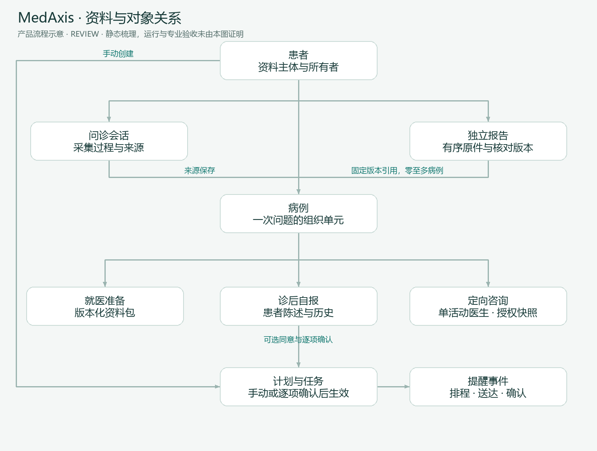
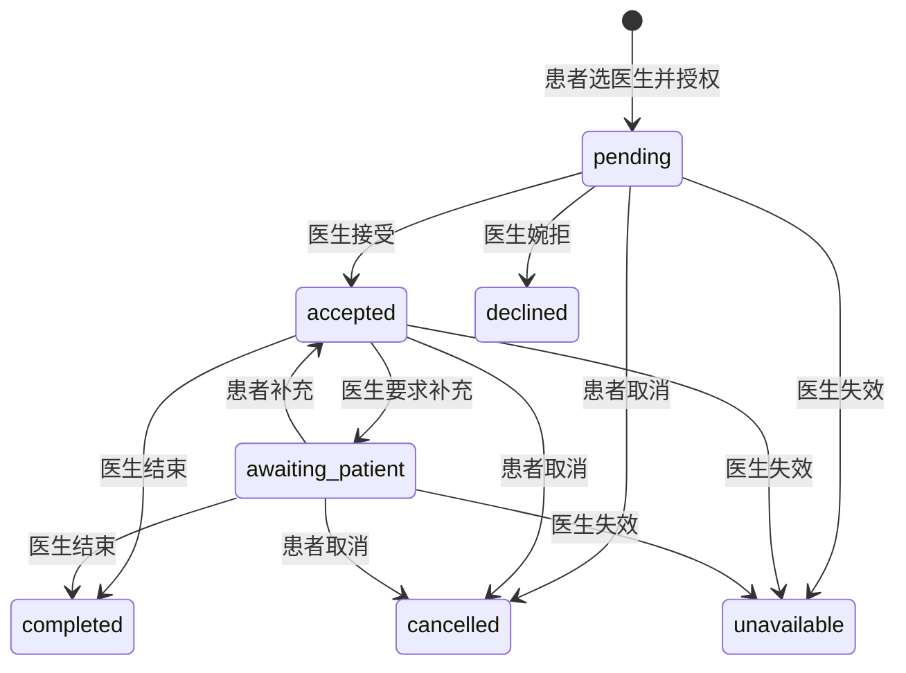

# MedAxis 领域模型

> Status: REVIEW · 2026-10-09 · 描述产品概念，不替代数据库 schema

## 一句话理解

**会话负责收集信息，病例组织一次问题，报告保留材料，准备包服务就医；咨询只分享选定快照，计划只执行明确确认后的任务。** 这些对象不能因为都出现在同一页面而混为一种“病历”。

## 统一词汇

| 术语 | 产品含义 | 不能混淆为 |
|---|---|---|
| 患者 / Patient | 数据主体和本人资料操作者 | 前端可见角色缓存；儿童监护关系仍未知 |
| 问诊会话 / AgentSession | 主诉、补问和辅助输出的采集过程 | 已保存病例或正式诊断 |
| 病例 / MedicalCase | 一次问题的持久组织单元，含来源会话、准备与自报记录 | 患者全部健康史；机构病例库 |
| 就医准备 / Preparation | 带来源版本、本人修订与待补充项的资料包 | AI 自动完成的专业审核 |
| 独立报告 / PatientReport | 患者拥有的一组有序原件及其处理/核对版本 | 问诊生成的辅助报告；旧附件解析任务 |
| 来源版本 / Source version | 本次原件和文字的明确版本依据 | 永远同步更新的“最新结论” |
| AI 候选 / Candidate | 基于某来源整理的建议结构 | 生效医嘱、本人核对版本 |
| 手动草稿 / Draft | 尚未确认的编辑内容；有些可另存后端 | 所有输入刷新都可恢复 |
| 本人核对 / Confirmed review | 患者确认资料整理符合原件/自述 | 医生认证、诊断签署或临床正确性 |
| 病例引用 / Report link | 病例指向指定报告来源/核对版本 | 自动跟随未来版本的分享授权 |
| 诊后反馈 / Post-visit feedback | 患者自报的就诊记录及历史 | 平台医生实际签发内容 |
| 定向咨询 / Consultation | 单病例、单一活动医生、授权快照的对话 | 全患者历史共享、长期绑定医生 |
| 医生建议 / Advice | 带作者、时间、分类的健康咨询留言 | 在线处方、自动调药或医生已接诊诊疗 |
| 随访计划 / CarePlan | 本人手动安排或确认候选后生效的任务组 | 无人医学监护 |
| 提醒事件 / MonitoringEvent | 某个任务的排程、发送及确认记录 | 任务完成，或医学治疗效果 |
| 通知 / Notification | 提醒查看某对象状态的通用消息 | 咨询接受/完成等业务状态 |
| 机构病例库 / Research grant | 另行同意和审核后的未来复用范围 | 当前咨询同意的附赠权限 |

## 关系与归属

| 关系 | 含义 / 约束 | 实现证据 |
|---|---|---|
| 患者 → 多会话、多病例、多独立报告 | 服务端对象所有权分别检查 | [EVIDENCE E-02/E-04/E-08](EVIDENCE.md) |
| 来源会话 → 病例保存 | 使用来源身份支持重复保存语义；追问可有父会话 | [E-03/E-04](EVIDENCE.md) |
| 病例 → 准备与诊后反馈历史 | 同病例恢复，来源与 revision 分开 | [E-05/E-06](EVIDENCE.md) |
| 独立报告 ↔ 零至多个本人病例 | 通过固定版本引用；不是转移所有权 | [E-09](EVIDENCE.md) |
| 病例 → 至多一个活动咨询 | pending/accepted/awaiting_patient 为活动态 | [E-11](EVIDENCE.md) |
| 咨询 → 多条不可覆盖消息 | 患者与指定认证医生，各自受对象权限约束 | [E-11](EVIDENCE.md) |
| 计划 → 多任务 → 提醒事件 | 启停和来源失效影响待发送事件，不删除已发送事实 | [E-07/E-10](EVIDENCE.md) |
| 知识文档 → 多片段 → 检索引用 | 保存来源和模型/原文定位；相关不等于支持 | [E-14/E-15](EVIDENCE.md) |

概念图中的“患者拥有”不等于每个后端模型已有统一 owner 字段；具体实现以工程数据模型为准。图中咨询快照和病例报告引用也不是同一授权机制，新报告加入咨询的覆盖仍需确认。

## 状态与不变量

### 定向咨询（当前代码状态）

终态停止医生继续访问授权快照；患者需要重新选择与授权，不自动转接。图中角色文字按目标用户体验标注；当前 `end` 分支未显式限定医生角色，属于 [EVIDENCE §5](EVIDENCE.md) 的待核对差距，不能以图证明权限成立。具体操作见 [`consultation_action`](../../../backend/app/api/v1/consultations.py#L247)；图省略不改变状态的普通留言。

### 随访计划（专项规格语义）

待确认 → active；active 与 paused 可按规则切换；completed/cancelled 为终止路径，结束日期也影响排程。终止计划和确认提醒不能互相替代。字段值与允许迁移以 [FOLLOWUP_PLAN_SPEC](../FOLLOWUP_PLAN_SPEC.md) 为准。

### 报告处理（多条状态轴）

原件存在/回收、取字任务状态、AI 处理状态、核对 revision、病例引用是否过期是独立状态轴。不能用一个“已完成”标签遮盖其中失败。候选生成成功不等于本人确认，核对确认不等于医生审核；具体状态值沿用 [报告需求](../PATIENT_REPORTS_REQUIREMENTS.md)。

## 必须保持的产品不变量

1. 未知 ≠ 明确无；原话 ≠ AI；本人核对 ≠ 专业签署。
2. 草稿 ≠ 保存成功；浏览器聊天恢复 ≠ 服务端病例恢复。
3. 同一来源、同意、核对和引用必须能追到明确版本。
4. 对象归属、角色资格和分享范围均由服务器判断，界面可见性不能授权。
5. 咨询同意、模型文字外发、机构病例库和研究授权互不继承。
6. 消息已读、提醒已发、任务完成、咨询结束分别记录。
7. 撤销停止未来动作；已下载、已发邮件和已外发内容不能被假定追回。

医生资质、机构成员资格、账号状态应独立建模；当前机构成员授权、监护关系和研究模型尚未完成，详见 [开放项](DECISIONS.md)。
