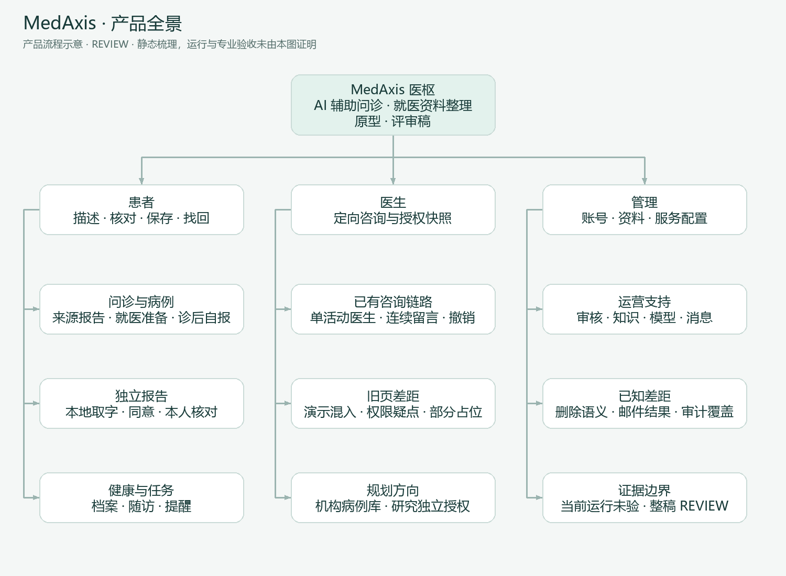
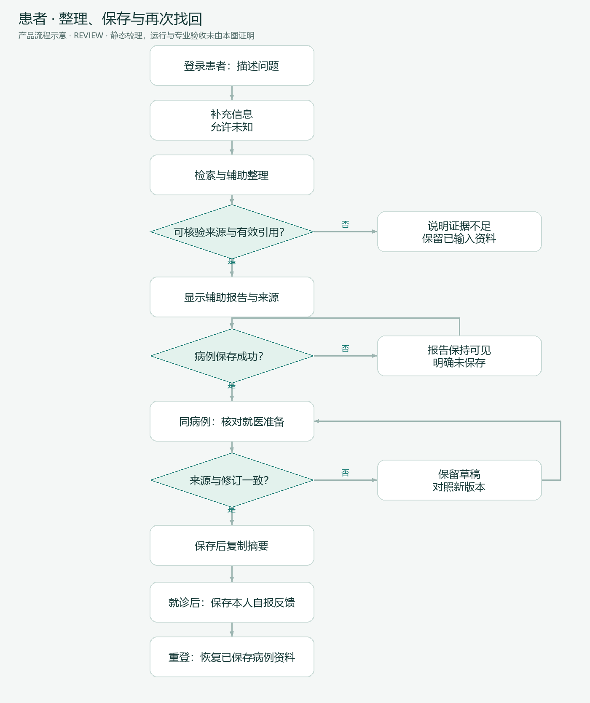

# MedAxis 全项目产品需求文档

> Status: REVIEW · v1.0 · 2026-10-09 · Amends：历史项目级 PRD 的整合层
>
> 文档交付不等于产品获批、业务功能验收或上线授权。当前源码与证据定位统一见 [EVIDENCE](EVIDENCE.md)。

## 1. 产品结论

**MedAxis 是 AI 辅助问诊与就医资料整理原型。** 患者描述问题、核对资料、保存病例、准备就医和记录诊后反馈；认证医生按定向授权提供健康建议；管理员维护服务所需的账号、知识与配置。

现阶段更有依据的价值是“整理与恢复资料”，不是“证明诊断正确”。报告、来源和本人核对必须能分辨；AI 输出与患者自报均不能冒充医生签署。

### 1.1 Brownfield 四层边界

| 层级 | 本次定义 | 性质 |
|---|---|---|
| Owner Mission | 使用产品相关 Skill 梳理整个 MedAxis，形成易读 PRD 与配套图文文档 | OWNER_DECISION：本次请求 |
| Current Product | 患者整理链路、独立报告代码、定向咨询、管理功能已存在；旧医生页仍有占位与权限范围疑点 | FACT：静态工作区核对；各链路成熟度不同 |
| Future Target | 经证据验证的患者—医生资料协作，后续可讨论同机构授权病例库与研究导出 | 既有方向；成熟度及商业成立均未证明 |
| Current Scope | 全项目定义、领域/流程/验收、实现差距、图文阅读材料 | OWNER_DECISION：仅文档；不包含本次开发、迁移或部署 |

### 1.2 工作假设

产品仍处于 `HYPOTHESIS_MODE`。有需求表达、源码和合成验证记录，缺少系统访谈、真实用户行为和临床专业核对。首轮建议使用合成案例和成年测试者；真实儿科场景的监护人、被照护人身份与授权模型未定义，不能从儿科指南语料推导为已支持。

## 2. 问题、替代方式与反证

| 问题假设 | 当前替代方式（待研究） | 希望改变的行为 | 反证与证据缺口 |
|---|---|---|---|
| 描述主诉时容易漏掉时间、变化和资料 | 临时回忆、相册、聊天记录 | 核对一份保留未知项的摘要 | 问答负担可能大于收益；无遗漏率基线 |
| 生成资料难以再次找到 | 截图、复制笔记 | 重登后在同病例找回已保存资料 | 浏览器聊天与服务端病例是两种恢复；真实可用性未验证 |
| 诊前准备、检查报告和诊后记录分散 | 文件夹、纸张、独立备忘录 | 保持资料来源与本次就医问题关联 | 人工整理可能已足够；独立报告完整部署验收未完成 |
| 医生不知道谁在等自己回复 | 分散消息、人工转发 | 在单一活动咨询内连续处理 | 医生工作量、响应预期和责任认知未知 |
| AI 表述容易显得过于确定 | 用户自行辨别 | 看清原话、候选、核对与专业建议 | 有来源不等于原文支持；用户是否理解标签未知 |

选择这一方向的依据是现有实现可以支撑有限实验；不存在已证明的市场规模、付费意愿或“最佳上市时机”结论。先用任务完成、信息辨识和恢复行为验证价值，再扩展协作范围。

## 3. 用户与任务

| 角色 | 触发情境 / Job | 成功结果 | 权限边界 |
|---|---|---|---|
| 注册患者 | 需要整理本次症状和资料，准备就医 | 找到同一病例，辨认未知项和来源，带走已保存摘要 | 仅本人数据；分享需选择对象与版本 |
| 普通访客 | 试用一次问答 | 知道试用额度、过期与保存限制 | 不承诺登录患者所有持久功能；演示模式关闭访客 |
| 已认证且 active 医生 | 接到指定患者的健康咨询 | 查看授权快照、回复/追问/结束 | 定向咨询授权；不等于拥有患者全部历史 |
| 管理员 | 维护账号、资质、资料与服务配置 | 看清处理结果与失败，防止误操作 | 管理角色不等于医生资格；审计覆盖仍需补证 |
| 机构/研究使用者 | 复用另行授权且审核后的病例 | 待定义的机构范围和导出 | 规划方向；不继承咨询同意 |

购买者、付费方式、机构合作方、运营负责人均为 `UNKNOWN`。当前产品验证不依赖虚构商业客户。

## 4. 范围与优先级

以下优先级是 `ASSUMPTION`，供评审取舍，不是已批准排期。MVP 指建议的首轮验证闭环，不能把所有已有模块都变成 Must。

| 范围层 | 内容 | 首轮产品判断 |
|---|---|---|
| 建议 MVP / P0 | 身份与对象归属；多轮信息采集；证据不足不发布；报告与病例保存；同病例恢复；就医准备；诊后自报；独立报告的外发同意与核对边界 | 保持“描述—整理—核对—保存—找回”完整闭环；新报告纳入时须先完成目标环境验证 |
| P1 / 条件扩展 | 手动档案、日常测量、随访与提醒；诊后 AI 候选；定向医生咨询；运营管理体验 | 可分别作为纵向切片验证；不可用旧医生页代替咨询验收 |
| P2 / 延后 | 同机构病例库、研究导出、外部医疗系统对接 | 已有方向，不作为首轮完成条件 |
| Won't / 本期不做 | 自动确诊、在线处方、自动调药、无人监护、预约/HIS、自动扩大分享授权、从日志默认训练 | 不通过命名或界面暗示支持 |

### 4.1 全项目需求目录

编号 `MX-*` 是本次整合索引，保留专项原编号；详细规则不重复维护。每项均有 [SPEC 验收行](PRODUCT_SPEC.md) 与 [EVIDENCE 证据](EVIDENCE.md)。

| ID | 用户需求 | 建议优先级 | 当前静态结论 | 详细真源 |
|---|---|---|---|---|
| MX-01 | 明确登录身份、试用与演示限制 | P0 | 有路由/服务；运行配置未查 | [SPEC](PRODUCT_SPEC.md#mx-01) |
| MX-02 | 分轮补充信息，允许未知与纠正 | P0 | 有编排/SSE | [SPEC](PRODUCT_SPEC.md#mx-02) |
| MX-03 | 获得带可核验来源的辅助报告，失败可辨认 | P0 | 来源/引用门禁；原文支持仍有缺口 | [评测协议](../EVALUATION_PROTOCOL.md) |
| MX-04 | 将结果保存到正确病例，重复提交不产生歧义 | P0 | 幂等服务和病例归属 | [SPEC](PRODUCT_SPEC.md#mx-04) |
| MX-05 | 恢复病例资料、核对并复制就医准备 | P0 | 保存/修订/过期控制 | [就医准备](../VISIT_PREPARATION_SPEC.md) |
| MX-06 | 在原病例保存患者自报就诊反馈 | P0 | 版本与历史代码 | [SPEC](PRODUCT_SPEC.md#mx-06) |
| MX-07 | 归档独立报告，保持顺序、去重与所有权 | P0（纳入时） | API/模型存在；部署验收缺口 | [报告需求](../PATIENT_REPORTS_REQUIREMENTS.md) |
| MX-08 | 预览脱敏文字并逐次同意 AI 整理 | P0（纳入时） | 本地取字与外发绑定代码 | [报告需求](../PATIENT_REPORTS_REQUIREMENTS.md) |
| MX-09 | 区分 AI 候选、手动草稿、本人核对和病例引用 | P0（纳入时） | 分层版本与关联代码 | [报告需求](../PATIENT_REPORTS_REQUIREMENTS.md) |
| MX-10 | 维护健康档案与测量，保留未知和来源 | P1 | 修订/幂等代码 | [档案规格](../HEALTH_PROFILE_SPEC.md) |
| MX-11 | 手动创建并执行记录计划，控制启停 | P1 | 生命周期与任务服务 | [随访规格](../FOLLOWUP_PLAN_SPEC.md) |
| MX-12 | 只把确认后的诊后候选转成任务 | P1 | 同意、候选、确认服务 | [诊后 AI](../POST_VISIT_AI_ACTIONS_SPEC.md) |
| MX-13 | 知道提醒的送达与确认状态 | P1 | 站内事件；邮件可靠性有限 | [随访规格](../FOLLOWUP_PLAN_SPEC.md) |
| MX-14 | 选择认证医生，授权一份咨询快照并连续留言 | P1 | 新咨询链路已实现 | [医生 PRD](../DOCTOR_PRD.md) Q1/Q2 |
| MX-15 | 医生仅处理授权资料，患者可取消共享 | P0 权限不变量 | 咨询端有约束；旧医生 API 有差距 | [医生 PRD](../DOCTOR_PRD.md) |
| MX-16 | 管理账号、医生审核与审计，结果可信 | P1 | 有管理 API；删除/邮件状态有风险 | [SPEC](PRODUCT_SPEC.md#mx-16) |
| MX-17 | 管理知识、模型与消息服务，追溯变更 | P1 | 有管理页面/接口；未逐操作联调 | [SPEC](PRODUCT_SPEC.md#mx-17) |
| MX-18 | 仅在独立授权后形成机构病例库/研究材料 | P2 | 检索范围内未定位实现入口 | [医生 PRD](../DOCTOR_PRD.md) Q3 |
| MX-19 | 看清数据用途、外发、保留、恢复与退出 | P0 跨模块 | 部分实现；保留/备份/供应商边界未知 | [SPEC](PRODUCT_SPEC.md#mx-19) |

## 5. 产品体验与信息架构

患者导航以“今天、问诊、病例、报告、健康档案、随访、提醒”承载任务。病例是一次问题的组织中心；独立报告可脱离病例保存，也可按版本引用。医生端以“咨询待处理—授权资料—持续回复”为目标主线；旧分配病例页面是另一条入口，尚不能替代该主线。

管理端维护支持能力，不应向患者暴露模型内部字段。加载、空列表、局部失败、版本过期、禁用和恢复必须有可读状态，具体见 [流程图](USER_FLOWS.md) 与 [路由覆盖矩阵](EVIDENCE.md)。

## 6. AI 产品契约

### 6.1 用户价值与指标关系

信息补问与检索服务于“减少遗漏、方便核对与找回”；模型命中率只能解释其中一个环节。题量更少可能减少负担，也可能漏问；检索覆盖更高可能增加延迟或无答案误召回，必须同时记录代价。

| 指标 | 分子 / 分母与采集方式 | 当前基线 | 目标来源 / 状态 |
|---|---|---|---|
| 资料任务完成率 | 完成描述、核对、保存和再次找回的人次 / 开始该合成任务的人次；观察记录 | UNKNOWN | 先取可用性基线，owner 再裁决 |
| 来源辨识率 | 正确区分原话/AI/本人核对/医生建议的回答 / 固定辨识题 | UNKNOWN | 待研究；不编造达标线 |
| 恢复正确性 | 指定病例/版本恢复正确次数 / 合成恢复场景次数；独立核对 | 有历史样例，非当前全量基线 | 全部关键场景须无串病例/假成功；运行次数随方案确定 |
| 原文证据覆盖 | 完整覆盖 gold 的正例 / 有答案正例；固定语料和版本 | 历史 45 题实验有结果 | [语义召回记录](../SEMANTIC_RECALL_ACCEPTANCE.md)，不直接作为端到端目标 |
| 报告陈述获原文支持 | 专业标注支持的陈述 / 可判定陈述；错误/缺失分开 | UNKNOWN；历史 v4 能力缺口见证据 | 需专业审核与 judge 校准 |
| 无答案与失败处理 | 正确拒绝/说明不足次数 / 无答案、超时等分层样本 | 历史无答案仍有误召回 | 单独门禁，不能用总均分抵消 |
| 成本与延迟 | 真实入口每任务模型尝试/实际 token/费用、首响应和结束耗时 P50/P95 | UNKNOWN | 待真实入口受控采样；null 不填 0 |

### 6.2 数据、用途与版本

知识库内容、患者私有材料、合成评测集、预置展示数据用途各自独立。患者内容没有自动训练授权；研究授权不继承咨询授权。旧问诊附件可调用外部视觉/文件服务，新独立报告先本地取字、仅逐次同意发送脱敏文字，两者必须分别说明。

每份评测记录至少绑定：题集与 gold 版本、Prompt/参数、模型及接收方、embedding/reranker、知识原文/分段/索引、工具行为版本、源码/环境及 judge 校准。找不到精确版本写 UNKNOWN，不能只留模型商品名。

### 6.3 验收与发布不变量

不可被平均分抵消：无可核验来源却发布、虚构引用、患者身份串线、把未知变无、未经同意外发、失效来源继续产生任务、未保存显示成功、越权读取、候选自动成为医嘱。医学陈述是否被原文支持、患者适用性和真实专业效果需分别取证；检索命中不能替代专业审核。

评测方法唯一真源是 [EVALUATION_PROTOCOL](../EVALUATION_PROTOCOL.md)。本包不修改评测集、不调用模型、不复跑历史成绩。

同期问题覆盖优化已有给定候选的真实模型对照记录，代价与误判一起收录于 [EVIDENCE §4](EVIDENCE.md)。这是问题覆盖分类/排序证据，不能替代原文陈述支持、患者适用性、完整问诊或专业审核；端到端成本与延迟基线仍为 UNKNOWN。

### 6.4 当前范围与下一动作

本次交付 AI 能力、证据缺口和产品验收定义。下一步建议先确认产品范围，再用合成案例完成报告部署/授权验证、专业 gold 核对和受控真实入口采样；未完成前仅展示带条件的原型能力。AI 失败时优先保留原件、已保存记录和手动路径，不能静默换接收方或自动重发材料。

## 7. 非功能与运营约束

| 维度 | 产品要求 | 当前证据边界 |
|---|---|---|
| 权限 | 登录角色、账号状态、对象所有权、分享版本分层校验 | 咨询链路与旧医生入口需统一取证 |
| 一致性 | 重试按请求编号与内容去重，修订冲突保留输入 | 有相关代码；无本轮运行保证 |
| 可靠性 | 生成/保存/送达分别显示；断网、超时、后台失败有退出路径 | 提醒 SMTP 崩溃窗口不可承诺 exactly-once |
| 隐私 | 患者看清内容、接收方、同意范围；不把遮蔽称绝对匿名 | 报告新旧入口不同；全出口检查未完成 |
| 可访问性 | 中文可读、移动端核心操作可达、状态不用颜色单独表达 | 现有截图有移动端展示；任务可用性未验证 |
| 审计 | 记录必要动作与版本，避免敏感全文进入日志 | 已有管理审计不代表全动作覆盖 |
| 删除与恢复 | 区分回收、恢复、永久清理和不可追回的外发 | 保留时长、备份清理、供应商保留 UNKNOWN |

## 8. 迭代建议与成功条件

| 关口 | 观察到什么才推进 | 当前下一动作 |
|---|---|---|
| 产品评审 | MVP、首测人群、咨询边界和权限冲突有明确裁决 | 评审 [DECISIONS](DECISIONS.md) 与 [Readiness](DEVELOPMENT_READINESS.md) |
| 患者主线验证 | 合成案例从输入到保存/重登恢复，失败与版本状态正确 | 先验证目标环境，不采集真实患者数据 |
| 独立报告验证 | 本地解析、同意、核对、引用、回收组合场景可复现 | 复用报告切片验收，不跳过完整组合场景 |
| 医生咨询验证 | 指定授权、认证撤销、取消与连续回复端到端成立 | 优先收敛旧页面演示污染与权限范围 |
| AI 质量验证 | 冻结/独立样本、专业 gold、失败与成本结果可解释 | 按现有协议采集，保留负例与退步 |
| 扩展/发布 | 机构/研究授权、运营责任、回滚与专业/合规审查明确 | 延后；没有固定上线日期或上线授权 |

当前开发规划状态：**NOT_READY**。这是下一阶段授权和关键缺口的结论，不影响本次文档的交付；详见 [门禁判定](DEVELOPMENT_READINESS.md)。
