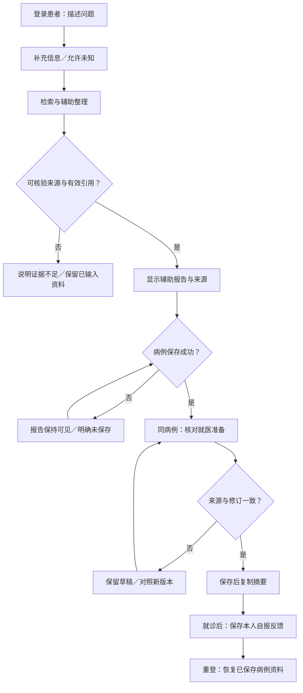
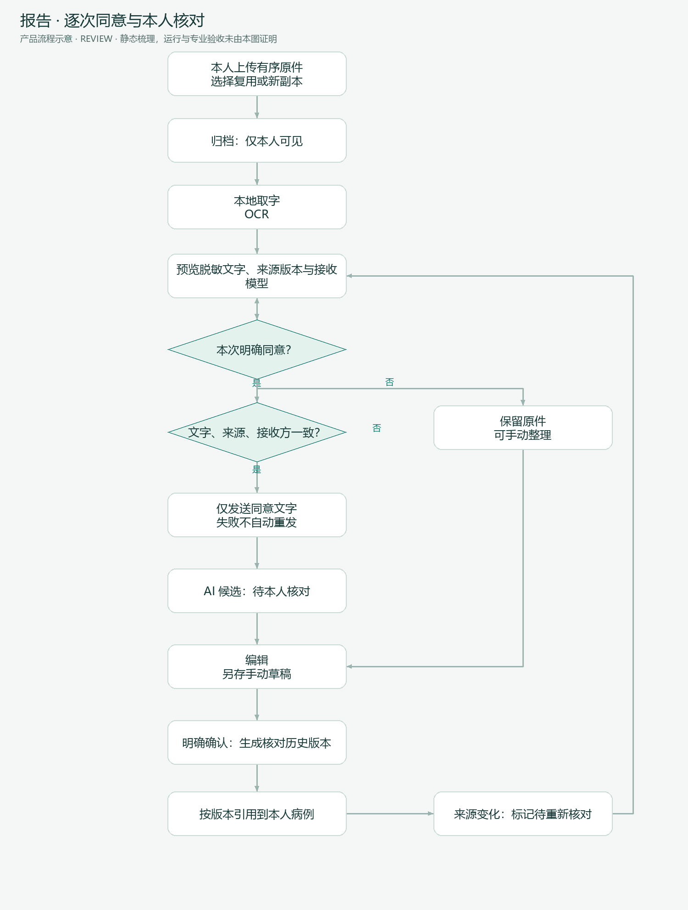
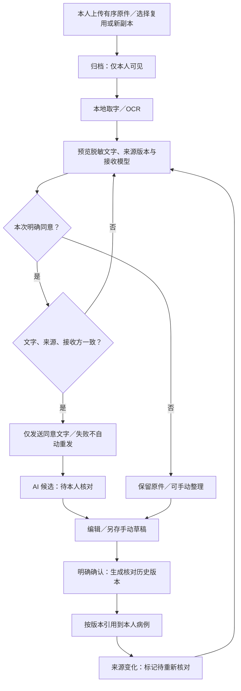
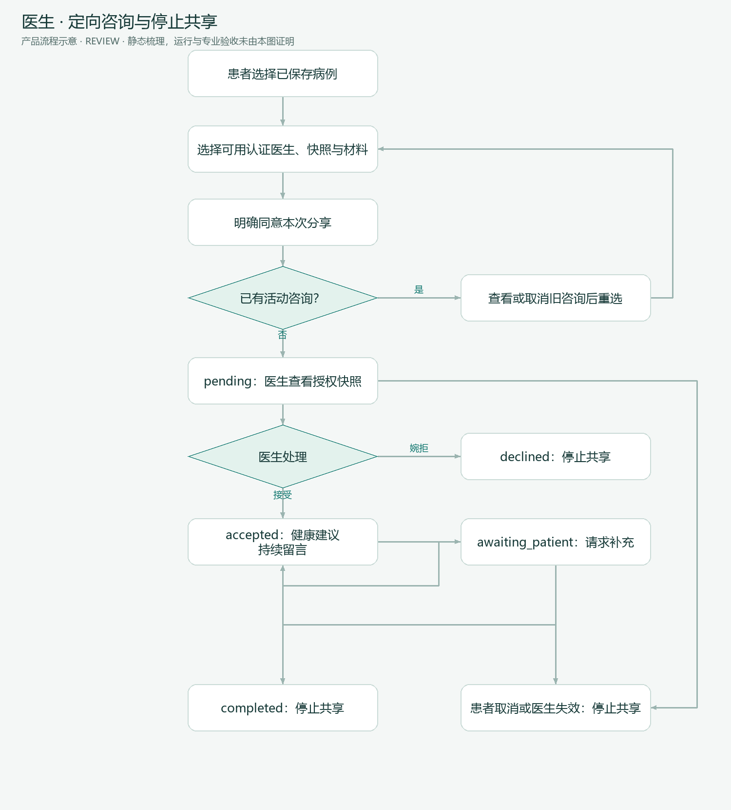
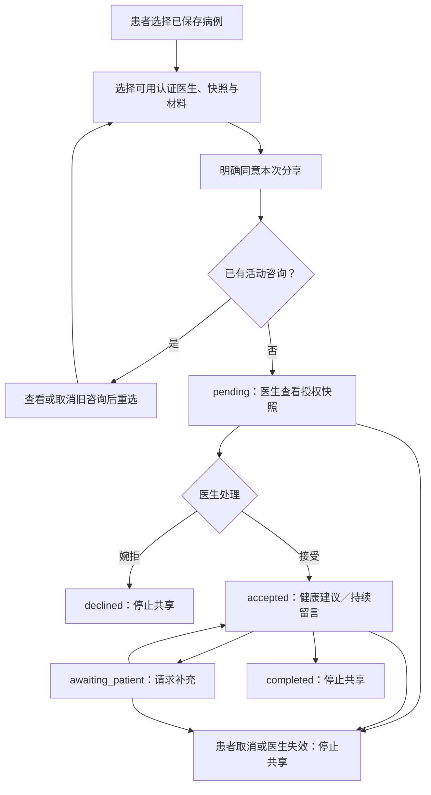

# MedAxis 用户流程

> Status: REVIEW · 2026-10-09 · 主线与异常放在同一条流程中；图片为下方图源的派生物

## 1. 患者从描述到再次找回

入口 `/chat`，持久资料在 `/cases?case_id=…&stage=…`。访客试用与面试模式见 A-01，不承诺同样的保存范围。用户可在补问、核对或反馈阶段退出；当前会话草稿与已保存记录恢复能力不同。保存失败不得进入“已归档”状态，刷新恢复不是恢复所有未保存输入。

## 2. 独立报告：同意与核对

这里只描述新 `/reports` 中心。旧问诊附件可将原图/文件发送外部模型，见 [E-16](EVIDENCE.md)，不能混用隐私承诺。OCR 失败保留原件并显示失败，不自动接外部 OCR；本人确认仍不是医生复核。

回收报告暂停普通可见引用；恢复、永久清理及备份覆盖需按专项执行验证。已外发副本不因为本地回收而被撤回。

## 3. 定向医生咨询

已实现咨询入口可由患者/医生页面中的咨询面板进入，不能凭 `/doctor/cases` 的存在断言该页已符合新咨询授权。读取和发布须重查认证；患者不能替医生接受；通知已读不代表已接收业务。旧医生页风险见 [差距矩阵](DEVELOPMENT_READINESS.md)。

## 4. 诊后记录到日常任务

患者保存自报反馈 → 自主选择 AI 整理 → 预览脱敏文字与接收方 → 明确同意 → 获得默认未选候选 → 逐项核对、补日期/时间 → 确认生效 → 站内提醒/可选通用邮件 → 本人记录任务完成。

异常：未同意走手动计划；缺药名、剂量或明确指示不能补成医嘱；来源变化取消待发送关联事件；暂停/终止停止未来排程；已发送事件仍保留。邮件发送不能证明患者看见，更不能证明任务执行。

## 5. 管理员处理

管理员登录 → 根据任务进入账号/审核/知识/配置/通知/邮件页面 → 核对对象和操作影响 → 提交 → 分别显示业务处理与外部发送结果 → 检查必要审计记录。

现有账号 kick 为数据库删除；医生拒绝审核含删除路径。产品评审必须明确停用与删除的区别。审核批准时邮件失败仍可能返回“已发送”，属于已定位差距；本次只记录，不执行管理操作。

## 失败、取消与恢复总表

| 遇到什么 | 用户应看到什么 | 可继续做什么 | 禁止的假成功 |
|---|---|---|---|
| 请求超时/来源不足 | 明确失败或证据不足 | 保留资料、人工核对、受控重试 | 展示完整辅助结论 |
| 版本冲突 | 旧版本与新版本需要对照 | 保留草稿、重载后重新确认 | 自动覆盖最新记录 |
| 后台解析/模型失败 | 独立任务失败状态 | 原件可读、手动整理 | 自动切外部 OCR/重发材料 |
| 切病例迟到响应 | 当前病例边界明确 | 只操作当前选中病例 | 用 A 资料填 B 表单 |
| 取消分享/医生失效 | 咨询停止共享，历史仍可解释 | 患者另选并再次授权 | 自动把授权转交新医生 |
| 提醒邮件失败 | 未送达或状态不确定 | 查站内事件/手动记录 | 宣称可靠实时监护 |
| 刷新/退出 | 已保存与未保存范围清楚 | 服务端恢复；未存草稿重新填写 | 承诺所有聊天/草稿跨设备恢复 |

逐项验收见 [PRODUCT_SPEC](PRODUCT_SPEC.md)。思维导图只概括模块，条件/回环关系以上述流程为准。
